<!--
AI_EDITOR_STATE:
source_file: GRC Capability Model v3.5_FREE-revision-2024-11-20-protected.pdf
source_version: Version 3.5-EN, revision 2024-01-22
handbook_style: "Nerd notes: simple, exam-focused, visual, memory hooks, no fluff"
completed_batches:
  - batch: 1
    source_content_pages: 1-5
    pdf_pages: 7-11
  - batch: 2
    source_content_pages: 6-10
    pdf_pages: 12-16
  - batch: 3
    source_content_pages: 11-15
    pdf_pages: 17-21
  - batch: 4
    source_content_pages: 16-20
    pdf_pages: 22-26
  - batch: 5
    source_content_pages: 21-25
    pdf_pages: 27-31
  - batch: 6
    source_content_pages: 26-30
    pdf_pages: 32-36
  - batch: 7
    source_content_pages: 31-35
    pdf_pages: 37-41
  - batch: 8
    source_content_pages: 36-40
    pdf_pages: 42-46
  - batch: 9
    source_content_pages: 41-45
    pdf_pages: 47-51
  - batch: 10
    source_content_pages: 46-50
    pdf_pages: 52-56
  - batch: 11
    source_content_pages: 51-55
    pdf_pages: 57-61
  - batch: 12
    source_content_pages: 56-60
    pdf_pages: 62-66
  - batch: 13
    source_content_pages: 61-65
    pdf_pages: 67-71
  - batch: 14
    source_content_pages: 66-70
    pdf_pages: 72-76
  - batch: 15
    source_content_pages: 71-75
    pdf_pages: 77-81
  - batch: 16
    source_content_pages: 76-80
    pdf_pages: 82-86
  - batch: 17
    source_content_pages: 81-85
    pdf_pages: 87-91
  - batch: 18
    source_content_pages: 86-90
    pdf_pages: 92-96
  - batch: 19
    source_content_pages: 91-95
    pdf_pages: 97-101
  - batch: 20
    source_content_pages: 96-100
    pdf_pages: 102-106
  - batch: 21
    source_content_pages: 101-105
    pdf_pages: 107-111
  - batch: 22
    source_content_pages: 106-110
    pdf_pages: 112-116
  - batch: 23
    source_content_pages: 111-115
    pdf_pages: 117-121
  - batch: 24
    source_content_pages: 116-120
    pdf_pages: 122-126
  - batch: 25
    source_content_pages: 121-125
    pdf_pages: 127-131
  - batch: 26
    source_content_pages: 126-130
    pdf_pages: 132-136
  - batch: 27
    source_content_pages: post-coverage exam add-on
    pdf_pages: n/a
next_batch:
  add_on: GRCP glossary index or practice bank
editing_rule: "Keep editing this same Markdown file. Do not create a new handbook file unless user asks."
-->

# Nerds Note Handbook - GRC Capability Model

**Source:** OCEG *GRC Capability Model™* / Red Book, Version 3.5-EN, revision 2024-01-22.  
**Purpose:** Turn the GRC Capability Model into a study-friendly handbook for GRCP preparation.  
**Style:** Simple explanations, memory hooks, exam traps, quick diagrams, and mini quizzes.

> **Important:** This handbook is not a replacement for the original model. It is a personal study guide that explains the ideas in clearer, easier notes.

---

## Progress Tracker

| Batch | Source Coverage | Handbook Status | Next Step |
|---|---:|---|---|
| 1 | Content pages 1-5 | Completed | Done |
| 2 | Content pages 6-10 | Completed | Done |
| 3 | Content pages 11-15 | Completed | Done |
| 4 | Content pages 16-20 | Completed | Done |
| 5 | Content pages 21-25 | Completed | Done |
| 6 | Content pages 26-30 | Completed | Done |
| 7 | Content pages 31-35 | Completed | Done |
| 8 | Content pages 36-40 | Completed | Done |
| 9 | Content pages 41-45 | Completed | Done |
| 10 | Content pages 46-50 | Completed | Done |
| 11 | Content pages 51-55 | Completed | Done |
| 12 | Content pages 56-60 | Completed | Done |
| 13 | Content pages 61-65 | Completed | Done |
| 14 | Content pages 66-70 | Completed | Done |
| 15 | Content pages 71-75 | Completed | Done |
| 16 | Content pages 76-80 | Completed | Done |
| 17 | Content pages 81-85 | Completed | Done |
| 18 | Content pages 86-90 | Completed | Done |
| 19 | Content pages 91-95 | Completed | Done |
| 20 | Content pages 96-100 | Completed | Done |
| 21 | Content pages 101-105 | Completed | Done |
| 22 | Content pages 106-110 | Completed | Done |
| 23 | Content pages 111-115 | Completed | Done |
| 24 | Content pages 116-120 | Completed | Done |
| 25 | Content pages 121-125 | Completed | Done |
| 26 | Content pages 126-130 | Completed | Done |
| 27 | Post-coverage exam add-on | Completed | GRCP cheat sheet |

---

# Batch 1 - Introduction, VUCA, Principled Performance, and the Big Picture  
**Source coverage:** Content pages 1-5  
**PDF pages:** 7-11

---

## 1. The Big Problem GRC Tries to Solve

### Nerd Note
Organizations lose huge value because of three broad failure types:

| Failure Type | Simple Meaning | Example |
|---|---|---|
| Misconduct | People intentionally do the wrong thing | Fraud, bribery, unethical sales |
| Mistakes | People try, but fail because of errors | Wrong reporting, missed control, bad process |
| Miscalculations | Decisions are based on poor judgment or bad assumptions | Bad strategy, underestimated risk |

### The Core Idea
GRC exists because organizations are not automatically reliable, ethical, or risk-aware. They need people, processes, and systems that help them:

- achieve their objectives,
- deal with uncertainty,
- stay within rules and values,
- protect value from being destroyed.

### Memory Hook
**3M = Misconduct + Mistakes + Miscalculations**

If a question asks *why GRC matters*, think:  
**GRC prevents the 3M problem from destroying value.**

---

## 2. Who Are "Protectors"?

### Simple Definition
**Protectors** are GRC professionals who help organizations produce and preserve value.

They can work in many departments, including:

- board and governance,
- strategy,
- risk,
- compliance,
- ethics,
- legal,
- HR,
- security,
- quality,
- internal control,
- audit.

### Nerd Translation
A Protector is not just a "compliance person."  
A Protector is someone who helps the organization move forward safely, ethically, and reliably.

### What Protectors Have in Common

| Shared Trait | Meaning |
|---|---|
| Protector Mindset | How they think, judge, and approach problems |
| Protector Skillset | The tools and disciplines they use to solve problems |

### Exam Trap
Do **not** think GRC belongs only to compliance, audit, or IT security.  
The model treats GRC as an interdisciplinary approach across many functions.

---

## 3. The Problem: VUCA and Disconnection

## VUCA

| Letter | Meaning | Simple Explanation |
|---|---|---|
| V | Volatility | Things change fast |
| U | Uncertainty | We do not know what will happen |
| C | Complexity | Many connected parts affect each other |
| A | Ambiguity | The meaning of events is unclear |

### Nerd Note
VUCA makes organizations unstable.  
It becomes harder to plan, decide, comply, manage risk, and perform well.

### Disconnection

Organizations also struggle because important things are disconnected:

| Type of Disconnection | What It Means | Why It Hurts |
|---|---|---|
| Department silos | Teams work separately | Duplicated work, conflict, slow decisions |
| People disconnection | Relationships are weak | Poor communication and low trust |
| Purpose/culture disconnection | Actions do not match values | Employees and stakeholders become misaligned |
| Skillset disconnection | People solve problems from one narrow angle | Weak solutions to complex problems |

### Big Message
VUCA + Disconnection = destabilizing forces.

Protectors are meant to be stabilizing forces.

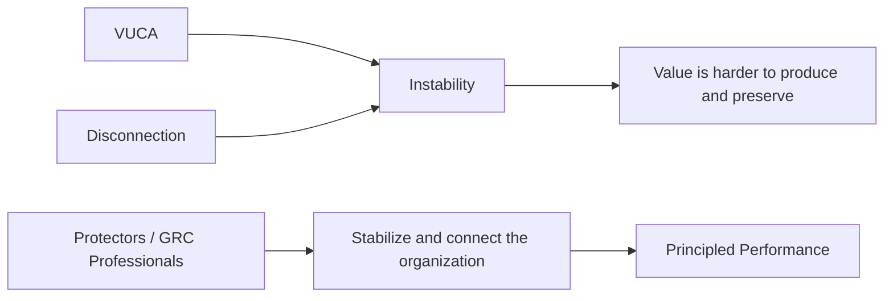

### Memory Hook
**VUCA makes things messy. Disconnection makes people handle the mess separately. GRC connects the work.**

---

## 4. The Solution: Principled Performance and GRC

### Principled Performance
Principled Performance means the organization can:

> reliably achieve objectives, address uncertainty, and act with integrity.

That definition has four parts:

| Part | Meaning |
|---|---|
| Reliably | Do it consistently, thoughtfully, dependably, and transparently |
| Achieve Objectives | Accomplish mission, vision, and balanced goals |
| Address Uncertainty | Handle opportunities and obstacles |
| Act with Integrity | Follow values, ethics, mandatory rules, and voluntary commitments |

### GRC
GRC is the pathway to Principled Performance.

### Nerd Translation
Principled Performance is the destination.  
GRC is the system that helps you get there.

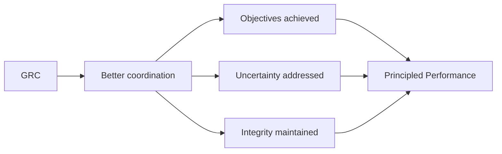

### Exam Trap
Principled Performance is **not** the same as "good intentions."

An organization can say nice things and still fail if it cannot actually:
- achieve objectives,
- handle uncertainty,
- act with integrity,
- do all of that reliably.

---

## 5. Good Intentions Are Not Enough

### Core Idea
Good intentions do not automatically make an organization a principled performer.

What matters is whether the organization actually meets the standard of Principled Performance.

### Think of It Like This

| Situation | Principled Performance? | Why |
|---|---|---|
| Organization has good mission statements but weak controls | No | Nice words are not enough |
| Organization achieves targets but breaks laws | No | It fails integrity |
| Organization follows rules but never achieves objectives | No | It fails performance |
| Organization achieves goals, manages uncertainty, and acts with integrity | Yes | It meets the full definition |

### Nerd Memory Line
**Principled Performance = results + uncertainty management + integrity + reliability.**

---

## 6. The Big Picture of Business

Every organization is trying to achieve objectives.

On the way to those objectives, it faces uncertainty.  
That uncertainty contains:

| Category | Meaning | Connected Discipline |
|---|---|---|
| Opportunities | Positive uncertainty that can create reward | Performance management |
| Obstacles | Negative uncertainty that can cause harm | Risk management |
| Obligations | Rules, duties, values, and commitments | Compliance management |

### Simple Diagram

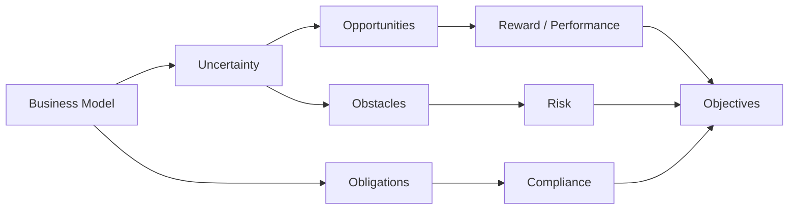

### KPI, KRI, KCI

| Indicator | Full Name | Measures |
|---|---|---|
| KPI | Key Performance Indicator | Progress toward desired performance |
| KRI | Key Risk Indicator | Risk exposure or warning signs |
| KCI | Key Compliance Indicator | Compliance with obligations |

### Memory Hook
**KPI = Are we winning?**  
**KRI = What could hurt us?**  
**KCI = Are we following the rules?**

---

## 7. High-Yield Exam Notes

### Must-Know Ideas

1. GRC is broader than compliance.
2. Protectors are GRC professionals who produce and preserve value.
3. VUCA and disconnection are major forces that destabilize organizations.
4. Principled Performance is the goal of GRC.
5. Good intentions alone do not equal Principled Performance.
6. Organizations must manage opportunities, obstacles, and obligations.
7. Performance, risk, and compliance connect to reward, negative uncertainty, and obligations.

### Easy-to-Mix-Up Concepts

| Concept | Do Not Confuse With | Difference |
|---|---|---|
| Principled Performance | Good intentions | Principled Performance requires actual reliable behavior |
| GRC | Compliance only | GRC integrates governance, risk, compliance, performance, assurance, security, ethics, and more |
| Risk | All uncertainty | Risk usually refers to negative effects of uncertainty |
| Opportunity | Risk | Opportunity is favorable uncertainty |
| Obligation | Objective | Obligation is something the organization must or has committed to do |

---

## 8. Mini Flashcards

**Q1: What problem does GRC help solve?**  
A: Value destruction caused by misconduct, mistakes, miscalculations, VUCA, and disconnection.

**Q2: What is Principled Performance?**  
A: Reliably achieving objectives, addressing uncertainty, and acting with integrity.

**Q3: What is VUCA?**  
A: Volatility, uncertainty, complexity, and ambiguity.

**Q4: Why is disconnection dangerous?**  
A: It causes silos, misalignment, weak relationships, and narrow problem-solving.

**Q5: What are Protectors?**  
A: GRC professionals who help produce and preserve value.

**Q6: What is the difference between KPI, KRI, and KCI?**  
A: KPI measures performance, KRI measures risk, and KCI measures compliance.

---

## 9. Mini Quiz

### Question 1
A company has a strong ethics statement but repeatedly misses legal requirements and hides risk issues. Is it achieving Principled Performance?

**Answer:** No. Good intentions and ethical language are not enough. It must reliably achieve objectives, address uncertainty, and act with integrity.

### Question 2
A department manages risks well but never coordinates with compliance, audit, or strategy teams. What GRC problem does this show?

**Answer:** Disconnection / siloed work.

### Question 3
A dashboard shows rising customer complaints, increased cyber incidents, and missed regulatory filings. Label each as KPI, KRI, or KCI.

**Answer:**
- Customer complaints: usually KPI or KRI depending on use.
- Cyber incidents: KRI.
- Missed regulatory filings: KCI.

### Question 4
Why is GRC called the pathway to Principled Performance?

**Answer:** Because GRC integrates capabilities that help the organization achieve objectives, handle uncertainty, and act with integrity.

---

## 10. Batch 1 Summary

The first five content pages explain the foundation of the whole model:

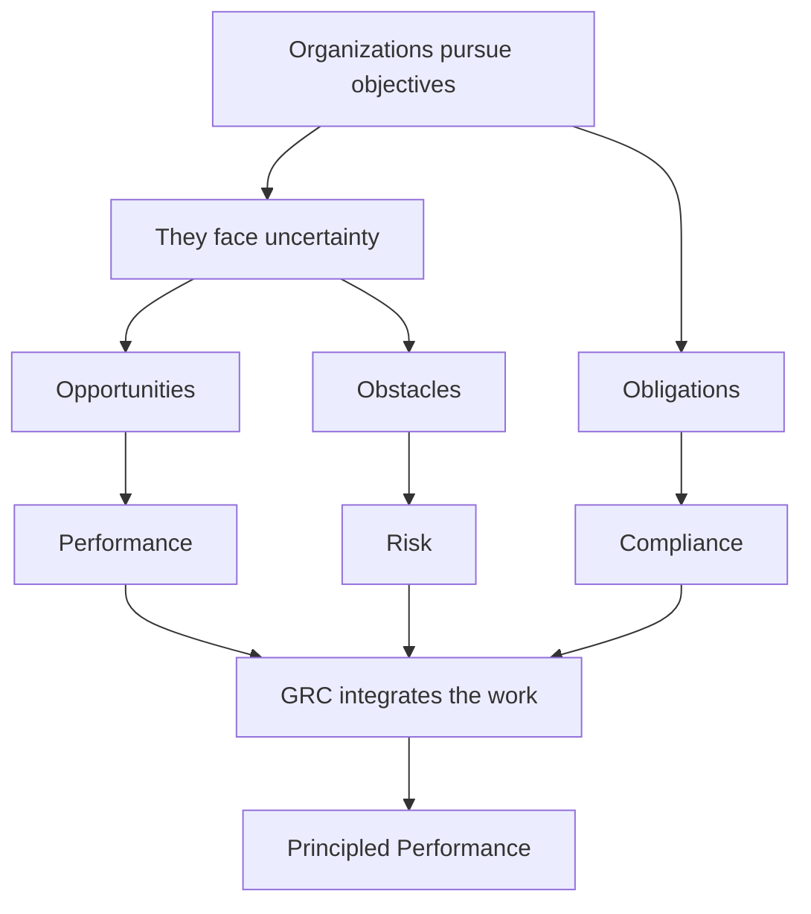

### One-Sentence Master Summary
GRC helps organizations overcome VUCA and disconnection by integrating capabilities so they can reliably achieve objectives, address uncertainty, and act with integrity.

---

# Batch 2 - Governance, Critical Disciplines, GRC Capabilities, and Protectors  
**Source coverage:** Content pages 6-10  
**PDF pages:** 12-16

---

## 1. The Full GRC Picture: Governance, Management, and Assurance

### Nerd Note
The model says an organization must do more than just **manage** performance, risk, and compliance.

A complete GRC picture includes:

| Layer | Simple Meaning | What It Does |
|---|---|---|
| Governance | Direction from above | Sets purpose, boundaries, authority, expectations, and oversight |
| Management | Day-to-day execution | Runs processes, uses resources, makes decisions, and evaluates results |
| Assurance | Independent confidence | Checks whether claims, controls, and outcomes can be trusted |

### Simple Translation
Management is not enough because people can manage the wrong things, manage badly, or say things are working when they are not.

So GRC needs:

- **Governance** to set direction and boundaries.
- **Management** to operate and execute.
- **Assurance** to verify and give confidence.

### Memory Hook
**GMA = Govern it, Manage it, Assure it.**

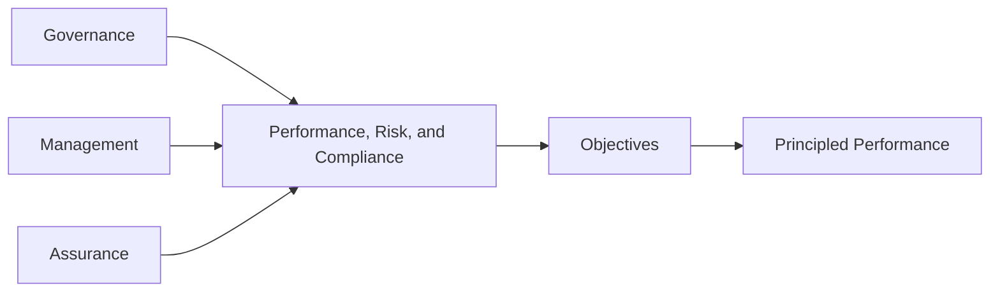

### Exam Trap
Do not reduce GRC to only management activities.

A strong GRC system asks:

1. Who gives direction?
2. Who executes?
3. Who checks and gives confidence?

---

## 2. What GRC Actually Means

### Basic Meaning
GRC stands for:

| Letter | Meaning |
|---|---|
| G | Governance |
| R | Risk |
| C | Compliance |

But the model makes it clear that GRC is **much bigger** than the letters.

### Strong Definition
GRC is an integrated collection of capabilities that enables an organization to:

- reliably achieve objectives,
- address uncertainty,
- act with integrity.

### Nerd Translation
GRC is not a department.  
GRC is not just software.  
GRC is not just compliance.  
GRC is not only IT security.

GRC is the way the organization connects different disciplines so everyone works toward Principled Performance.

### Super Important Line
**GRC is the pathway to Principled Performance.**

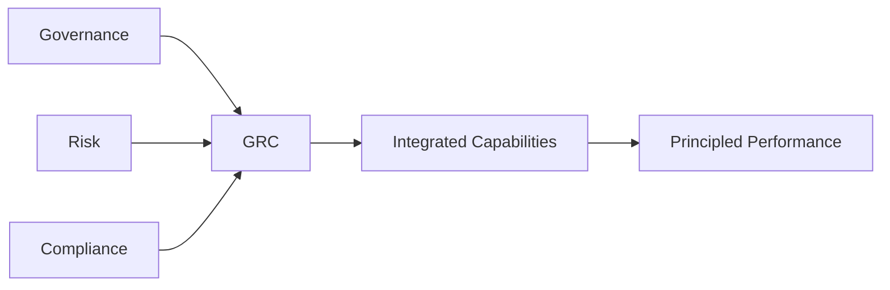

---

## 3. Critical Disciplines Under GRC

### Nerd Note
The model treats GRC as an umbrella over several **Critical Disciplines**.

| Critical Discipline | Main Job | Simple Example |
|---|---|---|
| Governance & Oversight | Guide and constrain the organization | Board oversight, committees, authority levels |
| Strategy & Performance | Set objectives and monitor performance | KPIs, strategy maps, business plans |
| Risk & Decision-Support | Address uncertainty and support decisions | Risk registers, risk assessments, decision analysis |
| Compliance & Ethics | Manage obligations and values | Policies, codes of conduct, regulatory compliance |
| Security & Continuity | Protect critical assets and keep operations running | Cybersecurity, physical security, business continuity |
| Audit & Assurance | Give confidence that things are working | Internal audit, external audit, control testing |

### Why Integration Matters
Each discipline has strengths. When they work separately, the organization gets silos. When they are integrated, each discipline supports the others.

Examples:

- Compliance can strengthen policies and procedures for risk and operations.
- Strategy can help risk teams connect risks to objectives.
- Audit can give confidence that controls and processes actually work.
- Security and continuity can protect critical assets and operations.

### Memory Hook
**GRC is not one tool. It is a team of disciplines.**

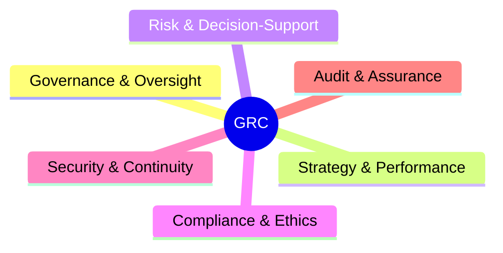

### Exam Trap
If a question says “GRC is basically compliance management,” that is too narrow.

Correct understanding: GRC integrates multiple disciplines to support objectives, uncertainty, and integrity.

---

## 4. GRC Roles and Jobs

### Nerd Note
Because GRC covers many disciplines, many jobs can be considered GRC-related.

| Discipline | Possible Roles |
|---|---|
| Governance & Oversight | Board member, oversight committee member |
| Strategy & Performance | CEO, executive, strategic manager |
| Risk & Decision-Support | Risk manager, risk analyst, risk consultant |
| Compliance & Ethics | Compliance officer, ethics officer, business conduct manager |
| Security & Continuity | Information security officer, privacy officer, business continuity leader |
| Audit & Assurance | Internal auditor, external auditor, quality auditor |

### Simple Translation
A GRC professional does not have to have “GRC” in their job title.

A person may be doing GRC work if they help the organization:

- set direction,
- manage risks,
- comply with obligations,
- protect assets,
- audit controls,
- improve performance.

### Job Search Note
For your career, GRC can connect to roles such as:

- Compliance Officer,
- Risk Analyst,
- Internal Auditor,
- Business Continuity Analyst,
- Governance Specialist,
- Information Security / Compliance Analyst,
- Policy and Controls Analyst.

---

## 5. GRC Capabilities: LEARN, ALIGN, PERFORM, REVIEW

### Nerd Note
The GRC Capability Model is built around four major components.

| Component | Main Question | Simple Meaning |
|---|---|---|
| LEARN | Who are we and what affects us? | Understand context, stakeholders, culture, business model, and uncertainty |
| ALIGN | Where are we going and how will we get there? | Set objectives, strategies, risk responses, and obligations alignment |
| PERFORM | How do we act, detect, and respond? | Execute plans, operate controls, detect issues, respond to events |
| REVIEW | Are we improving and can we trust the system? | Measure, assure, review, and improve |

### Memory Hook
**LAPR = Learn → Align → Perform → Review**

Think of it like studying for an exam:

| GRC Step | Student Example |
|---|---|
| Learn | Understand the syllabus and exam format |
| Align | Build a study plan and set targets |
| Perform | Study, practice, and answer questions |
| Review | Check mistakes and improve before the exam |

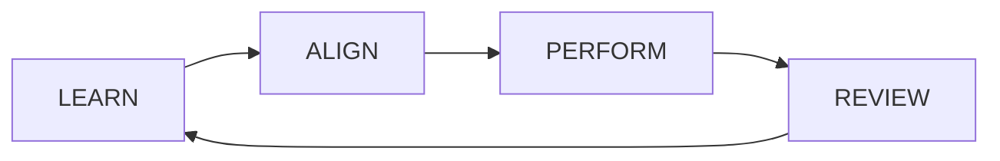

### Exam Trap
Do not treat REVIEW as the end forever.

Review feeds back into learning. GRC is continuous improvement, not a one-time checklist.

---

## 6. Protectors Revisited

### Simple Definition
Protectors are GRC professionals who help the organization solve the value-destruction problem.

They do this by taking an **interdisciplinary approach**.

### What Interdisciplinary Means
It means they do not solve every problem using one narrow method.

Instead, they combine knowledge from:

- governance,
- risk,
- compliance,
- ethics,
- strategy,
- audit,
- security,
- continuity,
- controls.

### Nerd Translation
A high-performing Protector is not just a rule checker.

A Protector asks:

- What are we trying to achieve?
- What could help or hurt us?
- What rules and values apply?
- What controls are needed?
- How do we know this is working?
- How do we improve?

---

## 7. Produce Value and Preserve Value

### Core Idea
The model warns against a common misconception:

> Protectors are not only “defense.”

They help the organization both:

| Value Type | Meaning | Examples |
|---|---|---|
| Produce Value | Help the organization move forward and succeed | Better decisions, better strategy, better performance |
| Preserve Value | Protect progress from being lost | Controls, compliance, security, continuity, audit |

### Nerd Translation
Producing value is like climbing higher up a mountain.

Preserving value is like using ropes and safety gear so one mistake does not make you fall all the way down.

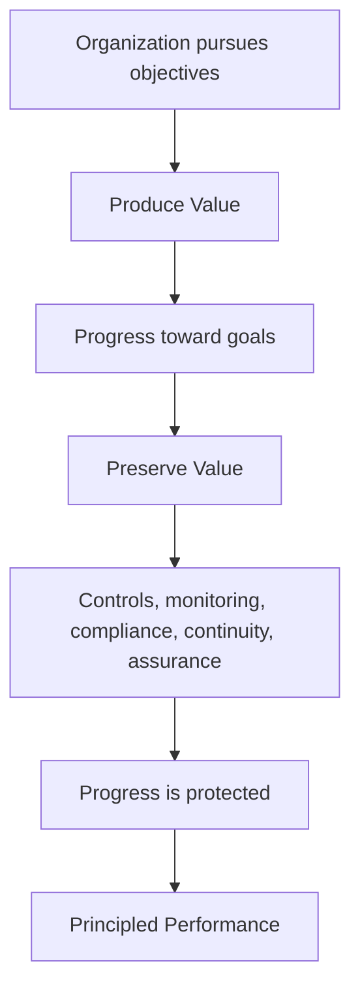

### Memory Hook
**Produce = move forward. Preserve = do not lose what you built.**

### Exam Trap
If an answer says GRC only prevents bad things, it is incomplete.

GRC also supports good performance by helping the organization make better decisions, coordinate work, and reliably achieve objectives.

---

## 8. High-Yield Exam Notes

### Must-Know Ideas

1. GRC includes governance, management, and assurance.
2. Governance gives direction and boundaries.
3. Management executes and operates resources.
4. Assurance gives confidence that things are true and working.
5. GRC is broader than governance, risk, and compliance as separate topics.
6. GRC integrates Critical Disciplines.
7. LEARN, ALIGN, PERFORM, and REVIEW are the four major capability components.
8. Protectors produce and preserve value.
9. GRC is not just defense; it also supports performance.

### Easy-to-Mix-Up Concepts

| Concept | Do Not Confuse With | Difference |
|---|---|---|
| Governance | Management | Governance sets direction and constraints; management executes |
| Assurance | Management review | Assurance is objective confidence, not just internal opinion |
| GRC | GRC software | Software may support GRC, but it is not GRC itself |
| Compliance | GRC | Compliance is one discipline inside the broader GRC approach |
| Preserve value | Avoid all risk | Preserving value means protecting progress, not stopping all action |

---

## 9. Mini Flashcards

**Q1: What are the three layers of the full GRC picture?**  
A: Governance, management, and assurance.

**Q2: What does governance do?**  
A: It guides, constrains, and oversees the organization.

**Q3: What does management do?**  
A: It directly operates resources, processes, and decisions.

**Q4: What does assurance do?**  
A: It objectively evaluates and gives confidence that something is justified and true.

**Q5: Is GRC just compliance?**  
A: No. Compliance is only one discipline within GRC.

**Q6: What are the four GRC capability components?**  
A: LEARN, ALIGN, PERFORM, REVIEW.

**Q7: What does it mean that Protectors produce and preserve value?**  
A: They help the organization succeed while protecting progress from loss.

---

## 10. Mini Quiz

### Question 1
A company has a risk team, compliance team, audit team, and strategy team, but each works separately and uses different information. What is the GRC weakness?

**Answer:** Lack of integration. GRC requires coordination and orchestration across disciplines.

### Question 2
A manager says, “We bought a GRC platform, so now we have GRC.” What is wrong with this statement?

**Answer:** GRC is not software. Software can support GRC, but GRC is an integrated capability system.

### Question 3
A business continuity officer helps prevent service disruption and also helps the company continue serving customers. Is this producing value, preserving value, or both?

**Answer:** Both. It preserves value by reducing disruption and produces value by supporting reliable service delivery.

### Question 4
Which component comes after ALIGN in the GRC Capability Model?

**Answer:** PERFORM.

### Question 5
Why is assurance important in GRC?

**Answer:** It provides confidence that statements, controls, and outcomes are reliable and true.

---

## 11. Batch 2 Summary

The second five content pages build the structure of GRC:

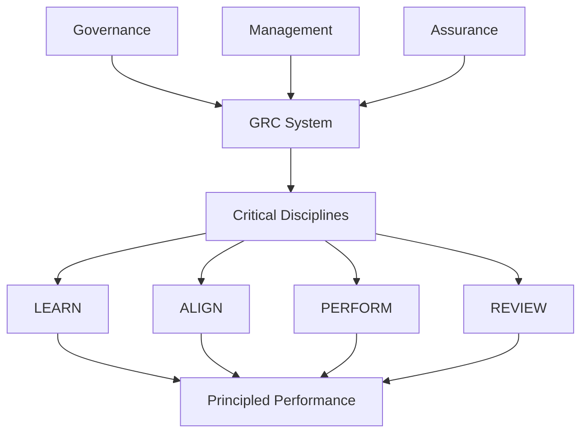

### One-Sentence Master Summary
GRC is an integrated system of governance, management, assurance, and critical disciplines that helps Protectors produce and preserve value through the LEARN, ALIGN, PERFORM, and REVIEW capabilities.

---

# Batch 3 - Protector Mindset and Beginning of Protector Skillset  
**Source coverage:** Content pages 11-15  
**PDF pages:** 17-21

---

## 1. Protectors as Stabilizing Forces

### Nerd Note
The model says Protectors usually work in functions that help stabilize the organization.

They are often found in areas like:

- board and oversight,
- risk,
- compliance,
- security,
- finance,
- HR,
- IT,
- internal controls,
- audit.

### Simple Translation
Some departments push the organization forward into opportunity, like sales, marketing, and product innovation.

Protectors make sure the organization does not move forward blindly, illegally, unsafely, or in a way that destroys trust.

### Important Balance
Protectors must balance two things:

| Balance Area | Meaning |
|---|---|
| Value Production | Helping the organization move toward its objectives |
| Value Preservation | Protecting the organization from losing progress |

### Memory Hook
**Sales may push the car faster. Protectors make sure the brakes, mirrors, seatbelt, and route are working.**

### Exam Trap
Do not think “stabilizing force” means “slowing everything down.”

A good Protector does not block progress. A good Protector makes progress safer, more reliable, and more sustainable.

---

## 2. The Mountain Climber Analogy

### Core Idea
The model uses a mountain climber example to explain value production and value preservation.

| Mountain Climbing | Organization |
|---|---|
| Climber moves toward the summit | Organization moves toward objectives |
| Climber makes progress upward | Organization produces value |
| Climber may slip or fall | Organization faces obstacles and failures |
| Ropes and clamps protect the climber | Controls, policies, monitoring, assurance, and continuity protect the organization |

### Nerd Translation
Producing value is climbing higher.

Preserving value is locking in progress so one mistake does not destroy everything.

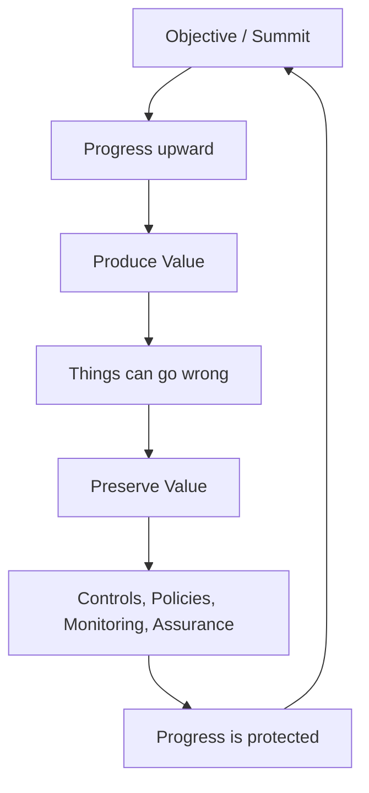

### Simple Example
A company launches a new online service.

- The launch itself produces value.
- Cybersecurity protects the platform.
- Compliance ensures legal requirements are met.
- Business continuity prepares for downtime.
- Audit checks whether controls actually work.

Together, these preserve value.

---

## 3. Protector Mindset vs Protector Skillset

### Main Difference
The model separates the Protector into two sides:

| Concept | Simple Meaning | Think of It As |
|---|---|---|
| Protector Mindset | How a high-performing Protector thinks and judges situations | The brain / attitude |
| Protector Skillset | The disciplines and methods used to solve problems | The tools / actions |

### Nerd Translation
Mindset is how you approach the problem.

Skillset is what you use to solve the problem.

### Example
A compliance officer sees a repeated policy breach.

| Side | Example Response |
|---|---|
| Mindset | Stay calm, take ownership, collaborate, think long-term |
| Skillset | Use policy management, risk analysis, control testing, training, reporting |

### Memory Hook
**Mindset = how I think. Skillset = what I do.**

---

## 4. The Six Protector Mindset Traits

The high-performing Protector uses six major mindset traits:

| Trait | Simple Meaning |
|---|---|
| Collaborative | Works with people instead of operating alone |
| Stable | Brings calm and structure during uncertainty |
| Accountable | Takes ownership instead of blaming others |
| Visionary | Sees the bigger picture and long-term purpose |
| Versatile | Uses multiple disciplines, not only one narrow view |
| Proactive | Acts early instead of waiting for failure |

### Memory Hook
**C-S-A-V-V-P**

To remember it, use:

> **Cool Stable Accountable Visionary Versatile Protectors**

Or shorter:

> **Collaborate, Stabilize, Account, Visualize, Vary, Prevent.**

---

## 5. Golden Mean: The Most Testable Idea Here

### Nerd Note
A Protector should avoid both underusing and overusing each trait.

This is called aiming for the **Golden Mean**.

### Simple Translation
A trait becomes weak if you do too little of it.  
A trait can also become harmful if you overdo it.

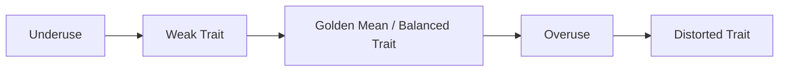

### Example
Collaboration is good.

But:

- too little collaboration = isolation and silos,
- too much collaboration = endless talking and no ownership,
- balanced collaboration = teamwork with accountability.

### Exam Trap
If an option says “more of a good trait is always better,” be careful.

The model’s idea is balance, not maximum intensity.

---

## 6. Mindset Trait 1: Collaborative

### Simple Meaning
A Protector works with others because GRC problems cross departments.

### Why It Matters
Producing and preserving value requires relationships, teamwork, and shared information.

### Underuse vs Overuse

| Trait Level | What It Looks Like |
|---|---|
| Underuse | Isolated, antagonistic, keeps information hidden |
| Balanced Use | Builds trust, shares information, works with others, still owns outcomes |
| Overuse | Becomes too social, avoids hard accountability, everyone talks but nobody owns results |

### Simple Workplace Example
A risk analyst who never talks to operations will miss real operational risks.

A risk analyst who only holds meetings but never follows up will also fail.

Balanced collaboration means working with operations and still making sure actions are assigned and completed.

---

## 7. Mindset Trait 2: Stable

### Simple Meaning
A Protector brings calm, structure, and discipline in the middle of VUCA.

### Why It Matters
VUCA and disconnection create instability. Protectors help people think clearly instead of reacting emotionally.

### Underuse vs Overuse

| Trait Level | What It Looks Like |
|---|---|
| Underuse | Chaotic, emotional, dramatic, easily pulled into confusion |
| Balanced Use | Calm, careful, conscientious, steady under pressure |
| Overuse | Seems detached, cold, or like they do not care |

### Simple Workplace Example
During an incident, a stable Protector does not panic. They organize facts, priorities, responsibilities, and next steps.

### Memory Hook
**Stable = be the anchor, not the storm.**

---

## 8. Mindset Trait 3: Accountable

### Simple Meaning
A Protector takes ownership instead of saying, “not my job.”

### Why It Matters
GRC fails when everyone assumes someone else is responsible.

### Underuse vs Overuse

| Trait Level | What It Looks Like |
|---|---|
| Underuse | Blames others, waits for instructions, avoids responsibility |
| Balanced Use | Owns tasks, follows through, escalates properly, accepts responsibility |
| Overuse | Micromanages, steps on other people’s roles, goes beyond proper scope |

### Simple Workplace Example
If a control failure is discovered, an accountable Protector does not just say, “Operations caused it.”

They help clarify the issue, assign responsibility, escalate when needed, and track remediation.

### Exam Trap
Accountability does not mean doing everyone’s job. It means taking proper ownership within role, authority, and escalation boundaries.

---

## 9. Mindset Trait 4: Visionary

### Simple Meaning
A Protector sees the bigger picture and the long-term purpose.

### Why It Matters
Risk, compliance, and control work can become very detailed. Vision prevents the Protector from forgetting why the work matters.

### Underuse vs Overuse

| Trait Level | What It Looks Like |
|---|---|
| Underuse | Short-term thinking, pessimism, narrow focus, only sees problems |
| Balanced Use | Purposeful, optimistic, long-term, connects work to objectives |
| Overuse | Too abstract, unrealistic, too idealistic, no practical endpoint |

### Simple Workplace Example
A visionary compliance officer does not only say, “We need this policy because regulation says so.”

They explain how the policy protects trust, improves consistency, and supports the company’s objectives.

---

## 10. Mindset Trait 5: Versatile

### Simple Meaning
A Protector uses different disciplines depending on the problem.

### Why It Matters
GRC problems are often “wicked problems,” meaning they are messy, connected, and cannot be solved from only one angle.

### Underuse vs Overuse

| Trait Level | What It Looks Like |
|---|---|
| Underuse | Uses one tool for every problem; narrow thinking |
| Balanced Use | Combines risk, compliance, strategy, audit, security, controls, and ethics when needed |
| Overuse | Creates overly complex solutions that nobody can implement |

### Memory Hook
**Versatile = do not use only a hammer.**

### Simple Workplace Example
A vendor risk issue may require:

- risk assessment,
- compliance review,
- contract terms,
- cybersecurity review,
- business continuity planning,
- management approval,
- monitoring.

That is versatility.

---

## 11. Mindset Trait 6: Proactive

### Simple Meaning
A Protector acts early instead of waiting for damage to happen.

### Why It Matters
Modern organizations move quickly. If GRC only reacts after failure, the organization will always be late.

### Underuse vs Overuse

| Trait Level | What It Looks Like |
|---|---|
| Underuse | Clueless, passive, paralyzed, afraid to act |
| Balanced Use | Looks ahead, detects warning signs, prepares responses, corrects early |
| Overuse | Jumps too quickly, changes too often, acts without enough evidence |

### Simple Workplace Example
A proactive business continuity analyst does not wait for a system outage. They identify critical services, run tests, document recovery steps, and train people before disruption happens.

### Exam Trap
Proactive does not mean reckless. It means early, thoughtful action.

---

## 12. Protector Skillset Begins

### Nerd Note
After explaining the mindset, the model begins the **Protector Skillset**.

The skillset means GRC professionals integrate Critical Disciplines so they can use the strengths of each discipline.

### Simple Translation
A strong Protector does not say:

> “I am only compliance, so I only think about rules.”

Instead, they ask:

> “What combination of governance, strategy, risk, compliance, security, continuity, and assurance skills is needed here?”

### Why This Matters
Using multiple disciplines helps the organization:

- fill gaps,
- avoid blind spots,
- accelerate success,
- solve problems more completely.

---

## 13. Skillset Area 1: Governance & Oversight

### Simple Meaning
Governance & Oversight skills help the organization set direction, define boundaries, and assign authority.

### These Skills Help the Organization

| Governance & Oversight Skill | Simple Meaning |
|---|---|
| Set direction | Define mission, vision, and values |
| Identify boundaries | Clarify what is allowed and not allowed |
| Allocate authority | Decide who has decision rights |
| Authorize systems | Approve performance, risk, and compliance systems |
| Shape culture | Support a culture of integrity |

### Nerd Translation
Governance answers:

- Who decides?
- What direction are we going?
- What are the limits?
- What systems must exist?
- What kind of culture do we want?

---

## 14. Skillset Area 2: Strategy & Performance

### Simple Meaning
Strategy & Performance skills help the organization define objectives, indicators, strategies, and tactics.

### These Skills Help the Organization

| Strategy & Performance Skill | Simple Meaning |
|---|---|
| Set direction | Confirm mission, vision, and values |
| Set objectives | Define what success means |
| Set indicators | Use measures to track performance and progress |
| Map strategies and tactics | Decide how objectives will be achieved |
| Address opportunities, obstacles, and obligations | Connect strategy with GRC realities |

### Nerd Translation
Strategy & Performance asks:

- What are we trying to achieve?
- How will we measure success?
- What plan gets us there?
- What opportunities can help us?
- What obstacles and obligations must we handle?

---

## 15. High-Yield Exam Notes

### Must-Know Ideas

1. Protectors are stabilizing forces in VUCA and disconnection.
2. Protectors balance value production and value preservation.
3. The mountain climber analogy explains progress and protection.
4. Protector Mindset is how Protectors think.
5. Protector Skillset is how Protectors solve problems and act.
6. The six mindset traits are Collaborative, Stable, Accountable, Visionary, Versatile, and Proactive.
7. Each mindset trait must be balanced between underuse and overuse.
8. Governance & Oversight skills set direction, boundaries, authority, systems, and culture.
9. Strategy & Performance skills set objectives, indicators, strategies, and tactics.

### Most Important Exam Trap
The best answer is often the balanced one.

For mindset questions, avoid answers that are extreme:

- never collaborate,
- collaborate with no ownership,
- take no responsibility,
- micromanage everything,
- act too late,
- act recklessly early.

The model prefers the **Golden Mean**.

---

## 16. Mini Flashcards

**Q1: What role do Protectors play against VUCA?**  
A: They act as stabilizing forces.

**Q2: What is the mountain climber analogy used to explain?**  
A: Producing value by making progress and preserving value by protecting that progress.

**Q3: What is the Protector Mindset?**  
A: The way a high-performing Protector thinks, decides, and evaluates problems, people, and reality.

**Q4: What is the Protector Skillset?**  
A: The disciplines and methods a Protector uses to solve problems, make progress, and lead.

**Q5: What are the six Protector Mindset traits?**  
A: Collaborative, Stable, Accountable, Visionary, Versatile, and Proactive.

**Q6: What does Golden Mean mean here?**  
A: Balanced use of a trait, avoiding both underuse and overuse.

**Q7: What does Governance & Oversight help with?**  
A: Direction, boundaries, authority, systems, and culture of integrity.

**Q8: What does Strategy & Performance help with?**  
A: Objectives, indicators, strategies, tactics, and addressing opportunities, obstacles, and obligations.

---

## 17. Mini Quiz

### Question 1
A compliance manager refuses to talk to operations and says, “They should already know the rules.” Which Protector Mindset trait is underused?

**Answer:** Collaborative. The manager is working in isolation and failing to build relationships.

### Question 2
A risk officer takes control of every department’s remediation plan and refuses to let process owners make decisions. Which trait is overused?

**Answer:** Accountability. The officer is moving into micromanagement and beyond proper scope.

### Question 3
A business continuity team prepares recovery plans, tests them, and trains employees before an outage happens. Which trait is shown?

**Answer:** Proactive.

### Question 4
A Protector says, “This issue is not only compliance. It also involves risk, contracts, cybersecurity, and continuity.” Which trait is shown?

**Answer:** Versatile.

### Question 5
Why can overusing collaboration be bad?

**Answer:** It can turn work into endless discussion where nobody owns outcomes.

### Question 6
What is the difference between Protector Mindset and Protector Skillset?

**Answer:** Mindset is how the Protector thinks and approaches situations; skillset is the tools and disciplines used to solve problems.

---

## 18. Batch 3 Summary

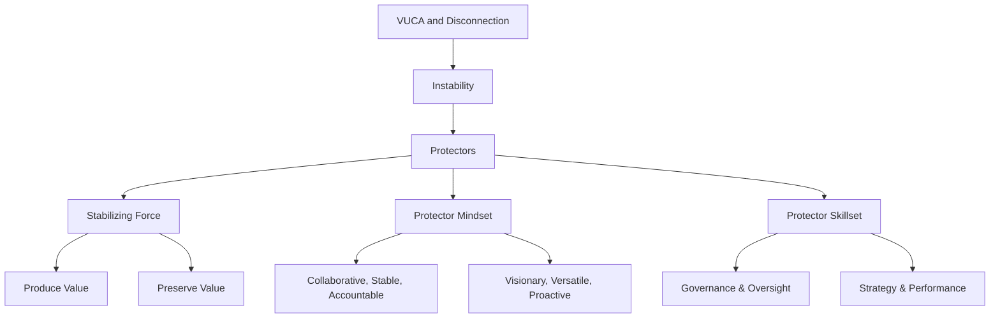

### One-Sentence Master Summary
Protectors help organizations move forward without losing control by combining a balanced Protector Mindset with an interdisciplinary Protector Skillset.

---
---

# Batch 5 — Anatomy of GRC Capabilities and Measuring GRC

**Source coverage:** Content pages 21–25  
**Purpose for GRCP prep:** Understand the structure of the GRC Capability Model and how maturity and total performance are measured.

## 1. Main Idea of This Batch

The GRC Capability Model is organized into components and elements. These help describe what a high-performing GRC capability should include and how it can be measured.

```text
GRC Capability = components + elements + practices + measurement.
```

## 2. The Four Components

| Component | Simple Meaning | Main Question |
|---|---|---|
| LEARN | Understand reality | Who are we, where are we, and what affects us? |
| ALIGN | Set direction and plan | Where are we going and how will we address opportunities, obstacles, and obligations? |
| PERFORM | Act and respond | How do we execute, detect, and respond? |
| REVIEW | Check and improve | Are we progressing and how can we improve? |

## 3. The Twenty Elements

The model has 20 elements distributed across the four components:

| Component | Number of Elements | Simple Meaning |
|---|---:|---|
| LEARN | 4 | Understand stakeholders, context, and culture. |
| ALIGN | 5 | Set direction, objectives, and plans. |
| PERFORM | 8 | Execute actions and controls. |
| REVIEW | 3 | Evaluate, assure, and improve. |

Each element usually includes a summary, practices, considerations, and optional tools/techniques.

## 4. Maturity Model

Maturity explains how developed a capability is.

| Level | Name | Simple Meaning |
|---|---|---|
| 1 | Initial | Improvised, ad hoc, and chaotic. |
| 2 | Managed | Defined and managed, sometimes informally. |
| 3 | Consistent | Formally documented and consistently used. |
| 4 | Measured | Managed with data and evidence. |
| 5 | Optimizing | Continuously improved over time. |

### GRCP Trap

The highest level is **optimizing**, not “perfect.” GRC capabilities should keep improving because the organization and its context keep changing.

## 5. Total Performance Model

Total Performance measures each element through four dimensions.

| Dimension | Simple Question | Memory Word |
|---|---|---|
| Effectiveness | Does it work and achieve the intended result? | Sound |
| Efficiency | Does it use resources wisely? | Lean |
| Agility | Can it respond quickly to change? | Responsive |
| Resilience | Can it withstand stress and recover or improve? | Antifragile |

## 6. Example: Education Element

Education can be measured by asking:

- Is the training program well-designed and covering the right topics? → effectiveness
- How much does it cost per worker? → efficiency
- How quickly can training be updated when new risks appear? → agility
- What happens if the learning system fails or key staff are unavailable? → resilience

## 7. GRCP Exam Traps

| Trap | Correct Understanding |
|---|---|
| Maturity and performance are the same | Maturity is how developed the capability is; total performance measures how well it performs. |
| Level 5 means done forever | Level 5 means continuously optimizing. |
| Efficiency alone means good GRC | A cheap process that does not work is not high performing. |
| Resilience only means recovery | Resilience includes withstanding stress and becoming more capable after stress. |

## 8. Flashcards

**Q1: What are the four GRC components?**  
A: LEARN, ALIGN, PERFORM, REVIEW.

**Q2: How many elements are in the model?**  
A: 20 elements.

**Q3: What is maturity Level 1?**  
A: Initial — improvised, ad hoc, and often chaotic.

**Q4: What is maturity Level 5?**  
A: Optimizing — consistently improving over time.

**Q5: What are the four Total Performance dimensions?**  
A: Effectiveness, efficiency, agility, and resilience.

## 9. Mini Quiz

### Question 1
A compliance training process is documented and used consistently but not measured with data. Which maturity level is closest?

**Answer:** Level 3 — Consistent.

### Question 2
A process works well but costs far too much. Which total performance dimension is weak?

**Answer:** Efficiency.

### Question 3
A program can quickly adjust to new regulations. Which total performance dimension is strong?

**Answer:** Agility.

## 10. Batch 5 Summary Diagram

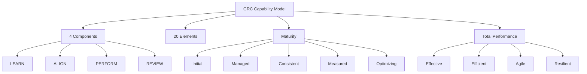

### One-Sentence Master Summary
Batch 5 teaches that GRC capabilities are organized into LEARN, ALIGN, PERFORM, and REVIEW, measured through maturity levels and total performance dimensions.

---

# Batch 6 — Applying the GRC Capability Model and Getting There

**Source coverage:** Content pages 26–30  
**Purpose for GRCP prep:** Understand how the model applies to different organizational scopes, people, processes, resources, and improvement steps.

## 1. Main Idea of This Batch

The GRC Capability Model can be applied at any level of an organization: enterprise, business unit, department, or team.

```text
Scope decides what “organization” means.
```

## 2. Organization in Scope

| Term | Simple Meaning |
|---|---|
| Organization in scope | The unit where the model is being applied. |
| Enterprise | The highest unit that includes the whole organization. |
| Business unit | A subordinate unit often focused on product, geography, or customers. |
| Department | A shared service or functional unit such as HR, IT, compliance, or risk. |
| Team | The smallest unit; may be permanent, temporary, or cross-functional. |

## 3. Organizational Levels

| Level | Meaning |
|---|---|
| Superior | Units the organization in scope reports to or is accountable to. |
| Subordinate | Units that report to or are accountable to the organization in scope. |
| Peer | Lateral units at a similar level. |

## 4. Special Units and People

| Term | Simple Meaning |
|---|---|
| Governing authority / Board | Highest accountability and authority for governance. |
| Executives | Senior managers with broad responsibility. |
| Managers | People who manage others. |
| Staff / team members | Personnel who usually do not manage others. |
| Leaders | People who have attention and respect, regardless of title. |
| Third party / extended enterprise | External partners that perform work or support objectives. |

### Nerd Note

Leadership is not only a title. A person can be a leader because others follow and respect them.

## 5. Processes and Resources

| Term | Simple Meaning |
|---|---|
| Integrated plan | Plan that allocates processes and resources to achieve objectives, address uncertainty, and act with integrity. |
| Process | A series of actions or steps. |
| Resources | Means used to achieve objectives. |

Resources include:

- human capital,
- technology capital,
- physical capital,
- information capital,
- financial capital.

## 6. Getting There: Improvement Cycle

The model uses a simple improvement cycle.

| Step | Meaning |
|---|---|
| Commit | Obtain commitment to Principled Performance and GRC. |
| Plan | Use the model to design capabilities. |
| Do | Assign accountability and implement capabilities. |
| Check | Evaluate execution. |
| Act | Fine-tune and improve. |

```text
Commit → Plan → Do → Check → Act
```

## 7. GRCP Exam Traps

| Trap | Correct Understanding |
|---|---|
| The model only applies to whole enterprises | It can apply to teams, departments, units, or the enterprise. |
| Board always means corporate board only | It means the governing authority for the organization in scope. |
| Leaders are only managers | Leadership can be informal and based on influence. |
| Third parties are outside GRC | Third parties are part of the extended enterprise and can affect objectives. |

## 8. Flashcards

**Q1: What is organization in scope?**  
A: The unit where the GRC Capability Model is being applied.

**Q2: What is the enterprise?**  
A: The most superior unit covering the entire organization.

**Q3: What are peer units?**  
A: Lateral units often accountable to the same superior unit.

**Q4: What is an integrated plan?**  
A: A plan that allocates processes and resources to achieve objectives, address uncertainty, and act with integrity.

**Q5: What are the five implementation steps?**  
A: Commit, Plan, Do, Check, Act.

## 9. Mini Quiz

### Question 1
A compliance department applies the model only to its policy process. Is that allowed?

**Answer:** Yes. The organization in scope may be a department, team, or process area.

### Question 2
A vendor handles customer data. Is it relevant to GRC?

**Answer:** Yes. It is part of the extended enterprise and may affect objectives, uncertainty, and obligations.

## 10. Batch 6 Summary Diagram

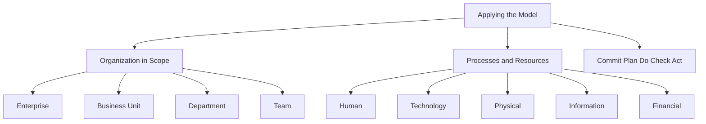

### One-Sentence Master Summary
Batch 6 teaches that the GRC Capability Model can be applied at any organizational scope and improved through commitment, planning, implementation, evaluation, and adjustment.

---

# Batch 7 — Starting Points and Part I Big Picture Concepts

**Source coverage:** Content pages 31–35  
**Purpose for GRCP prep:** Understand the different ways organizations begin GRC work and the big-picture relationship between objectives, opportunities, obstacles, and obligations.

## 1. Main Idea of This Batch

All organizations share the same destination: **Principled Performance**. But they do not all start from the same place.

```text
Same destination, different starting points.
```

## 2. Five Starting Points

| Starting Point | Meaning | Example |
|---|---|---|
| SP0 Blank Canvas | Starting as if building GRC from scratch | Formalizing a new integrated GRC approach. |
| SP1 Topical | Starting with a specific topic | Anti-corruption, information security, internal control. |
| SP2 Discipline | Starting with a discipline/program | Risk management framework, compliance program, BCM framework. |
| SP3 Element | Starting with a model element | Training system, policy management, risk analysis. |
| SP4 Crisis | Starting because something went wrong | Scandal, breach, sanction, major incident. |

## 3. Part I: GRC Concepts

Principled Performance can be broken into four major parts:

1. reliably,
2. achieve objectives,
3. address uncertainty,
4. act with integrity.

These concepts explain how GRC works at the deepest level.

## 4. Big Picture of Business

Every organization is trying to achieve objectives. On the way, it faces:

| Concept | Meaning |
|---|---|
| Objective | A measurable outcome to achieve. |
| Opportunity | Uncertain event that may positively affect objectives. |
| Obstacle | Uncertain event that may negatively affect objectives. |
| Obligation | Requirement the organization must or should address. |

## 5. Opportunities, Obstacles, and Obligations

| Area | Associated With | Managed Through | Indicator |
|---|---|---|---|
| Opportunities | Reward / performance | Performance management | KPI |
| Obstacles | Risk | Risk management | KRI |
| Obligations | Compliance | Compliance management | KCI |

## 6. Important Usage Note

The term KPI is sometimes used broadly to mean all indicators, but the model separates KPI, KRI, and KCI to make the three perspectives clearer.

### Nerd Note

For the GRCP exam, do not fight the wording. Understand the distinction:

```text
KPI = performance/reward
KRI = risk/obstacle
KCI = compliance/obligation
```

## 7. GRCP Exam Traps

| Trap | Correct Understanding |
|---|---|
| Every organization starts GRC the same way | Starting point depends on context and current challenges. |
| Crisis starting point is ideal | It is reactive; the model can still help recover and integrate. |
| Opportunity only means sales growth | It means any uncertain event with positive effect on objectives. |
| Compliance is only laws | It includes mandatory and voluntary obligations. |
| KPI/KRI/KCI labels are always used consistently in companies | Real organizations may use KPI broadly, but the model distinguishes them. |

## 8. Flashcards

**Q1: What is the destination of GRC work?**  
A: Principled Performance.

**Q2: What is SP0?**  
A: Blank Canvas starting point.

**Q3: What is SP4?**  
A: Crisis starting point.

**Q4: What are the four big GRC concepts?**  
A: Reliably, achieve objectives, address uncertainty, and act with integrity.

**Q5: What does KPI relate to?**  
A: Performance/reward.

**Q6: What does KRI relate to?**  
A: Risk/obstacles.

**Q7: What does KCI relate to?**  
A: Compliance/obligations.

## 9. Mini Quiz

### Question 1
A company begins GRC work after a data breach. Which starting point is this?

**Answer:** SP4 Crisis.

### Question 2
A company begins by building a risk management framework. Which starting point is this?

**Answer:** SP2 Discipline.

### Question 3
A company begins by implementing a policy management system. Which starting point is this?

**Answer:** SP3 Element.

## 10. Batch 7 Summary Diagram

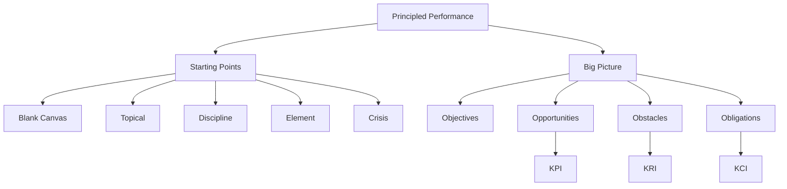

### One-Sentence Master Summary
Batch 7 teaches that organizations can start GRC work from different points, but all paths should connect objectives, opportunities, obstacles, and obligations on the way to Principled Performance.

---

# Batch 8 — Reliability, Decision Criteria, and Assurance Levels

**Source coverage:** Content pages 36–40  
**Purpose for GRCP prep:** Understand what “reliably” means in Principled Performance and how governance, management, and assurance make the organization dependable.

## 1. Main Idea of This Batch

A GRC system is not only about having policies, risks, controls, or compliance tasks. It is about helping the organization make better decisions again and again. That is why the word **reliably** matters.

For GRCP, remember this:

```text
Reliability = consistency + dependability + transparency.
```

A reliable organization does not only achieve objectives once by luck. It has a system that allows people to make aligned decisions, correct errors, monitor performance, manage uncertainty, and prove that obligations are being addressed.

## 2. GRC Is About Better Decision-Making

The GRC Capability Model uses different decision-making criteria so that decisions are not random, emotional, or disconnected.

| Criteria Type | Simple Meaning | Example Question |
|---|---|---|
| Decision-making criteria | Rules used to choose between options | Which option should we select? |
| Direction-setting criteria | Criteria for deciding the organization’s direction | Where should we go? |
| Objective-setting criteria | Criteria for setting objectives and key results | What exactly should we achieve? |
| Identification criteria | Criteria for finding opportunities, obstacles, and obligations | What could affect us? |
| Analysis criteria | Criteria for analyzing risk, reward, and compliance | How serious is this? |
| Design criteria | Criteria for selecting actions and controls | What should we put in place? |

### Nerd Note

Decision criteria prevent the organization from relying on personal opinion only. They create a shared logic for decision-making.

## 3. Reliability Applies to the Whole Definition

Principled Performance means the organization must:

1. reliably achieve objectives,
2. reliably address uncertainty,
3. reliably act with integrity.

Do not treat reliability as a separate topic. It modifies everything.

```text
Not: Achieve objectives + address uncertainty + act with integrity + reliability.
Correct: Reliably do all three.
```

## 4. Governance vs Management

| Concept | Simple Meaning | How It Works |
|---|---|---|
| Management | Directly guiding and operating resources | Managers arrange people, processes, and systems to get work done. |
| Governance | Indirectly guiding and limiting resources | The board or governing authority sets direction, constraints, limits, and expectations. |

### Easy Example

The CIO manages the IT department because the CIO directly arranges resources and activities. The board governs IT by setting limits, policies, risk appetite, and expectations.

### GRCP Trap

Governance and management can overlap. Some actions may serve both. The point is not to memorize titles only. The point is to understand **direct operation** versus **indirect constraint and direction**.

## 5. Assurance Provides Reliability

Assurance gives confidence that what people believe is happening is actually happening.

| Term | Simple Meaning |
|---|---|
| Assurance | Objective and competent evaluation that gives confidence. |
| Evaluate | Compare evidence against suitable criteria. |
| Subject matter | The thing being evaluated. |
| Suitable criteria | The benchmark used to judge the subject matter. |
| Information producer | The person or system producing information. |
| Information consumer | The person or group relying on the information. |
| Assurance provider | The person or team performing assurance work. |

### Nerd Note

Assurance is not just “checking.” It is checking in a structured way using evidence and criteria.

## 6. Level of Assurance

The level of assurance depends mainly on:

```text
Objectivity + Competence = Higher Assurance
```

| Factor | Meaning |
|---|---|
| Objectivity | Ability to be impartial and free from bias or conflict. |
| Competence | Ability to use proper professional methods and knowledge. |

### Assurance Levels

| Level | Simple Meaning | Example |
|---|---|---|
| Absolute assurance | Impossible certainty | No one can prove everything with 100% certainty. |
| Reasonable assurance | High but not absolute confidence | External audit-style assurance. |
| Limited assurance | Moderate confidence | Review or limited testing. |
| Lower assurance | Basic confidence | Self-assessment or informal benchmarking. |

## 7. Independence vs Objectivity

Independence helps objectivity, but they are not the same.

```text
Independence = structural separation.
Objectivity = actual ability to be unbiased.
```

A person may be structurally independent but still biased. Another person may not be fully independent but may provide a lower level of useful assurance if they are competent and sufficiently objective for the purpose.

## 8. GRCP Exam Traps

| Trap | Correct Understanding |
|---|---|
| Thinking assurance means 100% certainty | Absolute assurance is impossible. |
| Thinking independence equals objectivity | Independence supports objectivity but does not guarantee it. |
| Thinking governance means doing the work | Governance is usually indirect guidance and constraint. |
| Thinking management and governance never overlap | They can overlap in practice. |
| Thinking every issue needs high assurance | Assurance level should match the need and subject matter. |

## 9. Memory Hooks

```text
Reliably = do it again, prove it again, improve it again.
```

```text
Management touches the work.
Governance shapes the work.
Assurance checks the work.
```

```text
Assurance strength = Objectivity × Competence.
```

## 10. Flashcards

**Q1: What does reliability mean in GRC?**  
A: Being consistent, dependable, and transparent while achieving objectives, addressing uncertainty, and acting with integrity.

**Q2: What is management?**  
A: Directly guiding, controlling, and evaluating resources or activities.

**Q3: What is governance?**  
A: Indirectly guiding, controlling, and evaluating by setting direction, limits, and constraints.

**Q4: What does assurance provide?**  
A: Confidence that statements or beliefs about subject matter are justified and true.

**Q5: Why is absolute assurance impossible?**  
A: Because no evaluation can remove all uncertainty.

**Q6: What two qualities increase assurance level?**  
A: Objectivity and competence.

**Q7: Is independence the same as objectivity?**  
A: No. Independence is a structure that may support objectivity, but objectivity is the actual ability to be unbiased.

## 11. Mini Quiz

### Question 1
A team reviews its own work informally. Is this likely high assurance or lower assurance?

**Answer:** Lower assurance, because objectivity is limited.

### Question 2
A board sets risk limits for IT spending. Is this governance or management?

**Answer:** Governance, because the board indirectly constrains and guides IT.

### Question 3
A CIO assigns people and budgets to complete an IT project. Is this governance or management?

**Answer:** Management, because the CIO directly arranges resources.

### Question 4
A report is checked against agreed criteria using evidence. What concept is this?

**Answer:** Assurance/evaluation.

## 12. Batch 8 Summary Diagram

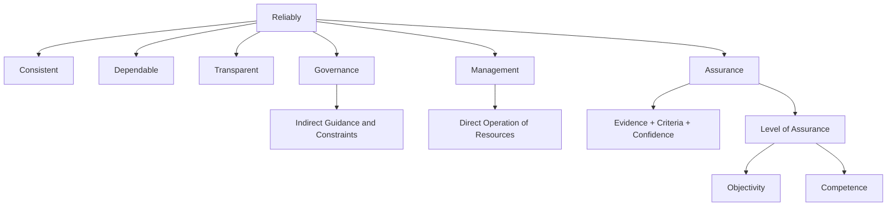

### One-Sentence Master Summary
Reliability in GRC comes from using clear decision criteria, effective governance, direct management, and appropriate assurance so the organization can repeatedly achieve objectives, address uncertainty, and act with integrity.

---

# Batch 9 — Lines of Accountability and the Start of Achieving Objectives

**Source coverage:** Content pages 41–45  
**Purpose for GRCP prep:** Understand who is accountable for performance, risk, compliance, and assurance, then connect this to objectives and stakeholders.

## 1. Main Idea of This Batch

The **Lines of Accountability** model helps explain who does what in GRC. It shows how different people and teams contribute to producing value, preserving value, managing risk, meeting obligations, and providing assurance.

Then the model shifts into **Achieve Objectives**, where everything starts with stakeholder expectations.

```text
Stakeholders create expectations.
Expectations shape mission, vision, and objectives.
Objectives drive GRC work.
```

## 2. The Five Lines of Accountability

| Line | Who It Usually Includes | Main Role |
|---|---|---|
| First Line | Operational individuals and teams | Own and manage day-to-day performance, risk, and compliance. |
| Second Line | Risk, compliance, HR, security, technology, support functions | Build programs, policies, frameworks, tools, and oversight to support the first line. |
| Third Line | Internal audit, external audit, outside experts | Provide higher assurance over first and second line activities. |
| Fourth Line | Executive team | Manage organization-wide performance, risk, and compliance. |
| Fifth Line | Governing authority / board | Ultimate accountability for governance, management, and assurance. |

## 3. Simple Way to Remember the Lines

```text
1st Line = Does the work.
2nd Line = Guides and supports the work.
3rd Line = Assures the work.
4th Line = Runs the enterprise.
5th Line = Ultimately governs the enterprise.
```

## 4. The Lines Are Not Static

The model is not meant to be rigid. A second line can sometimes provide assurance if it did not design or perform the activity being reviewed and has enough objectivity and competence. A first line can also perform assurance over a vendor it manages.

### Nerd Note

The exam may test whether you think only the third line can provide assurance. That is too rigid. The better answer is: assurance depends on objectivity, competence, and the desired level of assurance.

## 5. Fractality of Accountability

The model can apply to both small and large organizations.

A large enterprise may have many departments, units, and layers. A sole proprietor may be one person physically, but can still separate activities by time and purpose: doing work, reviewing work, planning, and accepting ultimate accountability.

```text
Same concept, different scale.
That is fractality.
```

## 6. Achieve Objectives

Principled Performance requires the organization to reliably achieve objectives. But objectives do not appear randomly. They come from stakeholder expectations.

Objectives should be:

- intentional,
- clearly defined,
- linked across levels,
- cascaded through the organization,
- measurable through indicators,
- aligned with SMART thinking.

### GRCP Trap

Accidentally achieving a good result does not equal Principled Performance. The achievement must be intentional and reliable.

## 7. Stakeholders

| Stakeholder Type | Examples | Why They Matter |
|---|---|---|
| External stakeholders | Customers, shareholders, creditors, suppliers, government, media, society | They influence or judge the organization from outside. |
| Internal stakeholders | Personnel, managers, executives, board members, involved owners | They influence or judge the organization from inside. |
| Customer | The person or group served by the organization | The customer judges whether value is being produced, protected, or destroyed. |

## 8. Customer Is Special

Every organization exists to serve some kind of customer. In a business, the customer buys the product or service. In a department, the customer may be another internal unit. In government, the customer may be the constituent or regulated entity.

For GRCP, remember:

```text
The customer judges value.
```

## 9. Objective vs Indicator

| Concept | Meaning | Example |
|---|---|---|
| Objective | A measurable outcome to achieve | Improve customer satisfaction. |
| Indicator | A measure of progress or status | Net Promoter Score. |

Objectives should be memorable and qualitative. Indicators make them measurable.

## 10. Objective Modifiers

Objectives may be modified by:

| Modifier Type | Examples |
|---|---|
| Topic | Compliance objective, reporting objective |
| Time | Annual objective, quarterly objective, monthly objective |
| Importance | Strategic, tactical, operational |
| Level | Enterprise, department, team, individual |

### Nerd Note

A strategic objective for one department may only be a tactical objective for the enterprise. The label depends on context.

## 11. GRCP Exam Traps

| Trap | Correct Understanding |
|---|---|
| Only third line gives assurance | Other lines can provide assurance depending on objectivity and competence. |
| Lines are fixed departments | Lines describe accountability roles, not always fixed boxes. |
| Board can delegate all accountability away | The board may delegate work, but ultimate accountability remains. |
| Objectives start with management preference only | Objectives should reflect stakeholder expectations. |
| Indicator and objective are the same | Objective is the outcome; indicator measures it. |

## 12. Flashcards

**Q1: What does the first line do?**  
A: Owns and manages day-to-day performance, risk, and compliance.

**Q2: What does the second line do?**  
A: Creates programs, frameworks, standards, policies, tools, and oversight to support the first line.

**Q3: What does the third line do?**  
A: Provides higher assurance over first and second line activities.

**Q4: What does the fourth line represent?**  
A: Executive team accountability for organization-wide performance, risk, and compliance.

**Q5: What does the fifth line represent?**  
A: The governing authority or board with ultimate accountability.

**Q6: What is an objective?**  
A: A measurable outcome to achieve.

**Q7: What is an indicator?**  
A: A measure of progress toward or status of an objective.

**Q8: Why is the customer important?**  
A: The customer judges whether value is being produced, protected, or destroyed.

## 13. Mini Quiz

### Question 1
A risk team creates a policy and tool to help operations manage vendor risks. Which line is this most likely?

**Answer:** Second line.

### Question 2
Internal audit tests whether the risk process is working. Which line is this?

**Answer:** Third line.

### Question 3
A board reviews red flags and confirms that systems are in place. Which line is this?

**Answer:** Fifth line.

### Question 4
“Improve customer satisfaction” is what?

**Answer:** An objective.

### Question 5
“Monthly NPS score” is what?

**Answer:** An indicator.

## 14. Batch 9 Summary Diagram

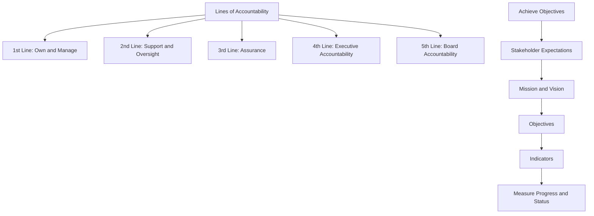

### One-Sentence Master Summary
Batch 9 teaches that reliable GRC depends on clear accountability across the five lines and that objectives should be intentionally shaped by stakeholder expectations and measured through indicators.

---

# Batch 10 — Writing Objectives, CTO/RTO, Ownership, Mission, Vision, and Alignment

**Source coverage:** Content pages 46–50  
**Purpose for GRCP prep:** Learn how objectives are written, owned, and aligned across the organization.

## 1. Main Idea of This Batch

Objectives are the backbone of GRC. If the organization does not know what it is trying to achieve, it cannot properly define performance, risk, compliance, controls, or assurance.

```text
Bad objective = unclear GRC.
Clear objective = clear risk, compliance, controls, and assurance.
```

## 2. Objective Modifiers Depend on Context

An objective can be described by level, time, topic, or importance. The same objective may be strategic in one context and tactical in another.

Example: “Improve compliance program coverage” may be a strategic objective for the compliance department, but only one tactic under the enterprise objective “Enhance integrity.”

## 3. Writing Objectives

A well-written objective usually includes:

```text
Verb + Noun
```

Examples:

- Increase revenue
- Grow customer base
- Improve customer satisfaction
- Maintain conversion rate
- Increase system resilience

The simpler the wording, the easier it is to align people around it.

## 4. CTO vs RTO Objectives

| Type | Full Meaning | Purpose | Value Type |
|---|---|---|---|
| CTO | Change the Organization | Improve, grow, increase, transform | Produce new value |
| RTO | Run the Organization | Maintain, manage, sustain, keep promises | Preserve existing value |

### Easy Difference

```text
CTO = make things better.
RTO = keep things working.
```

### Example

| Situation | Objective Type |
|---|---|
| Improve customer satisfaction | CTO |
| Maintain high customer satisfaction | RTO |
| Reduce customer support hold time | CTO |
| Maintain service-level performance | RTO |

## 5. Why RTO Is Not “Less Important”

RTO objectives can sound boring, but they protect trust. If an organization promised a level of service, then maintaining that promise preserves value.

For GRCP, do not assume that only change objectives matter. Running the organization reliably is also part of Principled Performance.

## 6. Ownership of Objectives

Each objective needs a clear owner with authority and resources.

```text
One objective = one ultimate owner.
```

Multiple people may contribute, but unclear shared ownership can create ambiguity.

### Nerd Note

Executives may monitor customer satisfaction, but the customer service department may own the objective and have the resources to act.

## 7. Mission and Vision

| Concept | Simple Meaning | Timeframe |
|---|---|---|
| Mission | Who the organization serves, what it does, and what it aims to achieve | Today and long term |
| Vision | What the organization aspires to become and why it matters | Long-term aspirational future |

Mission and vision are special objectives because they apply across the whole organization and shape direction.

## 8. Strategic Goals

Strategic goals are long-term objectives that express the organization’s major priorities. They should balance different perspectives such as:

- financial,
- customer,
- internal processes,
- learning and growth,
- short-term and long-term priorities,
- financial and non-financial outcomes.

## 9. Alignment

Objectives must align across levels.

```text
Top-down: enterprise objectives cascade downward.
Bottom-up: progress and feedback bubble upward.
```

If the enterprise changes direction, departments should adjust. If departments are struggling or exceeding expectations, that feedback should update enterprise understanding.

## 10. GRCP Exam Traps

| Trap | Correct Understanding |
|---|---|
| Objectives must always be strategic | Objectives can exist at enterprise, department, team, and individual levels. |
| CTO is always more important than RTO | Both produce and preserve value. |
| Multiple owners are better | A single ultimate owner reduces ambiguity. |
| Mission and vision are just slogans | They guide direction and decision-making. |
| Alignment only goes downward | Alignment also bubbles upward through feedback. |

## 11. Flashcards

**Q1: What is the basic structure of a well-written objective?**  
A: Verb + noun.

**Q2: What does CTO mean?**  
A: Change the Organization.

**Q3: What does RTO mean?**  
A: Run the Organization.

**Q4: Which type produces new value?**  
A: CTO.

**Q5: Which type preserves existing value?**  
A: RTO.

**Q6: Why should an objective have one ultimate owner?**  
A: To avoid ambiguity and ensure accountability.

**Q7: What is mission?**  
A: A statement of who the organization serves, what it does, and what it hopes to achieve.

**Q8: What is vision?**  
A: An aspirational statement of what the organization wants to become and why it matters.

## 12. Mini Quiz

### Question 1
“Maintain high customer satisfaction” is CTO or RTO?

**Answer:** RTO, because it preserves existing value.

### Question 2
“Improve customer satisfaction” is CTO or RTO?

**Answer:** CTO, because it seeks improvement/change.

### Question 3
Why is one ultimate owner important?

**Answer:** It creates clear accountability.

### Question 4
Can a department objective be strategic for the department but tactical for the enterprise?

**Answer:** Yes. Objective labels depend on context.

## 13. Batch 10 Summary Diagram

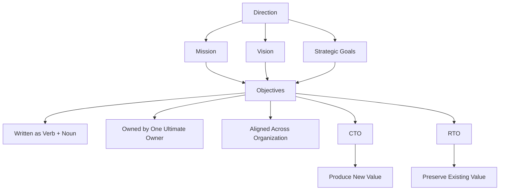

### One-Sentence Master Summary
Batch 10 teaches that objectives must be clearly written, owned, and aligned, with CTO objectives producing new value and RTO objectives preserving existing value.

---

# Batch 11 — Objective Mapping, Indicators, KPI/KRI/KCI, and Thresholds

**Source coverage:** Content pages 51–55  
**Purpose for GRCP prep:** Understand how objectives connect across the organization and how indicators measure progress, risk, and compliance.

## 1. Main Idea of This Batch

Objectives should not float alone. They should be mapped across the organization and measured by indicators.

```text
Objective = what we want.
Indicator = how we measure progress or status.
```

## 2. Mapping Objectives

Mapping shows how objectives influence one another.

| Direction | Meaning |
|---|---|
| Up | Link to superior objectives. |
| Down | Link to subordinate objectives. |
| Across | Link to peer units. |
| Diagonal | Link to related units in different reporting paths. |

### Nerd Note

Mapping helps allocate resources. If one department influences an enterprise objective more than another, leadership may allocate more attention and resources there.

## 3. Visibility

Superior levels do not need visibility into every lower-level objective. They need visibility into the objectives that directly affect enterprise priorities.

```text
Not everything needs to be visible upward.
Only what matters to higher-level objectives needs visibility.
```

## 4. Indicators

Indicators measure progress toward or status of an objective.

A good indicator includes:

- title,
- metric,
- current value,
- starting value,
- target value,
- time period.

## 5. Leading vs Lagging Indicators

| Type | Meaning | Example |
|---|---|---|
| Leading indicator | Gives information about possible future events or conditions | Increase in complaints may predict lower satisfaction. |
| Lagging indicator | Gives information about past events or conditions | NPS score reflects satisfaction already experienced. |

## 6. KPI, KRI, and KCI

| Indicator Type | Measures | Simple Meaning |
|---|---|---|
| KPI | Performance/reward | Are we achieving performance objectives? |
| KRI | Risk/obstacles | Are risks increasing or threatening objectives? |
| KCI | Compliance/obligations | Are obligations being met? |

### Critical GRCP Point

The same metric can be classified differently depending on the objective.

Example: Website uptime could be a KPI if the objective is to improve customer experience, but a KCI if the objective is to meet a service-level obligation.

## 7. Targets, Appetite, Tolerance, and Capacity

| Term | Simple Meaning |
|---|---|
| Target | Expected or planned value. |
| Timescale | Time period for reaching the target. |
| Appetite | Preferred variation around the target. |
| Tolerance | Acceptable but not preferred variation that can be addressed. |
| Capacity | Extreme variation the organization cannot or will not absorb. |

### Easy Memory

```text
Appetite = preferred zone.
Tolerance = warning zone.
Capacity = danger zone.
```

## 8. GRCP Exam Traps

| Trap | Correct Understanding |
|---|---|
| Every objective needs KPI, KRI, and KCI | Some objectives may only need one or two types. |
| KPI/KRI/KCI depends only on the metric name | Classification depends on the objective being measured. |
| All objectives must be visible to the board | Only relevant mapped objectives need visibility upward. |
| Target alone is enough | Good indicators also need timescale and sometimes appetite/tolerance/capacity. |
| Appetite and tolerance mean the same thing | Appetite is preferred; tolerance is acceptable but not preferred. |

## 9. Flashcards

**Q1: What does objective mapping show?**  
A: How objectives influence or connect to one another across the organization.

**Q2: What is an indicator?**  
A: A measure of progress toward or status of an objective.

**Q3: What is a leading indicator?**  
A: An indicator that gives information about future events or conditions.

**Q4: What is a lagging indicator?**  
A: An indicator that gives information about past events or conditions.

**Q5: What does KPI measure?**  
A: Performance or reward related to an objective.

**Q6: What does KRI measure?**  
A: Risk related to an objective.

**Q7: What does KCI measure?**  
A: Compliance related to an objective.

**Q8: What is capacity?**  
A: The extreme range beyond which the organization is unwilling or unable to address variation.

## 10. Mini Quiz

### Question 1
A metric predicts future customer dissatisfaction. Is it leading or lagging?

**Answer:** Leading.

### Question 2
NPS measures satisfaction from customers who already responded. Is it leading or lagging?

**Answer:** Lagging.

### Question 3
Website uptime is used to prove an SLA was met. Is it KPI, KRI, or KCI?

**Answer:** KCI, because it relates to meeting an obligation.

### Question 4
A value moves outside appetite but remains within tolerance. What does that mean?

**Answer:** It is not preferred but still addressable through planned response.

## 11. Batch 11 Summary Diagram

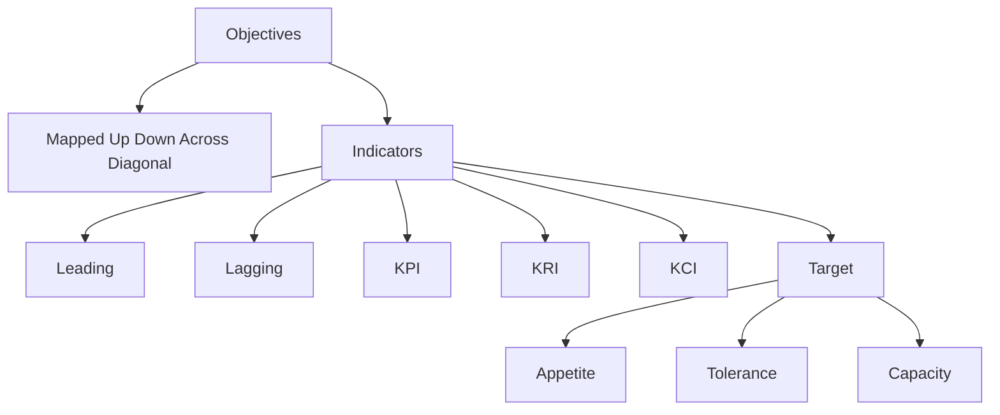

### One-Sentence Master Summary
Batch 11 teaches that objectives should be mapped and measured with indicators, and that KPI, KRI, and KCI classification depends on the objective, not just the metric name.

---

# Batch 12 — Response Ranges and the Start of Addressing Uncertainty

**Source coverage:** Content pages 56–60  
**Purpose for GRCP prep:** Understand indicator response logic and the basic uncertainty model: cause → event → consequence.

## 1. Main Idea of This Batch

Indicators are useful only if the organization knows how to respond when values move outside expected ranges. This batch also begins the major GRC concept of **addressing uncertainty**.

```text
Indicators tell you where you are.
Thresholds tell you when to respond.
Uncertainty explains what might happen next.
```

## 2. Response Logic

| Indicator Position | Meaning | Typical Response |
|---|---|---|
| Within appetite | Preferred variation | Business as usual. |
| Outside appetite but within tolerance | Not preferred but manageable | Planned response. |
| Outside tolerance | Serious issue | Significant response or possible stop. |
| Near/beyond capacity | Jeopardy or ruin | Extreme response required. |

The purpose of response logic is to avoid hitting capacity.

## 3. One-Sided Indicators

Some indicators do not need both upper and lower limits.

| Indicator | Usual Limit Logic |
|---|---|
| Customer satisfaction | Usually lower limits matter because higher is better. |
| Customer complaints | Usually upper limits matter because lower is better. |

### Nerd Note

Even “perfect” values can be suspicious. Zero complaints may mean customers have no working complaint channel. 100% satisfaction may mean the measurement process is unrealistic.

## 4. Committed, Best Possible, and Stretch Values

| Term | Simple Meaning |
|---|---|
| Committed value | Likely value based on current assumptions and planned execution. |
| Best possible value | Likely value under best assumptions and best execution. |
| Stretch value | Unlikely but still possible value. |

## 5. Addressing Uncertainty

Uncertainty comes from incomplete information, conflicting information, randomness, unpredictable circumstances, and unknown future developments.

In GRC, addressing uncertainty means making decisions about potential upside and downside while pursuing objectives.

| Term | Simple Meaning |
|---|---|
| Uncertainty | Being unsure because knowledge is incomplete or reality is random. |
| Opportunity | Future uncertain event that may positively affect objectives. |
| Obstacle | Future uncertain event that may negatively affect objectives. |

## 6. Cause → Event → Consequence

Uncertainty can be understood through a simple chain:

```text
Cause → Event → Consequence
```

| Term | Simple Meaning |
|---|---|
| Condition | A state of reality. |
| Event | Something that happens. |
| Cause/source | Trigger or potential trigger of an event. |
| Consequence | Outcome or potential outcome of an event. |
| Likelihood | Estimated chance of the event. |
| Impact | Estimated consequence. |
| Effect | Combination of likelihood and impact. |

## 7. Distributions

Likelihood and impact are rarely single exact numbers. Real uncertainty often involves a range of possible outcomes.

```text
Uncertainty is usually a range, not a dot.
```

## 8. GRCP Exam Traps

| Trap | Correct Understanding |
|---|---|
| Values outside appetite always mean disaster | They may only require planned response if within tolerance. |
| Zero complaints always means excellent performance | It may signal poor detection or reporting. |
| Opportunity means guaranteed benefit | It is uncertain and may only have positive effect on balance. |
| Risk is only about bad things happening | Risk is specifically the negative effect of uncertainty on objectives. |
| Likelihood and impact are exact | They are often estimated as distributions/ranges. |

## 9. Flashcards

**Q1: What happens inside appetite?**  
A: Usually business as usual.

**Q2: What happens outside appetite but inside tolerance?**  
A: A planned response is usually triggered.

**Q3: What does capacity represent?**  
A: The extreme range the organization cannot or will not absorb.

**Q4: What is uncertainty?**  
A: Being unsure due to incomplete knowledge or randomness.

**Q5: What is an opportunity?**  
A: An uncertain future event that may positively affect objectives.

**Q6: What is an obstacle?**  
A: An uncertain future event that may negatively affect objectives.

**Q7: What is the basic uncertainty chain?**  
A: Cause → Event → Consequence.

**Q8: What is effect based on?**  
A: Likelihood and impact.

## 10. Mini Quiz

### Question 1
A metric moves outside appetite but remains inside tolerance. Should the organization panic?

**Answer:** No. It should trigger a planned response.

### Question 2
A risk has low likelihood but catastrophic impact. Should it be ignored?

**Answer:** No. Impact matters as well as likelihood.

### Question 3
Weak password → unauthorized access → data exposure. What is “unauthorized access”?

**Answer:** The event.

### Question 4
Why can a single risk number be misleading?

**Answer:** Because uncertainty usually involves a distribution of possible outcomes.

## 11. Batch 12 Summary Diagram

```mermaid
flowchart TD
    A[Indicator Value] --> B[Appetite]
    A --> C[Tolerance]
    A --> D[Capacity]

    B --> B1[Business as Usual]
    C --> C1[Planned Response]
    D --> D1[Extreme Response]

    E[Uncertainty] --> F[Opportunity]
    E --> G[Obstacle]
    E --> H[Cause Event Consequence]
    H --> I[Likelihood]
    H --> J[Impact]
```

### One-Sentence Master Summary
Batch 12 teaches that thresholds guide response decisions and that uncertainty should be analyzed through causes, events, consequences, likelihood, and impact.

---

# Batch 13 — Positive/Negative Uncertainty, Design Options, and Inherent vs Residual Effect

**Source coverage:** Content pages 61–65  
**Purpose for GRCP prep:** Understand how uncertainty becomes reward or risk, how organizations respond to it, and how controls change inherent effects into residual effects.

## 1. Main Idea of This Batch

Uncertainty can create positive or negative effects depending on the objective. The same event can sometimes create both benefit and harm.

```text
Uncertainty + objective = classify as opportunity, obstacle, or both.
```

## 2. Positive Side of Uncertainty

| Term | Simple Meaning |
|---|---|
| Prospect | A cause that may eventually lead to benefit. |
| Opportunity | An event that may have a positive effect on objectives. |
| Benefit | Positive impact on the organization. |
| Reward / Performance | Positive favorable effect of uncertainty on objectives. |
| Performance management | Managing resources to pursue reward while addressing risk. |

## 3. Negative Side of Uncertainty

| Term | Simple Meaning |
|---|---|
| Hazard | A cause that may eventually lead to harm. |
| Obstacle / Threat | An event that may have a negative effect on objectives. |
| Harm / Damage | Negative impact on the organization. |
| Risk | Negative unfavorable effect of uncertainty on objectives. |
| Risk management | Managing resources to address risk while pursuing reward. |

### Nerd Note

Risk and reward are connected. Good GRC does not only reduce bad outcomes; it also helps the organization pursue good outcomes responsibly.

## 4. Design Options for Addressing Situations

When facing an opportunity, obstacle, or obligation, the organization can choose broad design options.

| Design Option | Simple Meaning | Example |
|---|---|---|
| Avoid | Stop the activity or source causing the situation. | Leave a risky market. |
| Accept | Live with the situation with awareness and minor adjustments. | Accept low-level risk. |
| Share | Partner, outsource, insure, or use financial tools. | Buy insurance or outsource a process. |
| Control | Implement actions and controls. | Add training, monitoring, policies, or technology. |

### Transfer vs Share

Transfer is a special form of sharing where the organization tries to move almost all of the consequence to another party, such as an insurance company.

## 5. Controlling Opportunities, Obstacles, and Obligations

| Situation | Control Logic |
|---|---|
| Opportunity | Promote the event, detect it early, and compound the benefit. |
| Obstacle | Prevent the event, detect it early, correct it, and recover from harm. |
| Obligation | Cover requirements with controls, layer controls, and detect violations early. |

## 6. Inherent Effect vs Residual Effect

| Term | Simple Meaning |
|---|---|
| Inherent effect | Effect of uncertainty before actions and controls. |
| Residual effect | Effect of uncertainty after actions and controls. |
| Inherent risk | Risk before controls. |
| Residual risk | Risk after controls. |

```text
Inherent = before controls.
Residual = after controls.
```

## 7. Actions and Controls

The model uses “actions & controls” because not everything is a formal control. Sometimes a decision or single action addresses a situation.

| Type | Purpose |
|---|---|
| Proactive | Promote favorable events or prevent/deter unfavorable events. |
| Detective | Detect favorable or unfavorable events. |
| Responsive | Compound favorable effects or correct/recover from unfavorable effects. |

## 8. Act with Integrity Begins

Acting with integrity means the organization keeps promises, fulfills obligations, and cleans up the mess if a promise is broken.

```text
Integrity = Promises Kept / Promises Made
```

Obligations can be mandatory or voluntary.

| Type | Meaning | Example |
|---|---|---|
| Mandatory obligation | Must be addressed because of legitimate authority. | Laws and regulations. |
| Voluntary obligation | Chosen by the organization. | Contracts, values, commitments. |

## 9. GRCP Exam Traps

| Trap | Correct Understanding |
|---|---|
| Risk and reward are separate worlds | They are both effects of uncertainty on objectives. |
| Controls only reduce risk | Controls can also promote and compound opportunities. |
| Avoid is always best | Avoid may remove both risk and opportunity. |
| Residual risk means no risk | It means remaining risk after controls. |
| Compliance is only about laws | Compliance also includes voluntary obligations. |

## 10. Flashcards

**Q1: What is reward?**  
A: The positive favorable effect of uncertainty on objectives.

**Q2: What is risk?**  
A: The negative unfavorable effect of uncertainty on objectives.

**Q3: What is a prospect?**  
A: A cause that may eventually lead to benefit.

**Q4: What is a hazard?**  
A: A cause that may eventually lead to harm.

**Q5: What are the four broad design options?**  
A: Avoid, accept, share, and control.

**Q6: What is inherent effect?**  
A: The effect of uncertainty before actions and controls.

**Q7: What is residual effect?**  
A: The effect of uncertainty after actions and controls.

**Q8: What are the three action/control types?**  
A: Proactive, detective, and responsive.

## 11. Mini Quiz

### Question 1
An organization buys insurance for a risk. Which design option is this?

**Answer:** Share.

### Question 2
A company exits a market to avoid regulatory exposure. Which design option is this?

**Answer:** Avoid.

### Question 3
Training is added to reduce a risk. Is this inherent or residual risk treatment?

**Answer:** It is an action/control intended to reduce inherent risk into residual risk.

### Question 4
A control helps detect a positive sales opportunity early. Is it still a control?

**Answer:** Yes. Controls can support opportunities, not only risks.

## 12. Batch 13 Summary Diagram

```mermaid
flowchart TD
    A[Uncertainty] --> B[Positive Effect]
    A --> C[Negative Effect]

    B --> B1[Prospect]
    B --> B2[Opportunity]
    B --> B3[Benefit]
    B --> B4[Reward]

    C --> C1[Hazard]
    C --> C2[Obstacle]
    C --> C3[Harm]
    C --> C4[Risk]

    A --> D[Design Options]
    D --> E[Avoid]
    D --> F[Accept]
    D --> G[Share]
    D --> H[Control]

    H --> I[Inherent Effect]
    I --> J[Actions and Controls]
    J --> K[Residual Effect]
```

### One-Sentence Master Summary
Batch 13 teaches that uncertainty can create reward or risk, and organizations address it by avoiding, accepting, sharing, or controlling it so inherent effects become acceptable residual effects.

---

# Batch 14 — Compliance, Duality of Obligations, Values, and Culture

**Source coverage:** Content pages 66–70  
**Purpose for GRCP prep:** Understand that integrity requires both actual compliance and evidence, and that values and culture are central to acting with integrity.

## 1. Main Idea of This Batch

Acting with integrity is not just about saying “we comply.” The organization must actually address obligations and prove it with evidence.

```text
High compliance = in fact + in evidence.
```

## 2. Measuring Compliance

To measure compliance, start with three things:

1. requirements,
2. actions and controls that address the requirements,
3. evidence that those actions and controls are designed and operating effectively.

## 3. In Fact vs In Evidence

| Compliance Condition | Meaning |
|---|---|
| In fact | The requirement is actually addressed by effective actions and controls. |
| In evidence | There is documentation, records, or proof showing that it is addressed. |

Low compliance can mean the requirement is not actually addressed, not evidenced, or both.

### GRCP Trap

Doing the right thing but having no evidence may still result in weak compliance.

## 4. Duality of Obligations

Obligations create two separate but connected concerns:

| Concern | Meaning |
|---|---|
| Compliance | Are the required actions completed and evidenced? |
| Risk | Is the underlying harm still possible even if the minimum requirement is met? |

### Example

An anti-discrimination training requirement may be satisfied legally, but the organization may still face a higher risk of discrimination depending on its culture, hiring process, or manager behavior.

## 5. Values in Action

Mandatory and voluntary boundaries both matter. But values are especially important because they are promises the organization chose to make.

Breaking a voluntary value promise may damage trust even more than missing some mandatory requirements.

```text
Values are voluntary obligations with reputational power.
```

## 6. Mission, Vision, and Values

| Concept | Simple Meaning |
|---|---|
| Mission | Who the organization serves, what it does, and what it hopes to achieve. |
| Vision | What the organization aspires to become and why it matters. |
| Values | What the organization believes and stands for. |

## 7. Culture Concepts

| Concept | Simple Meaning |
|---|---|
| Culture | Shared patterns that emerge from beliefs, values, mindsets, behaviors, norms, and opinions. |
| Mindsets | Individual perceptions about self, surroundings, others, or a topic. |
| Climate | Collective perception about self, surroundings, others, or a topic. |
| Norms | Socially reinforced rules or expectations. |
| Beliefs | Internal ideas or assumptions. |
| Values | Principles considered important. |
| Behaviors | Observable actions. |

## 8. Norms and Behaviors

| Type | Meaning | Example |
|---|---|---|
| Prescriptive norm | Encourages desired behavior | Be honest. |
| Proscriptive norm | Discourages undesired behavior | Do not cheat. |
| Voluntary behavior | Intentional action | Choosing to report a concern. |
| Habitual behavior | Semi-automatic action | Routinely checking a policy before acting. |
| Involuntary behavior | Automatic or instinctual action | Stress response. |

## 9. GRCP Exam Traps

| Trap | Correct Understanding |
|---|---|
| Compliance means just doing the requirement | It also requires evidence. |
| Legal compliance removes all risk | The underlying risk may still exist. |
| Values are optional and less important | Values are voluntary promises and can be highly important. |
| Culture is only written values | Culture is shown through norms, beliefs, behaviors, climate, and mindsets. |
| Climate and culture are identical | Climate is collective perception; culture is broader and more durable. |

## 10. Flashcards

**Q1: What does high compliance require?**  
A: Requirements must be addressed in fact and in evidence.

**Q2: What is the duality of obligations?**  
A: Obligations create both compliance concerns and risk concerns.

**Q3: Why are values important?**  
A: They are voluntary promises that guide behavior and affect stakeholder trust.

**Q4: What is culture?**  
A: Shared patterns emerging from beliefs, values, mindsets, behaviors, norms, and opinions.

**Q5: What is climate?**  
A: Collective perception about the organization or a topic.

**Q6: What is a prescriptive norm?**  
A: A norm that encourages desired behavior.

**Q7: What is a proscriptive norm?**  
A: A norm that discourages undesired behavior.

**Q8: What is a habitual behavior?**  
A: A semi-automatic behavior shaped by beliefs and values.

## 11. Mini Quiz

### Question 1
A company performs required training but keeps no records. Is compliance strong?

**Answer:** No. It may be addressed in fact but not in evidence.

### Question 2
A company meets minimum legal anti-discrimination training, but managers still behave unfairly. What is the issue?

**Answer:** The compliance requirement may be addressed, but the underlying risk remains.

### Question 3
“Be honest” is what type of norm?

**Answer:** Prescriptive norm.

### Question 4
“Do not cheat” is what type of norm?

**Answer:** Proscriptive norm.

## 12. Batch 14 Summary Diagram

```mermaid
flowchart TD
    A[Act with Integrity] --> B[Obligations]
    B --> C[Mandatory]
    B --> D[Voluntary]

    A --> E[Compliance]
    E --> F[In Fact]
    E --> G[In Evidence]

    B --> H[Duality]
    H --> I[Compliance Concern]
    H --> J[Risk Concern]

    A --> K[Values]
    K --> L[Culture]
    L --> M[Mindsets]
    L --> N[Climate]
    L --> O[Norms]
    L --> P[Behaviors]
```

### One-Sentence Master Summary
Batch 14 teaches that acting with integrity requires obligations to be addressed both in fact and in evidence, while values and culture shape whether integrity is actually lived in the organization.

---

# Batch 15 — Integrated Action & Control Model™ (IACM), Action Types, Categories, and Orientations

**Source coverage:** Content pages 71–75  
**Purpose for GRCP prep:** Understand how actions and controls work before, during, and after events, and how they support governance, management, and assurance.

## 1. Main Idea of This Batch

The Integrated Action & Control Model helps you think about actions and controls in a complete way. It is not only about preventing bad things. It is also about promoting good things, detecting what happens, and responding properly.

```text
IACM = before, during, after + favorable and unfavorable events.
```

## 2. What IACM Is Trying to Do

Actions and controls should:

- decrease the likelihood and impact of unfavorable events and behaviors,
- increase the likelihood and impact of favorable events and behaviors.

This applies to:

| Area | Favorable Event | Unfavorable Event |
|---|---|---|
| Opportunities | Increases ultimate benefit | Decreases ultimate benefit |
| Obstacles | Decreases ultimate harm | Increases ultimate harm |
| Obligations | Decreases violations | Increases violations |

### Nerd Note

The word “ultimate” matters because there may be a chain of causes, events, and consequences before the final benefit, harm, or violation appears.

## 3. Ambiguous Events

An event may be both good and bad depending on how you analyze it.

Example: A senior executive quits.

| Possible Negative Side | Possible Positive Side |
|---|---|
| Lost knowledge | New ideas from replacement |
| Lost relationships | Career advancement for internal successor |
| Team worry | Alumni relationship and renewed structure |

### GRCP Point

Do not classify events too quickly. Analyze causes and consequences first.

## 4. Before and After Thinking

| Timing | Favorable Event Logic | Unfavorable Event Logic |
|---|---|---|
| Before | Promote/enable good events | Prevent/deter bad events |
| During | Detect good or bad events | Detect good or bad events |
| After | Compound/accelerate benefits | Correct/recover from harm |

## 5. Action & Control Types

| Type | Meaning | Subtypes |
|---|---|---|
| Proactive | Acts before events | Promote/enable; prevent/deter |
| Detective | Detects events when they occur | Detection of favorable and unfavorable events |
| Responsive | Acts after events | Compound/accelerate; correct/recover |

### Easy Memory

```text
Proactive = before.
Detective = during.
Responsive = after.
```

## 6. Subtypes Explained

| Subtype | Purpose |
|---|---|
| Prevent/deter | Reduce likelihood of unfavorable events. |
| Promote/enable | Increase likelihood of favorable events. |
| Detect | Identify occurrence quickly. |
| Compound/accelerate | Increase benefit and future favorable occurrence. |
| Correct/recover | Reduce harm and return to stable or improved state. |

## 7. Action & Control Categories

| Category | Simple Meaning | Example |
|---|---|---|
| Policy | Formal expectations and rules | Code of conduct, risk policy |
| People | Human factors, roles, accountability, training | Training, role assignment |
| Process | How activities are performed | Approval workflow |
| Physical | Facilities and physical infrastructure | Badge access, secure storage |
| Information | Communication and information flow | Reporting channels |
| Technology | Hardware/software systems | Access controls, GRC system |
| Financial | Financial tools | Insurance, reserves, hedging |

## 8. Techniques Can Span Categories

A single technique can cross multiple categories.

Example: Segregation of duties can involve:

- people: who is allowed to do what,
- policy: documented role rules,
- technology: access restrictions.

### Nerd Note

Do not assume one control equals one category. Real controls are often layered.

## 9. Action & Control Orientation

When designing controls, consider three orientations.

| Orientation | Purpose |
|---|---|
| Management actions & controls | Help management address opportunities, obstacles, and obligations. |
| Governance actions & controls | Help governing authority constrain and guide the organization. |
| Assurance actions & controls | Help assurance providers evaluate and provide confidence. |

## 10. Management Controls Come First

Management actions and controls should be the primary focus. Additional governance or assurance controls should be added only when management controls do not provide enough information, guidance, or assurance.

```text
Start with management controls.
Add governance/assurance controls only when needed.
```

This avoids unnecessary duplication and complexity.

## 11. GRCP Exam Traps

| Trap | Correct Understanding |
|---|---|
| Controls only prevent bad things | Controls also promote and compound good things. |
| Detective controls are only for problems | They detect favorable and unfavorable events. |
| Responsive controls only restore the old state | They may return to original, stable, or superior state. |
| Every control fits one category only | Some techniques span multiple categories. |
| Governance and assurance controls should always be added | Add them when management controls are insufficient. |

## 12. Flashcards

**Q1: What is the IACM?**  
A: A model for structuring actions and controls by timing, event favorability, category, and orientation.

**Q2: What do proactive controls do?**  
A: Promote favorable events and prevent/deter unfavorable events before they happen.

**Q3: What do detective controls do?**  
A: Detect favorable and unfavorable events when they occur.

**Q4: What do responsive controls do?**  
A: Compound/accelerate benefits or correct/recover from harm.

**Q5: Name the action/control categories.**  
A: Policy, people, process, physical, information, technology, and financial.

**Q6: What are the three orientations?**  
A: Management, governance, and assurance.

**Q7: Which orientation should usually be the primary design focus?**  
A: Management actions and controls.

**Q8: Why might governance controls be added?**  
A: When management controls do not provide enough information or guidance for governance.

## 13. Mini Quiz

### Question 1
A company creates training to reduce misconduct before it happens. What type is this?

**Answer:** Proactive prevent/deter control.

### Question 2
A hotline detects reports of misconduct. What type is this?

**Answer:** Detective control.

### Question 3
A recovery plan restores operations after a failure. What type is this?

**Answer:** Responsive correct/recover control.

### Question 4
A rewards program encourages desired behavior. What type is this?

**Answer:** Proactive promote/enable control.

### Question 5
An audit trail is added only because assurance providers need evidence. What orientation is this?

**Answer:** Assurance orientation.

## 14. Batch 15 Summary Diagram

```mermaid
flowchart TD
    A[IACM] --> B[Before]
    A --> C[During]
    A --> D[After]

    B --> E[Promote/Enable Favorable]
    B --> F[Prevent/Deter Unfavorable]
    C --> G[Detect Favorable and Unfavorable]
    D --> H[Compound/Accelerate Benefits]
    D --> I[Correct/Recover Harm]

    A --> J[Categories]
    J --> J1[Policy]
    J --> J2[People]
    J --> J3[Process]
    J --> J4[Physical]
    J --> J5[Information]
    J --> J6[Technology]
    J --> J7[Financial]

    A --> K[Orientations]
    K --> L[Management]
    K --> M[Governance]
    K --> N[Assurance]
```

### One-Sentence Master Summary
Batch 15 teaches that the IACM organizes actions and controls around timing, favorable and unfavorable events, categories, and governance/management/assurance needs.

---

# Batch 16 — Universal Outcomes and the Beginning of LEARN

**Source coverage:** Content pages 76–80  
**Purpose for GRCP prep:** Memorize the Universal Outcomes and understand the LEARN component, especially external context.

## 1. Main Idea of This Batch

After the GRC concepts, the model moves into GRC outcomes and capabilities. Every organization is unique, but every GRC capability should help the organization achieve common universal outcomes.

Then the model begins the first capability component: **LEARN**.

```text
Outcomes = what GRC should help achieve.
LEARN = understand reality before deciding what to do.
```

## 2. Universal Outcomes

The Universal Outcomes describe what GRC capabilities should help the organization realize.

| Code | Outcome | Simple Meaning |
|---|---|---|
| U1 | Achieve objectives that produce and preserve value | Strategy and execution should create and protect value. |
| U2 | Balance risk and reward | Opportunities and obstacles should be addressed to acceptable levels. |
| U3 | Improve culture | Build accountability, integrity, trust, communication, and total performance. |
| U4 | Enhance stakeholder confidence | Provide assurance that increases stakeholder trust. |
| U5 | Integrate and improve decision-making | Connect governance, management, assurance, performance, risk, compliance, and decisions. |
| U6 | Prevent, detect, and correct undesired conduct and weaknesses | Reduce negative events and behaviors. |
| U7 | Promote, detect, and reward desired conduct and strengths | Increase positive events and behaviors. |
| U8 | Sense and respond to context | Notice internal/external changes and adjust strategy/tactics. |
| U9 | Improve total performance | Improve effectiveness, efficiency, agility, and resilience. |
| U10 | Honor and express values | Pursue total performance without sacrificing values. |

## 3. Universal Outcomes Memory Hook

```text
GRC should help the organization:
Achieve, Balance, Improve, Enhance, Integrate,
Prevent, Promote, Sense, Improve, Honor.
```

That is not a perfect acronym, but it helps you remember the flow.

## 4. The Four GRC Capability Components

The GRC Capability Model has four major components.

| Component | Key Question |
|---|---|
| LEARN | Who are we, where are we, who do we serve, and what might affect us? |
| ALIGN | Where are we going and how will we address opportunities, obstacles, and obligations? |
| PERFORM | How do we act, detect, and respond? |
| REVIEW | Are we making progress, how confident are we, and how can we improve? |

## 5. LEARN Component

LEARN means examining and understanding:

- stakeholders,
- external context,
- internal context,
- organizational culture.

The goal is sensemaking. The organization needs to understand reality and changes as they unfold before setting direction, objectives, and actions.

```text
LEARN before you ALIGN.
```

## 6. Internal Context, External Context, Culture, and Stakeholders

| Area | Simple Meaning |
|---|---|
| External context | The outside reality where the organization operates. |
| Internal context | The organization’s internal capabilities and resources. |
| Culture | Shared beliefs, values, mindsets, behaviors, norms, and climate. |
| Stakeholders | People/groups whose expectations matter. |

These are connected. They do not have perfect boundaries.

## 7. LEARN Considerations

Important points for GRCP:

- Learning is a sensemaking process.
- External context and stakeholder needs are outside direct control, but the organization may influence them over time.
- Internal context and culture are more directly controllable, but they still take long-term effort to shape.
- Context depends on the organization in scope. If the scope is one team, everything outside the team may be considered external context.
- Subordinate units should still understand enterprise-level realities because they cascade downward.
- Changes should be sensed and analyzed to decide why, what, when, and how the organization should change.
- Not every change matters; some are distractions.

## 8. Measuring LEARN

LEARN can be measured using total performance dimensions.

| Dimension | Question |
|---|---|
| Effective | Do we have the capability to understand context, culture, and stakeholders? |
| Efficient | Do we use financial, physical, human, and information capital efficiently while learning? |
| Agile | When things change, how quickly can we relearn context and culture? |
| Resilient | Can the learning capability withstand stress and become stronger after stress? |

## 9. L1 External Context

The first LEARN element is external context.

External context includes outside factors such as:

- industry,
- market,
- political,
- economic,
- societal,
- technology,
- legal,
- environmental,
- demographic,
- geopolitical factors.

## 10. Practices for External Context

| Practice | Simple Meaning |
|---|---|
| Analyze external context | Understand outside factors that may affect the organization. |
| Influence external context | Identify outside factors the organization may try to shape. |
| Assign external factors | Give accountable people authority and resources to analyze and sense them. |
| Sense external context | Continuously watch for direct, indirect, or cumulative changes. |
| Reconsider external context | Define triggers and timescales for reassessing external factors. |

## 11. GRCP Exam Traps

| Trap | Correct Understanding |
|---|---|
| Universal outcomes are optional extras | Every GRC capability should strive to support them. |
| LEARN means collecting data only | LEARN is sensemaking, not just data collection. |
| External context is fully controllable | It is outside direct control, though it may be influenced. |
| Internal context changes instantly | Internal context and culture require long-term planning to shape. |
| Every external change deserves response | GRC professionals must separate important changes from distractions. |

## 12. Flashcards

**Q1: What are Universal Outcomes?**  
A: Common outcomes every GRC capability should help the organization realize.

**Q2: What is U2 about?**  
A: Balancing risk and reward.

**Q3: What is U4 about?**  
A: Enhancing stakeholder confidence.

**Q4: What is U8 about?**  
A: Sensing and responding to internal and external context.

**Q5: What are the four GRC components?**  
A: LEARN, ALIGN, PERFORM, REVIEW.

**Q6: What does LEARN focus on?**  
A: Stakeholders, external context, internal context, and culture.

**Q7: What is external context?**  
A: The outside reality in which the organization operates.

**Q8: What is the first LEARN element covered here?**  
A: L1 External Context.

**Q9: Why should external context be sensed continuously?**  
A: Changes may directly, indirectly, or cumulatively affect the organization.

**Q10: What is a key LEARN skill?**  
A: Distinguishing important changes from distractions.

## 13. Mini Quiz

### Question 1
Which component comes first: ALIGN or LEARN?

**Answer:** LEARN, because the organization should understand reality before deciding direction and actions.

### Question 2
A new regulation, market shift, and technology trend are examples of what?

**Answer:** External context factors.

### Question 3
A department notices a change in customer expectations and updates its objectives. Which universal outcome does this strongly reflect?

**Answer:** U8, sense and respond to context.

### Question 4
A GRC capability improves trust by giving stakeholders confidence in performance and integrity. Which universal outcome is this?

**Answer:** U4, enhance stakeholder confidence.

### Question 5
A team collects lots of data but does not interpret what matters. Is this strong LEARN capability?

**Answer:** No. LEARN is sensemaking, not just collecting data.

## 14. Batch 16 Summary Diagram

```mermaid
flowchart TD
    A[GRC Outcomes] --> U1[Produce and Preserve Value]
    A --> U2[Balance Risk and Reward]
    A --> U3[Improve Culture]
    A --> U4[Enhance Stakeholder Confidence]
    A --> U5[Improve Decision-Making]
    A --> U6[Prevent/Detect/Correct Bad]
    A --> U7[Promote/Detect/Reward Good]
    A --> U8[Sense and Respond]
    A --> U9[Improve Total Performance]
    A --> U10[Honor Values]

    B[GRC Components] --> L[LEARN]
    B --> AL[ALIGN]
    B --> P[PERFORM]
    B --> R[REVIEW]

    L --> C[Stakeholders]
    L --> D[External Context]
    L --> E[Internal Context]
    L --> F[Culture]

    D --> G[L1 External Context]
    G --> H[Analyze]
    G --> I[Influence]
    G --> J[Assign]
    G --> K[Sense]
    G --> M[Reconsider]
```

### One-Sentence Master Summary
Batch 16 teaches that GRC capabilities should produce universal outcomes, and the LEARN component begins by helping the organization make sense of stakeholders, context, and culture before aligning and acting.

---

---

# Batch 17 — LEARN: External Context, Internal Context, and Culture

**Source coverage:** Content pages 81–85  
**PDF pages:** 87–91  
**Purpose for GRCP prep:** Understand the first three LEARN elements: **L1 External Context**, **L2 Internal Context**, and **L3 Culture**.

## 1. Main Idea of This Batch

This batch continues the LEARN component. The core idea is simple:

```text
Before an organization can align objectives, manage risk, comply with obligations, or improve performance,
it must understand the reality it is operating in.
```

LEARN is not guessing. It is structured sensemaking.

The organization must understand:

- what is happening **outside** the organization,
- what is happening **inside** the organization,
- how people actually think and behave through **culture**.

## 2. The Three Reality Layers

| Layer | GRC Element | Simple Meaning | Control Level |
|---|---|---|---|
| Outside reality | L1 External Context | Forces outside the organization that may affect it | Mostly outside direct control |
| Inside reality | L2 Internal Context | How the organization is structured and operating | More directly controllable |
| Human reality | L3 Culture | Shared climate, mindsets, values, and behaviors | Influencable, but slow and difficult |

### Nerd Note
Do not treat context and culture as “soft background information.” In GRC, they shape the entire system. Bad context awareness leads to bad objectives, bad risk decisions, bad controls, and bad assurance.

## 3. L1 External Context — What It Means

External context means the environment outside the organization.

These are outside forces that can create:

- opportunities,
- obstacles,
- obligations,
- changes in stakeholder expectations.

External context is usually not fully controllable. The organization may be able to **influence** some factors, but it cannot simply command the market, economy, laws, technology trends, or geopolitical events to behave differently.

## 4. External Context Categories

External context may include many categories.

| Category | Simple Meaning | Example |
|---|---|---|
| Industry | Forces inside the organization’s industry | competitors, suppliers, substitutes |
| Market | Customer and demand conditions | customer preferences, demographics |
| Economic | Wider financial/economic conditions | inflation, interest rates, exchange rates |
| Technology | Technology development and change | automation, R&D, storage, computation |
| Societal | Social attitudes and norms | cultural expectations, customs |
| Legal / Regulatory | Legal and compliance environment | laws, rules, litigation, regulations |
| Political | Government intervention and stability | tax policy, political stability |
| Environmental | Climate and natural resources | ecological conditions, resource limits |
| Demographic | Population characteristics | age, income level, mobility, language |
| Geopolitical | International power/conflict forces | sanctions, export controls, military conflict |

## 5. External Context Tools

The model mentions several tools that help analyze external reality.

| Tool | What It Helps With |
|---|---|
| Sensemaking | Turning signals into meaningful understanding |
| SWOT Analysis | Strengths, weaknesses, opportunities, threats |
| PESTLE Analysis | Political, economic, social, technological, legal, environmental forces |
| Porter’s Five Forces | Competitive pressure in an industry |
| Scenario Planning | Preparing for possible future conditions |
| STEEPLE Analysis | Broader external scan including ethical/environmental factors |

### GRCP Memory Hook

```text
External context = outside forces.
Use PESTLE/STEEPLE/Five Forces to scan the outside world.
```

## 6. L2 Internal Context — What It Means

Internal context means the organization’s own internal reality.

It includes how the organization is designed, resourced, structured, and operated.

Internal context includes:

- strengths and weaknesses,
- strategy and operating plans,
- organizational structure,
- policies,
- people,
- processes,
- technology,
- information,
- resources.

## 7. L2 Internal Context Practices

| Practice | Simple Meaning |
|---|---|
| Analyze internal context | Understand the internal factors that define how the organization works. |
| Influence internal context | Decide which internal factors the organization may change or improve. |
| Assign internal factors | Give accountable people the authority and resources to analyze and sense internal factors. |
| Sense internal context | Continuously watch for internal changes that may affect the organization. |
| Reconsider internal context | Define triggers and timing for reassessing internal factors. |

## 8. Internal Context Considerations

The internal context is important because it explains whether the organization is actually capable of achieving its objectives.

| Internal Item | Why It Matters |
|---|---|
| Mission | Explains why the organization exists. |
| Vision | Explains what the organization wants to become. |
| Values | Define voluntary boundaries for how the organization operates. |
| Value proposition | Explains how the organization serves stakeholders/customers. |
| Operating model | Explains how work actually gets done. |
| Organizational chart | Shows relationships between departments and functions. |
| Department purpose | Clarifies accountability and scope. |
| Policies and structures | May create either helpful discipline or harmful incentives. |

### Important GRCP Point
Internal context helps identify **gaps and overlaps** in accountability.

A gap means no one clearly owns something.  
An overlap means too many people or functions claim the same responsibility, which can create confusion.

## 9. Internal Context Tools

| Tool | What It Helps With |
|---|---|
| Sensemaking | Understanding internal signals and changes |
| SWOT Analysis | Internal strengths/weaknesses and external opportunities/threats |
| Business Model Canvas | Understanding how the organization creates and delivers value |
| Enterprise Architecture | Mapping people, processes, systems, and information |
| Resource-Based View | Understanding internal resources and capabilities |
| Value Chain Analysis | Understanding activities that create value |
| Balanced Scorecard | Linking objectives and indicators across perspectives |

## 10. L3 Culture — What It Means

Culture means the existing climate, mindsets, and behaviors around governance, assurance, management, performance, risk, and compliance.

In simple terms:

```text
Culture = how people actually think and behave when doing the work.
```

Culture is not only what the policy says. It is what people actually do, especially when pressured, unsupervised, or facing trade-offs.

## 11. L3 Culture Practices

The model breaks culture analysis into many practical angles.

| Culture Area | What To Analyze |
|---|---|
| Governance culture | Whether leaders guide, constrain, and model expected behavior. |
| Management culture | How resources are arranged and how performance is driven. |
| Assurance culture | How the organization objectively examines critical activities and outcomes. |
| Performance culture | How people perceive performance and trade-offs. |
| Risk culture | How people perceive risk and use risk thinking in decisions. |
| Compliance culture | How people fulfill mandatory and voluntary obligations. |
| Ethical culture | How people demonstrate integrity. |
| Workforce culture | Satisfaction, loyalty, turnover, skills, and engagement. |

The organization should also:

- assign accountability for culture factors,
- identify cultural aspects it wants to influence,
- sense cultural changes continuously,
- define when culture should be reconsidered.

## 12. Culture Considerations

Culture is one of the hardest GRC topics because it is not easily designed like a process or system.

| Consideration | Simple Meaning |
|---|---|
| Culture is emergent | It comes from interactions between people’s values, beliefs, and behaviors. |
| Culture change is long-term | Leaders and workforce must reinforce it consistently over time. |
| Culture may change anyway | Some changes happen even if the organization tries to keep things the same. |
| Subcultures exist | Different departments, locations, or functions may have different cultures. |
| Internal comparison is better | Comparing against the organization’s own baseline may be more useful than external benchmarking. |

### Nerd Note
For the GRCP exam, remember that culture is not changed by writing a policy once. Culture changes through repeated behavior, leadership modeling, reinforcement, incentives, and accountability.

## 13. Culture Tools

| Tool | What It Helps With |
|---|---|
| Survey software | Pulling workforce feedback at scale |
| Ethnography | Observing how people actually behave in context |
| Culture map | Visualizing cultural patterns |
| Competing Values Framework | Understanding different cultural orientations |
| Denison Organizational Culture Model | Linking culture to organizational effectiveness |
| Schein Model | Understanding artifacts, values, and underlying assumptions |

## 14. External vs Internal vs Culture

| Question | External Context | Internal Context | Culture |
|---|---|---|---|
| Where is it? | Outside the organization | Inside the organization | Inside people/groups |
| Can the organization control it? | Usually no, but may influence it | More directly yes | Can influence, but slowly |
| What does it affect? | Strategy, risk, obligations, stakeholder needs | Capability, accountability, resources | Behavior, decisions, integrity, performance |
| Main GRCP phrase | Scan outside reality | Understand operating reality | Understand human reality |

## 15. GRCP Exam Traps

| Trap | Correct Understanding |
|---|---|
| External context is only legal/regulatory | It includes industry, market, economic, technology, societal, political, environmental, demographic, and geopolitical factors too. |
| Internal context is only org charts | It includes plans, policies, people, processes, technology, resources, information, and operating model. |
| Culture is easy to design | Culture is emergent and hard to predict or engineer directly. |
| Culture is the same everywhere | Subcultures may exist across locations, functions, or departments. |
| A policy automatically changes culture | Culture requires long-term reinforcement and modeled behavior. |
| External benchmarking is always best for culture | Internal baselines can be more useful because culture is idiosyncratic. |
| LEARN is a one-time activity | LEARN requires continuous sensing and reconsideration. |

## 16. Flashcards

**Q1: What is L1?**  
A: External Context.

**Q2: What is external context?**  
A: The outside reality in which the organization operates.

**Q3: Can external context be directly controlled?**  
A: Usually no. It may be influenced, but it is mostly outside direct control.

**Q4: Name three external context categories.**  
A: Examples include industry, market, economic, technology, legal/regulatory, political, environmental, demographic, and geopolitical factors.

**Q5: What is L2?**  
A: Internal Context.

**Q6: What is internal context?**  
A: The organization’s internal structure, operations, resources, policies, people, processes, technology, and information.

**Q7: Why does internal context matter?**  
A: It shows whether the organization has the capability and structure to achieve objectives.

**Q8: What is L3?**  
A: Culture.

**Q9: What is culture in simple words?**  
A: How people actually think and behave in the organization.

**Q10: Why is culture difficult to change?**  
A: It emerges from people’s values, beliefs, behaviors, and interactions, and needs long-term reinforcement.

## 17. Mini Quiz

### Question 1
A new sanctions regime affects the company’s suppliers. Is this external context, internal context, or culture?

**Answer:** External context, specifically geopolitical/legal-regulatory context.

### Question 2
A company has unclear ownership between compliance, risk, and operations. Which LEARN element helps reveal this?

**Answer:** Internal context, because it examines structures, roles, accountability, processes, and operating model.

### Question 3
Employees follow the policy when audited but ignore it during daily work. Which LEARN element is most relevant?

**Answer:** Culture, because the issue is actual behavior and mindset, not only documented requirements.

### Question 4
Why is culture benchmarking against other organizations limited?

**Answer:** Culture is idiosyncratic, so internal baselines and subculture comparisons may be more meaningful.

### Question 5
What is the difference between sensing and reconsidering context?

**Answer:** Sensing means continuously watching for changes. Reconsidering means defining triggers and timescales for reassessment.

## 18. Batch 17 Summary Diagram

```mermaid
flowchart TD
    A[LEARN Component] --> B[L1 External Context]
    A --> C[L2 Internal Context]
    A --> D[L3 Culture]

    B --> B1[Industry]
    B --> B2[Market]
    B --> B3[Economic]
    B --> B4[Technology]
    B --> B5[Legal/Regulatory]
    B --> B6[Political]
    B --> B7[Environmental]
    B --> B8[Demographic]
    B --> B9[Geopolitical]

    C --> C1[Mission and Vision]
    C --> C2[Values]
    C --> C3[Operating Model]
    C --> C4[Org Structure]
    C --> C5[People/Process/Tech]
    C --> C6[Policies and Resources]

    D --> D1[Governance Culture]
    D --> D2[Management Culture]
    D --> D3[Assurance Culture]
    D --> D4[Performance Culture]
    D --> D5[Risk Culture]
    D --> D6[Compliance Culture]
    D --> D7[Ethical Culture]
    D --> D8[Workforce Culture]

    B --> E[Sense and Reconsider]
    C --> E
    D --> E
```

### One-Sentence Master Summary
Batch 17 teaches that LEARN requires structured understanding of the organization’s outside environment, internal operating reality, and culture so GRC decisions are based on reality rather than assumptions.

---

---

# Batch 18 — LEARN Stakeholders and the Start of ALIGN

**Source coverage:** Content pages 86–90  
**PDF pages:** 92–96  
**Purpose for GRCP prep:** Finish the LEARN component with **L4 Stakeholders**, then begin **ALIGN** and understand how direction, objectives, and GRC planning start.

## 1. Main Idea of This Batch

This batch is a transition point.

```text
LEARN asks: What is our reality?
ALIGN asks: Now that we understand reality, where are we going and how will we get there?
```

The final LEARN element is **L4 Stakeholders**. After understanding external context, internal context, and culture, the organization must understand the people and groups that can affect it or judge it.

Then the model moves into **ALIGN**, where the organization defines direction, objectives, and the approach for dealing with opportunities, obstacles, and obligations.

## 2. L4 Stakeholders — What It Means

Stakeholders are the people, groups, or organizations that have expectations, needs, power, influence, or judgment over the organization.

### Simple Meaning

```text
Stakeholder understanding = knowing who matters, what they expect, how much influence they have, and how the organization should respond.
```

This is important because stakeholders shape:

- objectives,
- obligations,
- reputation,
- risk appetite,
- priorities,
- trust,
- performance judgment.

### Nerd Note
A stakeholder is not only someone inside the company. Customers, regulators, suppliers, creditors, the media, society, employees, executives, and board members can all be stakeholders.

## 3. L4 Stakeholders — Core Practices

| Practice | Simple Meaning | Why It Matters for GRC |
|---|---|---|
| Identify stakeholders | Know the groups and specific people who matter | You cannot manage expectations you have not identified |
| Prioritize stakeholder needs | Rank needs based on power, interest, urgency, and conflict | Not all needs can be treated equally |
| Develop relationships and influence | Build communication and relationship plans | Trust reduces friction and improves cooperation |
| Assign stakeholders | Give accountability to people with authority/resources | Stakeholder management cannot be vague |
| Sense stakeholders | Watch for changes in stakeholder expectations or influence | Stakeholders change, so GRC must keep listening |
| Reconsider stakeholders | Define triggers and timing for reassessment | Avoid using outdated stakeholder assumptions |

### GRCP Exam Trap
Do not assume stakeholder work is only “communication.” In the model, stakeholders are part of LEARN because they help the organization understand reality before setting direction and objectives.

## 4. External vs Internal Stakeholders

| Stakeholder Type | Examples | Simple Meaning |
|---|---|---|
| External stakeholders | Customers, shareholders, creditors, lenders, suppliers, underwriters, government, NGOs, media, society | Outside parties that affect or judge the organization |
| Internal stakeholders | Personnel, unions, managers, executives, board members, major owners | Inside parties that affect or judge the organization |

### Very Important GRCP Point
The model treats **customers as the most important external stakeholder**.

Why? Because customers are usually the clearest test of whether the organization is producing value in the real world.

## 5. Stakeholders Are “Self-Legitimizing”

This is a tricky idea.

### Simple Meaning

```text
If a person or group sees themselves as affected by the organization, the organization may need to treat them as a stakeholder.
```

This does **not** mean every stakeholder gets equal power.

It means the organization must:

- recognize stakeholder claims,
- understand their needs,
- prioritize them properly,
- decide how much influence each stakeholder should have.

### Example
A community group may see itself as affected by a company’s operations. The company cannot simply say, “You are not a stakeholder.” But the company still must decide how much influence that group should have compared with customers, regulators, employees, and owners.

## 6. Stakeholder Needs Can Conflict

Stakeholders often want different things.

| Stakeholder | Possible Need | Conflict Example |
|---|---|---|
| Customers | Lower prices, better service | May conflict with profit margin |
| Regulators | Strong controls and compliance | May increase operating cost |
| Employees | Better pay and workload balance | May conflict with cost targets |
| Shareholders | Higher return | May conflict with long-term investment |
| Society | Ethical and sustainable behavior | May conflict with short-term speed/profit |

### Nerd Note
GRC is partly about balancing these conflicts in a principled way. Stakeholder prioritization is not about pleasing everyone. It is about making justified, transparent, and aligned decisions.

## 7. Stakeholder Tools and Techniques

| Tool | What It Helps With |
|---|---|
| Stakeholder analysis | Identify and understand stakeholder groups |
| Interest-power analysis | Decide who needs close management, monitoring, or communication |
| Network analysis | Understand influence relationships between stakeholders |
| Ethnography | Observe actual behavior and needs, not only stated opinions |
| Surveys and focus groups | Collect stakeholder feedback directly |
| Social media monitoring | Sense public opinion, complaints, trends, or reputation signals |
| Sensemaking | Turn stakeholder signals into useful understanding |

## 8. The LEARN Component Is Now Complete

The LEARN component includes four elements.

| LEARN Element | Main Question | Simple Meaning |
|---|---|---|
| L1 External Context | What is happening outside us? | Market, industry, legal, political, economic, technology, etc. |
| L2 Internal Context | What is happening inside us? | Structure, resources, roles, processes, systems, operating model |
| L3 Culture | How do people actually think and behave? | Values, norms, climate, mindsets, behaviors, subcultures |
| L4 Stakeholders | Who do we serve and who judges us? | Needs, expectations, power, influence, relationships |

### Master LEARN Formula

```text
LEARN = External Reality + Internal Reality + Human Reality + Stakeholder Reality
```

## 9. Moving from LEARN to ALIGN

After LEARN, the model moves to **ALIGN**.

### Simple Meaning

```text
ALIGN means turning understanding into direction, objectives, and a plan.
```

ALIGN is where the organization decides:

- where it is going,
- what it is trying to achieve,
- what opportunities it should pursue,
- what obstacles it must address,
- what obligations it must satisfy,
- what actions and controls it should design.

### GRCP Memory Hook

```text
LEARN = understand reality
ALIGN = choose direction and plan the route
PERFORM = execute and respond
REVIEW = evaluate and improve
```

## 10. ALIGN Component — The Big Idea

Principled Performance requires more than understanding the environment. The organization must define its direction and create an approach for achieving objectives while addressing uncertainty and integrity.

ALIGN connects:

```text
Mission / Vision / Values
        ↓
Objectives and Indicators
        ↓
Opportunities, Obstacles, Obligations
        ↓
Actions and Controls
        ↓
Integrated Plan
```

### Nerd Note
ALIGN is not just “planning.” It is GRC planning. That means objectives, risks, opportunities, obligations, actions, controls, and accountability must fit together.

## 11. ALIGN Component Elements

The ALIGN overview diagram shows five elements.

| ALIGN Element | Simple Meaning |
|---|---|
| A1 Direction | Define mission, vision, values, goals, and strategies |
| A2 Objectives | Define measurable objectives and indicators |
| A3 Identification | Identify opportunities, obstacles, and obligations |
| A4 Analysis | Analyze what those opportunities, obstacles, and obligations mean |
| A5 Design | Design the organization, actions, and controls to address them |

### Memory Hook

```text
Direction → Objectives → Identification → Analysis → Design
```

Or:

```text
Where are we going? → What will we measure? → What may affect us? → What does it mean? → What will we build/do?
```

## 12. ALIGN Component Considerations

ALIGN requires both divergent and convergent thinking.

| Thinking Type | Meaning | Example |
|---|---|---|
| Divergent thinking | Explore many possible options | Different strategies, risks, stakeholder needs, scenarios |
| Convergent thinking | Narrow down and select | Final priorities, chosen strategy, approved objectives |

### Key Points

- Alignment usually requires several rounds of thinking, discussion, adjustment, and refinement.
- Decision-making criteria should guide every stage.
- Mission, vision, and values provide direction and decision rules.
- Objectives drive later analysis of opportunities, obstacles, and obligations.
- The final output is an **integrated plan of action**.

### GRCP Exam Trap
ALIGN is not a one-time meeting where leaders pick goals. It is an iterative process that connects direction, objectives, uncertainty, obligations, and controls.

## 13. Measuring ALIGN

Like other components, ALIGN can be measured using Total Performance.

| Measurement Lens | Question for ALIGN |
|---|---|
| Effective | Can we define direction, objectives, and the approach properly? |
| Efficient | Do we use resources well when aligning? |
| Agile | Can we re-align quickly when reality changes? |
| Resilient | Can our alignment capability withstand stress and improve after stress? |

### Simple Meaning
A strong organization can not only align once. It can **re-align** when the world changes.

## 14. A1 Direction — What It Means

A1 Direction is the first ALIGN element.

### Simple Meaning

```text
Direction tells the organization what it stands for, where it is going, and what broad goals/strategies it will follow.
```

Direction is built from:

- mission,
- vision,
- values,
- stakeholder needs,
- goals,
- strategies,
- direction-setting criteria.

## 15. A1 Direction — Core Practices

| Practice | Simple Meaning | Why It Matters |
|---|---|---|
| Define direction-setting criteria | Set rules for how direction will be chosen | Prevents random or biased strategy decisions |
| Define mission, vision, and values | Clarify why the organization exists, what it wants to be, and what it believes | Creates long-term guidance |
| Select stakeholders | Prioritize key stakeholders, especially customers | Direction must serve real stakeholder needs |
| Explore goals and strategies | Generate possible goals and paths | Avoids narrow thinking |
| Select goals and strategies | Choose and connect priorities | Creates focus and alignment |
| Validate direction | Communicate, negotiate, and finalize with relevant levels/units | Prevents misalignment across the organization |
| Reconsider direction | Define when direction should be reassessed | Prevents outdated strategy |

### Nerd Note
Direction should not be created in isolation. It should reflect context, culture, stakeholders, and the organization’s level/unit.

## 16. Direction-Setting Criteria

Direction-setting criteria are the rules or filters used to decide what direction makes sense.

They may consider:

- external context,
- internal context,
- culture,
- stakeholder expectations,
- organizational level,
- who has authority,
- available resources,
- mission, vision, and values.

### Example
A business unit wants to enter a new market. Direction-setting criteria might ask:

- Does this fit the enterprise mission?
- Does it serve priority customers?
- Is the regulatory environment manageable?
- Do we have enough resources and capability?
- Does the strategy fit our values?

## 17. GRCP Exam Traps

| Trap | Correct Understanding |
|---|---|
| Stakeholders are only shareholders | Stakeholders include many external and internal groups |
| All stakeholder needs should have equal influence | Needs must be prioritized because they can conflict |
| Stakeholder management is only PR | It is part of LEARN and affects objectives, risks, obligations, and trust |
| ALIGN is only strategy planning | ALIGN includes direction, objectives, identification, analysis, and design |
| Mission/vision/values are decorative statements | They provide direction and decision-making criteria |
| Re-alignment means failure | Re-alignment is necessary when context, culture, stakeholders, or uncertainty changes |

## 18. Flashcards

**Q1: What is the purpose of L4 Stakeholders?**  
A: To understand stakeholder expectations, requirements, power, influence, and perspectives that affect the organization.

**Q2: Who is the most important external stakeholder in the model?**  
A: Customers.

**Q3: What does self-legitimizing stakeholder mean?**  
A: A group that sees itself as affected may need to be treated as a stakeholder, even if the organization must still prioritize its influence.

**Q4: What is the purpose of ALIGN?**  
A: To define direction and objectives and design an approach for opportunities, obstacles, and obligations.

**Q5: What are the five ALIGN elements?**  
A: Direction, Objectives, Identification, Analysis, and Design.

**Q6: What is the output of alignment?**  
A: An integrated plan of action.

**Q7: What is A1 Direction about?**  
A: Defining mission, vision, values, goals, and strategies that guide the organization.

**Q8: Why should direction be reconsidered?**  
A: Because context, stakeholders, culture, resources, or strategic assumptions may change.

## 19. Mini Quiz

### Question 1
A regulator becomes more powerful after a new law is issued. Which LEARN element is most directly involved?

**Answer:** L4 Stakeholders, because stakeholder influence and expectations have changed.

### Question 2
A company identifies customers, regulators, employees, suppliers, and media, then ranks them by power and interest. What practice is this?

**Answer:** Stakeholder identification and prioritization.

### Question 3
A company understands its market and culture but has not decided its goals or strategy. Which component comes next?

**Answer:** ALIGN.

### Question 4
What is the difference between LEARN and ALIGN?

**Answer:** LEARN understands reality. ALIGN uses that understanding to define direction, objectives, and the approach.

### Question 5
Why are mission, vision, and values important in ALIGN?

**Answer:** They guide direction and provide decision-making criteria for goals, strategies, and priorities.

## 20. Batch 18 Summary Diagram

```mermaid
flowchart TD
    L[LEARN] --> L1[External Context]
    L --> L2[Internal Context]
    L --> L3[Culture]
    L --> L4[Stakeholders]

    L4 --> S1[Identify]
    L4 --> S2[Prioritize Needs]
    L4 --> S3[Develop Relationships]
    L4 --> S4[Assign Accountability]
    L4 --> S5[Sense Changes]
    L4 --> S6[Reconsider]

    L --> A[ALIGN]
    A --> A1[Direction]
    A1 --> A1a[Mission]
    A1 --> A1b[Vision]
    A1 --> A1c[Values]
    A1 --> A1d[Goals]
    A1 --> A1e[Strategies]
    A --> A2[Objectives]
    A --> A3[Identification]
    A --> A4[Analysis]
    A --> A5[Design]
```

### One-Sentence Master Summary
Batch 18 completes LEARN by explaining stakeholders, then starts ALIGN by showing how the organization turns reality into direction, objectives, and an integrated plan of action.

---

# Batch 19 — ALIGN: Direction Considerations, Objectives, and Identification

**Source coverage:** Content pages 91–95  
**PDF pages:** 97–101  
**Purpose for GRCP prep:** Strengthen the ALIGN component by finishing **A1 Direction**, then understanding **A2 Objectives** and **A3 Identification**.

## 1. Main Idea of This Batch

This batch explains how ALIGN becomes practical.

```text
A1 Direction = What broad direction are we choosing?
A2 Objectives = What measurable objectives/results show success?
A3 Identification = What opportunities, obstacles, and obligations may affect those objectives?
```

The big GRCP idea is that the organization should not jump straight into controls. It must first define direction, convert direction into objectives, then identify what may help, harm, or constrain those objectives.

### Nerd Note
A weak GRC program often starts with: “What controls do we need?”  
A strong GRC program asks first: “What are we trying to achieve, and what could affect that?”

## 2. A1 Direction — The Extra Considerations

A1 Direction is not only about writing mission, vision, and values. The model stresses that direction must be documented, communicated, aligned, and lived.

| Consideration | Simple Meaning | Why It Matters for GRCP |
|---|---|---|
| Document direction-setting criteria | Write down the rules used to choose direction | Helps coordinate across units and prevents hidden decision logic |
| Enterprise direction usually comes from governing authority/executives | The top sets overall direction | Lower units should align with and contribute to the enterprise direction |
| Subordinate buy-in matters | Departments and teams must understand how they contribute | Alignment fails if people do not see their role |
| Mission, vision, and values must be explicit | Do not leave purpose and values vague | Otherwise people operate based on ad hoc beliefs and personal interests |
| Strategic goals should be balanced | Goals should not only be financial | Include customers, stakeholders, operations, talent, enabling capabilities, and learning/growth |
| Values should include integrity and obligations | Values should support ethical conduct and compliance | GRC connects values to mandatory and voluntary boundaries |
| Values should “do work” | Values should influence decisions | A value statement is useless if it changes nothing |
| Leaders must model values | Leadership behavior must match stated values | Culture collapses when leaders violate values without consequence |
| Direction must be continuously communicated | People need repeated clarity | Reduces strategic misalignment and engagement decay |

### Simple Meaning

```text
Direction is not real until people understand it, believe it, and use it to make decisions.
```

## 3. The “Values Should Do Work” Idea

This is a very GRCP-relevant phrase.

### Simple Meaning

```text
Values should act like decision filters, not wall decorations.
```

A value like “integrity” should affect real choices, such as:

- refusing misleading sales practices,
- escalating compliance concerns,
- choosing safer designs,
- treating customers fairly,
- disciplining leaders who break rules,
- prioritizing long-term trust over short-term gain.

### Exam Trap
Do not treat values as soft or optional. In the GRC model, values are part of direction because they shape decisions, boundaries, culture, and integrity.

## 4. A1 Direction Tools and Techniques

| Tool / Technique | What It Helps With |
|---|---|
| Scenario planning | Explore possible futures and strategic uncertainty |
| Balanced Scorecard & Strategy Mapping | Connect goals across financial, customer, process, and learning perspectives |
| Business Model Canvas | Understand how the organization creates and delivers value |
| Value Proposition Canvas | Understand customer jobs, pains, and gains |
| Jobs-to-be-Done Framework | Understand what customers are really trying to accomplish |
| Objectives & Key Results | Translate direction into measurable focus |
| Mind mapping | Explore relationships between ideas |
| Design thinking | Understand users/stakeholders and design better solutions |

### Nerd Note
These tools are not random business buzzwords. They help turn direction from vague statements into structured thinking.

## 5. A2 Objectives — What It Means

A2 Objectives is about defining a balanced set of measurable objectives, results, and indicators.

### Simple Meaning

```text
A2 turns broad direction into specific objectives and measurable signals of success.
```

If A1 says, “Where are we going?”  
A2 says, “What exactly must we achieve, and how will we know we are progressing?”

## 6. A2 Objectives — Core Practices

| Practice | Simple Meaning | Why It Matters |
|---|---|---|
| Define objective-setting criteria | Set rules for choosing objectives | Prevents random goal-setting |
| Explore objectives | Draft possible objectives and see how they connect | Encourages alignment before final selection |
| Select objectives | Prioritize and finalize objectives | Creates focus and avoids scattered effort |
| Define indicators and results | Decide measurable outcomes and signals | Makes objectives monitorable |
| Assign objectives | Give ownership to accountable people | Objectives need authority and resources |
| Validate objectives | Communicate and negotiate with other units | Prevents conflicts and misalignment |
| Reconsider objectives | Define triggers/timing for reassessment | Keeps objectives current when reality changes |

### GRCP Memory Hook

```text
Criteria → Explore → Select → Measure → Assign → Validate → Reconsider
```

## 7. Objective vs Result vs Indicator

This is one of the most important exam distinctions.

| Term | Simple Meaning | Example |
|---|---|---|
| Objective | What we want to achieve and why | Improve customer trust in digital services |
| Result | The measurable outcome that shows achievement | Customer complaint rate reduced by 20% |
| Indicator | A signal used to monitor progress/status | Monthly complaint trend, customer satisfaction score, system downtime |

### Very Important GRCP Point
Objectives should explain the **what** and **why**. Results and indicators handle the numeric **how much**.

```text
Objective = purpose and direction
Result / Indicator = measurement and evidence
```

### Exam Trap
Do not write an objective as only a number. “Increase revenue by 10%” is more like a result/target. A stronger objective would explain the goal and reason, such as “Expand recurring revenue from priority customers to support sustainable growth.”

## 8. Objectives Must Align Up and Down

Objectives should connect in two directions.

| Direction | Simple Meaning | Example |
|---|---|---|
| Laddering up | A lower-level objective supports a higher-level objective | IT uptime supports enterprise customer experience |
| Cascading down | Enterprise objectives are translated into department/team objectives | Enterprise compliance goal becomes legal, HR, IT, and operations objectives |

### Nerd Note
Alignment does not mean copy-pasting enterprise objectives into every department. Each unit must localize the objective into its own functional language.

## 9. Balanced Objectives

Objectives should be balanced across different perspectives and time horizons.

| Perspective | Example Objective Area |
|---|---|
| Economic | Revenue, cost, margin, financial sustainability |
| Customer | Satisfaction, trust, service quality, retention |
| Stakeholder | Regulator confidence, community trust, shareholder value |
| Operational | Process quality, reliability, cycle time |
| Talent | Skills, leadership, engagement, retention |
| Enabling | Technology, data, infrastructure, partnerships |
| Learning and growth | Innovation, improvement, capability building |

### Simple Meaning
A company that only sets financial objectives may damage compliance, culture, customers, and long-term resilience.

## 10. SMART vs Milestone-Based Results

The model separates two situations.

| Situation | Better Measurement Style | Simple Meaning |
|---|---|---|
| Running the organization | SMART indicators/results | Use specific, measurable, achievable, relevant, time-bound measures |
| Transforming the organization | Milestone/progress-based indicators | Track progress through stages, deliverables, or transformation milestones |

### Example

| Objective Type | Example Indicator |
|---|---|
| Run | Monthly policy acknowledgment rate reaches 95% |
| Transform | Vendor risk program design approved, pilot completed, rollout launched |

### Exam Trap
SMART is useful, but not every transformation objective can be measured like a normal operating KPI from day one.

## 11. Target Philosophy: Commitment vs Aspirational

When setting results and indicators, the organization should use a consistent target philosophy.

| Target Style | Simple Meaning | Risk if Confused |
|---|---|---|
| Commitment target | A realistic number the organization is expected to meet | If missed, it signals underperformance |
| Aspirational/stretch target | An ambitious target meant to push improvement | If treated like a promise, it may create unfair pressure or misleading reporting |

### Nerd Note
Confusion between “committed” and “aspirational” targets can damage trust. People need to know whether a target is a promise or a stretch goal.

## 12. A2 Objectives Tools and Techniques

| Tool / Technique | What It Helps With |
|---|---|
| Balanced Scorecard & Strategy Mapping | Link objectives across perspectives |
| Objectives & Key Results | Connect objectives with measurable key results |
| Management by Objectives | Assign objectives and evaluate performance against them |
| SMART framework | Make results and indicators measurable and clear |

## 13. A3 Identification — What It Means

A3 Identification is about imagining, identifying, and describing the opportunities, obstacles, and obligations that might affect objectives.

### Simple Meaning

```text
A3 asks: What could help us, hurt us, or constrain us while pursuing our objectives?
```

A3 comes after objectives because you need to know what you are trying to achieve before you can identify what might affect it.

## 14. A3 Identification — The Three Things to Identify

| What to Identify | GRC Language | Simple Meaning | Example |
|---|---|---|---|
| Opportunities | Reward | Positive uncertainty that may help objectives | New market demand, new technology, partnership |
| Obstacles | Risk | Negative uncertainty that may harm objectives | Cyberattack, vendor failure, regulatory penalty |
| Obligations | Compliance | Mandatory/voluntary requirements and boundaries | Laws, contracts, policies, ethical commitments |

### Master Formula

```text
Objective + Uncertainty + Obligations = What A3 must identify
```

## 15. A3 Identification — Core Practices

| Practice | Simple Meaning | Why It Matters |
|---|---|---|
| Define identification criteria | Set rules for identifying and prioritizing opportunities, obstacles, obligations | Creates consistency |
| Understand existing approach | Review context, direction, objectives, strategies, actions, and controls | Reveals gaps, overlaps, and existing exposure |
| Identify opportunities and reward | Find positive uncertainty and potential upside | GRC is not only about threats |
| Identify obstacles and risk | Find negative uncertainty and potential downside | Supports risk management |
| Identify obligations and compliance | Find requirements and boundaries | Supports integrity and compliance |
| Identify interrelatedness and trends | Understand links between opportunities, obstacles, and obligations | Prevents silo thinking |
| Validate identification | Confirm with other units | Improves completeness and buy-in |
| Prioritize analysis | Decide what needs deeper analysis | Saves resources |
| Modify objectives | Adjust objectives if identification reveals important information | Keeps objectives realistic and aligned |
| Reconsider identification | Define timing/triggers for reassessment | Keeps identification continuous |

### GRCP Memory Hook

```text
Find → Connect → Validate → Prioritize → Adjust → Revisit
```

## 16. Identification Criteria

Identification criteria are the rules used to decide what should be identified and prioritized.

They may include:

- priority of associated objectives,
- targets,
- appetite,
- tolerance,
- capacity,
- category of opportunity/risk/obligation,
- likely impact,
- urgency,
- stakeholder importance,
- whether further analysis is needed.

### Simple Meaning

```text
Identification criteria stop the organization from treating every issue as equally important.
```

## 17. Top-Down and Bottom-Up Identification

A3 should use both top-down and bottom-up techniques.

| Approach | Simple Meaning | Strength |
|---|---|---|
| Top-down | Start from strategy, executives, enterprise objectives, major assumptions | Good for big strategic risks/opportunities |
| Bottom-up | Start from processes, teams, incidents, controls, frontline reality | Good for practical and operational issues |

### Nerd Note
A purely top-down approach may miss frontline problems. A purely bottom-up approach may miss strategic uncertainty. Strong GRC uses both.

## 18. A3 Tools and Techniques

| Tool / Technique | What It Helps With |
|---|---|
| Literature reviews | Learn from published knowledge and external research |
| Historical data analysis | Identify patterns from past events/incidents |
| Scenario testing | Explore possible future conditions |
| Modeling and analysis | Estimate possible effects and relationships |
| Perception surveys | Capture views from personnel or stakeholders |
| HAZOP | Structured hazard and operability analysis |
| FMEA | Identify failure modes and their effects |
| SWIFT analysis | Structured “what-if” risk identification |
| Brainstorming | Generate ideas from groups |
| Risk libraries | Use known categories/examples to improve completeness |

## 19. The ALIGN Flow So Far

```text
A1 Direction
    ↓
Mission, vision, values, goals, strategies
    ↓
A2 Objectives
    ↓
Objectives, results, indicators, owners
    ↓
A3 Identification
    ↓
Opportunities, obstacles, obligations
    ↓
A4 Analysis comes next
```

### Simple Meaning
You cannot properly analyze risk/reward/compliance until you have identified what may affect the objectives.

## 20. GRCP Exam Traps

| Trap | Correct Understanding |
|---|---|
| Values are only culture statements | Values are decision criteria and should shape behavior |
| Objectives are just numbers | Objectives state what and why; results/indicators handle numeric measurement |
| Objectives only cascade down | They should cascade down and ladder up |
| SMART applies to everything | SMART is strong for running operations; transformation may need milestone/progress measures |
| Identification means risk identification only | A3 identifies opportunities, obstacles, and obligations |
| A3 is a one-time workshop | Identification must be continuous as conditions change |
| Start with controls | First understand direction, objectives, and what may affect them |
| Bottom-up is enough | Strong identification uses both top-down and bottom-up methods |

## 21. Flashcards

**Q1: What is the purpose of A2 Objectives?**  
A: To define a balanced set of measurable objectives, results, and indicators.

**Q2: What is the difference between an objective and an indicator?**  
A: An objective explains what and why; an indicator measures progress or status.

**Q3: What does laddering up mean?**  
A: Lower-level objectives connect upward to support higher-level or enterprise objectives.

**Q4: What does cascading down mean?**  
A: Higher-level objectives are translated into objectives for departments, teams, or units.

**Q5: What does A3 Identification identify?**  
A: Opportunities, obstacles, and obligations that might affect objectives.

**Q6: Why should objectives be validated with other units?**  
A: To prevent conflicts, gaps, duplication, and misalignment.

**Q7: Why should identification be continuous?**  
A: Because forces, events, conditions, stakeholders, and obligations change over time.

**Q8: Why should values “do work”?**  
A: Because values should shape real decisions and behavior, not just appear in statements.

**Q9: What is the difference between commitment and aspirational targets?**  
A: Commitment targets are expected promises; aspirational targets are stretch goals.

**Q10: Why does A3 come after A2?**  
A: Because you need objectives before identifying what may affect them.

## 22. Mini Quiz

### Question 1
A company writes “integrity” in its values but rewards leaders who hide compliance issues. What is the GRC problem?

**Answer:** The value is not “doing work.” Leadership behavior is contradicting stated values, weakening culture and alignment.

### Question 2
A department says its objective is “95% completion.” What is missing?

**Answer:** The actual objective. “95% completion” is a result/indicator/target, but the objective should explain what is being achieved and why.

### Question 3
A company identifies only threats and ignores possible upside from a new technology. Which A3 mistake is happening?

**Answer:** It is treating identification as risk-only. A3 includes opportunities/reward as well as obstacles/risk and obligations/compliance.

### Question 4
A strategy team identifies enterprise risks but never asks frontline process owners what goes wrong day to day. What identification weakness is this?

**Answer:** Too much top-down identification and not enough bottom-up input.

### Question 5
A transformation project has no stable monthly KPI yet, but tracks approved design, pilot completion, and rollout progress. Is this acceptable?

**Answer:** Yes. Transformation objectives may use milestone or progress-based indicators.

## 23. Batch 19 Summary Diagram

```mermaid
flowchart TD
    A1[A1 Direction] --> D1[Mission / Vision / Values]
    A1 --> D2[Goals / Strategies]
    A1 --> D3[Direction-Setting Criteria]

    D1 --> A2[A2 Objectives]
    D2 --> A2
    D3 --> A2

    A2 --> O1[Objectives: What and Why]
    A2 --> R1[Results: Measurable Outcomes]
    A2 --> I1[Indicators: Progress Signals]
    A2 --> OW[Accountable Owners]

    O1 --> A3[A3 Identification]
    R1 --> A3
    I1 --> A3

    A3 --> P1[Opportunities / Reward]
    A3 --> P2[Obstacles / Risk]
    A3 --> P3[Obligations / Compliance]

    A3 --> A4[A4 Analysis Comes Next]
```

### One-Sentence Master Summary
Batch 19 shows that ALIGN moves from direction into measurable objectives, then identifies the opportunities, obstacles, and obligations that may affect those objectives before deeper analysis begins.

---

# Batch 20 — ALIGN Analysis, Design, and the Start of PERFORM

**Source coverage:** Content pages 96–100  
**PDF pages:** 102–106  
**Purpose for GRCP prep:** Finish the core of **ALIGN** by understanding **A4 Analysis** and **A5 Design**, then start **PERFORM**, where plans become real actions and controls.

## 1. Main Idea of This Batch

This batch completes the logic of ALIGN.

```text
A3 Identification = What could affect us?
A4 Analysis = How serious or valuable is it?
A5 Design = What should we do about it?
PERFORM = Actually run the actions and controls.
```

The big GRCP idea is that identification alone is not enough. A GRC professional must analyze what was identified, decide whether the current level of risk/reward/compliance is acceptable, and then design a practical integrated plan.

### Nerd Note
A weak organization says: “We found the risks, so we are done.”  
A strong GRC organization says: “We found them, analyzed them, prioritized them, designed responses, and built them into operations.”

## 2. A4 Analysis — What It Means

A4 Analysis is about analyzing the current and planned approach to risk, reward, and compliance.

### Simple Meaning

```text
A4 asks: How big is this issue, how acceptable is it, and does our current approach handle it well enough?
```

A4 does not only analyze risk. It analyzes three connected things:

| Area | What Is Analyzed | Simple Question |
|---|---|---|
| Reward | Opportunities and performance upside | Are we getting enough benefit? |
| Risk | Obstacles and negative uncertainty | Is the remaining risk acceptable? |
| Compliance | Mandatory and voluntary obligations | Are we meeting the requirements in fact and in evidence? |

## 3. A4 Analysis — Core Practices

| Practice | Simple Meaning | Why It Matters for GRCP |
|---|---|---|
| Define analysis criteria | Set the rules for analyzing and prioritizing | Prevents random or emotional analysis |
| Analyze risk/reward | Look at sources, likelihood, and consequences | Determines inherent and residual risk/reward |
| Analyze compliance | Evaluate obligations and requirements | Shows whether compliance is sufficient |
| Evaluate adequacy | Decide if current residual levels are acceptable | Tells you whether more work is needed |
| Validate analysis | Communicate and agree with other units | Reduces disagreement and hidden assumptions |
| Prioritize design | Decide where design changes are needed first | Focuses resources on what matters most |
| Reconsider analysis | Define triggers or timeframes for re-analysis | Keeps analysis current as conditions change |

### GRCP Memory Hook

```text
Criteria → Analyze → Evaluate → Validate → Prioritize → Reconsider
```

## 4. Inherent vs Residual in A4

A4 connects directly to the earlier concept of inherent and residual effect.

| Term | Simple Meaning | Example |
|---|---|---|
| Inherent risk/reward | Level before considering actions and controls | Vendor outage risk before any backup plan |
| Residual risk/reward | Level after considering actions and controls | Vendor outage risk after backup vendor, SLA, monitoring, and recovery plan |

### Exam Trap
Do not treat residual risk as automatically acceptable. Residual risk means “remaining risk after controls,” not “safe risk.” It still must be compared with appetite, tolerance, and capacity.

## 5. Analysis Criteria

Analysis criteria are the rules used to decide whether something is important, acceptable, or worth further work.

| Criteria Type | Examples | What It Helps Decide |
|---|---|---|
| Performance criteria | ROI, margins, budget, objective coverage | Is the reward/performance level good enough? |
| Risk criteria | appetite, tolerance, capacity | Is the residual risk acceptable? |
| Compliance criteria | obligation coverage, control depth, requirement fulfillment | Is compliance sufficient? |
| Resource criteria | cost, effort, capability, time | Are we over-managing or under-managing the issue? |

### Simple Meaning

```text
Analysis criteria are the grading rules for risk, reward, and compliance.
```

## 6. Priority Analysis

The model stresses that not everything deserves the same depth of analysis.

Priority quantitative analysis should focus on areas such as:

- priority objectives,
- high inherent risk,
- low-likelihood but very high-impact events,
- major compliance exposure,
- areas where current controls may be weak,
- issues that could create unacceptable or existential consequences.

### Nerd Note
A rare event can still deserve serious analysis if the impact is huge. Low likelihood does not mean low importance.

## 7. The A4 Decision Logic

After analysis, the organization should make a decision.

| Finding | What It Means | Likely Next Step |
|---|---|---|
| Residual risk/reward/compliance is acceptable | Current approach is good enough | Continue monitoring and reconsider later |
| Residual level is unclear | More understanding is needed | Do deeper analysis |
| Residual level is unacceptable | Current approach is not enough | Move to A5 Design changes |
| Objective seems unrealistic or misaligned | The target itself may be wrong | Reconsider objectives |

### Simple Meaning

```text
A4 either confirms the current approach is acceptable or proves that design changes are needed.
```

## 8. A4 Tools and Techniques

| Tool / Technique | Simple Use |
|---|---|
| Fishbone / Ishikawa diagram | Find root causes of a problem |
| Bowtie diagram | Show causes, event, preventive controls, consequences, and recovery controls |
| HACCP | Analyze critical control points, often in safety/process contexts |
| LOPA | Analyze layers of protection against major events |
| Bayesian analysis | Update probability based on evidence |
| Business Impact Analysis | Understand business consequences of disruption |
| Event Tree / Fault Tree Analysis | Model how events can unfold or fail |
| FMEA | Analyze failure modes and effects |
| Monte Carlo simulation | Model uncertainty using many possible outcomes |
| Value at Risk | Estimate possible loss within a confidence level |
| FAIR | Quantitative information risk analysis method |

### Exam Tip
You probably do not need to become an expert in every tool for GRCP, but you should understand that A4 uses structured analysis rather than guessing.

## 9. A5 Design — What It Means

A5 Design is about developing an integrated plan to achieve objectives within acceptable levels of risk, reward, and compliance.

### Simple Meaning

```text
A5 asks: What actions and controls should we design so the organization can achieve objectives safely, ethically, and effectively?
```

A5 turns analysis into a plan.

## 10. A5 Design — Core Practices

| Practice | Simple Meaning | Why It Matters |
|---|---|---|
| Define design criteria | Set rules for prioritizing actions and controls | Prevents random control selection |
| Explore design options | Decide whether to avoid, accept, share, or control | Keeps response options broad |
| Design management actions and controls | Build operational controls for day-to-day management | Most control activity happens here |
| Design governance actions and controls | Add board/executive guidance and constraints | Supports oversight and direction |
| Design assurance actions and controls | Add evidence and evaluation mechanisms | Supports confidence and assurance |
| Evaluate costs and benefits | Compare value, cost, and practicality | Avoids over-control and waste |
| Allocate actions and controls | Spread responsibilities across lines and units | Improves depth and segregation of duties |
| Refine key indicators | Improve KPIs, KRIs, and KCIs | Enables monitoring |
| Validate design | Agree design decisions with relevant units | Supports adoption |
| Develop integrated plan | Build the actual plan and acquire resources | Converts design into execution |
| Reconsider design | Define triggers/timing for redesign | Keeps controls current |

### GRCP Memory Hook

```text
Criteria → Options → Controls → Costs → Allocate → Indicators → Validate → Plan → Revisit
```

## 11. The Four Response Options in A5

A5 uses the familiar response options from earlier uncertainty sections.

| Option | Simple Meaning | Example |
|---|---|---|
| Avoid | Stop the activity or remove the exposure | Do not enter a market with unacceptable regulatory exposure |
| Accept | Keep the exposure within acceptable limits | Accept minor process delay risk because cost of control is too high |
| Share | Transfer or distribute part of the exposure | Insurance, outsourcing, contractual risk sharing |
| Control | Add actions and controls to change likelihood/impact | Approval workflow, monitoring, training, backup systems |

### Exam Trap
Do not assume every issue requires a control. Sometimes avoiding, accepting, or sharing is the better design choice.

## 12. Why “Control” Usually Needs More Detail

High-level options like avoid, accept, and share may sometimes be handled at a broad strategic level. But choosing to control usually requires more detailed planning.

When the organization chooses to control, it must think about:

- policy,
- people,
- process,
- physical safeguards,
- technology,
- information,
- ownership,
- monitoring,
- evidence,
- cost,
- accountability lines.

### Nerd Note
“Add a control” is not a plan. A real control design says who does what, when, using what evidence, and how effectiveness will be monitored.

## 13. A5 Design Must Be Integrated

The model emphasizes integrated planning.

### Simple Meaning

```text
One integrated plan should connect objectives, risk, reward, compliance, actions, controls, indicators, owners, and resources.
```

A design is weak if each department creates separate actions that do not connect. Integration prevents gaps, duplication, conflict, and wasted resources.

## 14. Technology Comes After Understanding Needs

A5 includes a very practical warning: do not select technology before thoroughly understanding needs and existing approaches.

### Simple Meaning

```text
Do not buy a GRC tool before knowing what the GRC process actually needs.
```

A tool can support a process, but it cannot replace unclear objectives, poor ownership, weak analysis, or bad design.

### Exam Trap
GRC is not software. Software may help, but the capability comes from integrated governance, management, assurance, actions, controls, people, and decision-making.

## 15. Cost-Benefit and Confidence

Not every cost or benefit can be measured perfectly. When using quantitative methods, the model notes that organizations may choose a confidence level suitable to the decision.

### Simple Meaning

```text
Analysis and design should be evidence-based, but not fake-perfect.
```

A professional should be honest about uncertainty. It is better to say “we are 75% confident based on available data” than pretend the number is absolutely certain.

## 16. Allocation Across Lines of Accountability

A5 also connects design to the Lines of Accountability.

| Allocation Issue | Why It Matters |
|---|---|
| Depth and coverage | Avoids relying on one weak control or one team only |
| Segregation of duties | Prevents conflicts of interest and self-review problems |
| Objectivity | Ensures review/assurance is not biased by ownership |
| Competence | Ensures the people performing controls know what they are doing |
| No unnecessary overlap | Avoids wasted effort and confusion |

### Simple Meaning

```text
Controls must be placed in the right hands, not just written in a document.
```

## 17. Transition: ALIGN to PERFORM

At this point, ALIGN has produced an integrated plan.

```text
LEARN = Understand reality
ALIGN = Decide direction, objectives, analysis, and design
PERFORM = Execute the actions and controls
REVIEW = Check progress, assurance, and improvement
```

### Simple Meaning
PERFORM is where the organization stops planning and starts doing.

## 18. P — PERFORM Overview

PERFORM addresses opportunities, obstacles, and obligations by carrying out proactive, detective, and responsive actions and controls.

### Simple Meaning

```text
PERFORM asks: Are we actually doing the actions and controls needed to achieve objectives, detect issues, and respond properly?
```

PERFORM is organized around three dimensions.

| Dimension | Options | Simple Meaning |
|---|---|---|
| Type | Proactive, Detective, Responsive | Timing and purpose of the control |
| Category | Policy, People, Process, Physical, Technology, Information | What kind of technique is used |
| Orientation | Management, Governance, Assurance | Who/what the control serves |

## 19. Proactive, Detective, Responsive — The Core PERFORM Logic

| Control Type | Simple Meaning | Example |
|---|---|---|
| Proactive | Helps good things happen or prevents bad things before they happen | Training, access restrictions, pre-approval, design standards |
| Detective | Finds progress, issues, events, or conditions | Monitoring dashboard, exception report, audit test, incident alert |
| Responsive | Reacts after something happens | Corrective action, recovery plan, disciplinary action, reward/recognition |

### Memory Hook

```text
Proactive = before
Detective = during / finding
Responsive = after
```

## 20. GRCP Exam Traps

| Trap | Correct Understanding |
|---|---|
| Analysis is only risk scoring | A4 analyzes risk, reward, and compliance |
| Inherent risk is enough | A4 focuses heavily on residual levels after actions and controls |
| Residual means acceptable | Residual must still be compared to appetite, tolerance, and capacity |
| Every identified issue needs detailed quantitative analysis | Priority objectives and high-impact/high-risk areas deserve deeper analysis first |
| Every problem needs a new control | A5 may avoid, accept, share, or control |
| Buying technology is the same as designing GRC | Technology supports design but does not replace needs analysis, ownership, and process |
| Controls belong only to management | Controls can serve management, governance, and assurance orientations |
| PERFORM is only about preventing bad events | PERFORM also promotes, detects, accelerates, and rewards favorable events |

## 21. Flashcards

**Q1: What does A4 Analysis do?**  
A: It analyzes risk, reward, and compliance to determine whether current or planned approaches are adequate.

**Q2: What is the difference between inherent and residual risk?**  
A: Inherent risk is before actions and controls; residual risk is what remains after actions and controls.

**Q3: What does A4 compare residual risk against?**  
A: Appetite, tolerance, capacity, targets, and other analysis criteria.

**Q4: What happens if residual levels are unacceptable?**  
A: The organization should consider design changes, deeper analysis, or reconsidering objectives.

**Q5: What is the purpose of A5 Design?**  
A: To develop an integrated plan of actions and controls to achieve objectives within acceptable levels of risk, reward, and compliance.

**Q6: What are the four broad response options in A5?**  
A: Avoid, accept, share, and control.

**Q7: Why should actions and controls be allocated across lines of accountability?**  
A: To create depth, coverage, segregation of duties, objectivity, and competence.

**Q8: Why should technology not be selected too early?**  
A: Because the organization must first understand needs, current approaches, gaps, and design requirements.

**Q9: What is PERFORM mainly about?**  
A: Executing proactive, detective, and responsive actions and controls.

**Q10: What are the three PERFORM dimensions?**  
A: Type, category, and orientation.

## 22. Mini Quiz

### Question 1
A team identifies a major cyber risk and says, “The risk is residual, so it is acceptable.” What is wrong?

**Answer:** Residual only means the risk remaining after controls. It must still be compared with appetite, tolerance, capacity, and analysis criteria.

### Question 2
A company buys a GRC platform before defining objectives, risk criteria, owners, controls, or reporting needs. What A5 mistake is happening?

**Answer:** Technology is being selected before understanding needs and current approaches. GRC design should come before tool selection.

### Question 3
A rare event has a very low probability but could shut down the entire business. Should it be ignored?

**Answer:** No. Low-likelihood but very high-impact events may deserve priority analysis.

### Question 4
A company decides to stop offering a product because the regulatory exposure is unacceptable. Which design option is this?

**Answer:** Avoid.

### Question 5
A control detects a failed transaction after it occurs and opens an investigation. Is it proactive, detective, or responsive?

**Answer:** Detective if it identifies the failed transaction; responsive if it then triggers correction/recovery. Some controls can connect more than one type.

## 23. Batch 20 Summary Diagram

```mermaid
flowchart TD
    A3[A3 Identification] --> A4[A4 Analysis]
    A4 --> C1[Define Analysis Criteria]
    A4 --> R1[Analyze Risk / Reward]
    A4 --> C2[Analyze Compliance]
    A4 --> AD[Adequacy Decision]

    AD --> OK[Acceptable: Monitor / Reconsider Later]
    AD --> NO[Unacceptable or Unclear]
    NO --> A5[A5 Design]

    A5 --> D1[Avoid]
    A5 --> D2[Accept]
    A5 --> D3[Share]
    A5 --> D4[Control]

    D4 --> IP[Integrated Plan]
    IP --> P[PERFORM]

    P --> P1[Proactive Controls]
    P --> P2[Detective Controls]
    P --> P3[Responsive Controls]
```

### One-Sentence Master Summary
Batch 20 completes ALIGN by showing how identified issues are analyzed and converted into an integrated design, then begins PERFORM where actions and controls are actually carried out.

---

# Batch 21 - PERFORM Measurement, P1 Controls, and P2 Policies
**Source coverage:** Content pages 101-105  
**PDF pages:** 107-111

---

## 1. PERFORM Component Considerations

PERFORM is not just “execute controls.” It is about using the right mix of actions and controls so the organization can address:

```text
opportunities + obstacles + obligations
```

The model organizes PERFORM through three practical lenses.

| Lens | Main Options | GRCP Simple Meaning |
|---|---|---|
| Type | Proactive, Detective, Responsive | When the action/control works and what it is trying to do |
| Orientation | Management, Governance, Assurance | Who the action/control is serving |
| Category | Policy, People, Process, Physical, Technology, Information | What kind of tool or technique is being used |

### Nerd Note
A control is not automatically “good” just because it exists. A useful control must fit the objective, risk, obligation, owner, audience, and assurance need.

## 2. Action & Control Types

| Type | Timing | Purpose | Easy Example |
|---|---|---|---|
| Proactive | Before | Promote good events and prevent bad events | Training, approval workflow, access restriction |
| Detective | During / after signal appears | Detect good or bad events as soon as possible | Exception report, monitoring alert, audit test |
| Responsive | After | Accelerate good outcomes or correct/recover from bad outcomes | Incident response, corrective action, reward, retraining |

### Memory Hook

```text
Proactive = stop or enable before
Detective = find fast
Responsive = fix or amplify after
```

### GRCP Trap
Do not think PERFORM only means preventing misconduct. PERFORM also supports favorable events by promoting, detecting, recognizing, accelerating, and compounding good outcomes.

## 3. Action & Control Orientation

Actions and controls can serve three different orientations.

| Orientation | What It Means | Example Question |
|---|---|---|
| Management | Helps run and control daily work | Are teams doing the work correctly? |
| Governance | Helps guide, constrain, and oversee the organization | Is leadership getting the information needed to direct the organization? |
| Assurance | Helps provide confidence to reviewers and assurance providers | Is there reliable evidence that controls work? |

### Simple Meaning

```text
Management does the work.
Governance guides and oversees the work.
Assurance checks confidence in the work.
```

A single control may help more than one orientation, but you should still know which orientation it mainly serves.

## 4. Action & Control Categories

The categories show the form of the action or control.

| Category | Simple Meaning | Example |
|---|---|---|
| Policy | Written expectations and rules | Code of conduct, security policy |
| People | Human responsibility or behavior | Training, segregation of duties |
| Process | Steps or workflow | Approval process, escalation process |
| Physical | Physical protection or restriction | Locks, badges, secure rooms |
| Technology | System-based control | Access control, automated alert |
| Information | Data, reports, evidence, knowledge | Dashboard, risk report, policy record |

### Nerd Note
Some controls cross categories. For example, segregation of duties is mainly a people control, but it may be written in policy and enforced through technology.

## 5. PERFORM Measurement

The model uses the same four performance qualities to measure PERFORM.

| Measurement Lens | PERFORM Question | Simple Meaning |
|---|---|---|
| Effective | Do the actions and controls work? | They achieve what they were designed to achieve |
| Efficient | Do they use resources wisely? | Not too expensive, wasteful, or heavy |
| Agile | Can they change when conditions change? | They can adapt quickly |
| Resilient | Can they withstand stress and recover stronger? | They do not collapse under pressure |

### Mini Example
A control may be effective but inefficient. For example, requiring five approvals for every small purchase may reduce fraud, but it may slow the business too much.

## 6. P1 Controls — The Main Idea

P1 is about implementing a mix of control types, categories, and techniques to support governance, management, and assurance.

### Simple Meaning

```text
P1 asks: Do we have the right controls, in the right places, for the right reasons?
```

P1 expects organizations to establish and perform:

| P1 Practice | Simple Meaning |
|---|---|
| Proactive controls | Encourage favorable events and prevent unfavorable ones |
| Detective controls | Identify progress, issues, conditions, conduct, or events |
| Responsive controls | Recover, correct weaknesses, discipline fairly, recognize good conduct, and deter repeated problems |

## 7. Proactive Controls: Prevent and Promote

Proactive controls work before the event.

| Proactive Subtype | Purpose | Example |
|---|---|---|
| Prevent / Deter | Reduce likelihood of unfavorable events | Access restrictions, conflict-of-interest checks |
| Promote / Enable | Increase likelihood of favorable events | Clear guidance, incentives, easy reporting channels |

### Simple Meaning

```text
Proactive controls are not only defensive. They can also make the right behavior easier.
```

## 8. Detective Controls: Find What Is Happening

Detective controls identify the occurrence of favorable or unfavorable events.

| Detective Focus | Example |
|---|---|
| Progress toward objectives | KPI dashboard |
| Possible misconduct | Whistleblowing report, exception alert |
| Control weakness | Internal audit testing |
| Favorable conduct | Performance recognition data |

### Exam Trap
A detective control does not automatically fix the problem. It finds the signal. A responsive action is usually needed to investigate, correct, recover, or reward.

## 9. Responsive Controls: Correct, Recover, and Accelerate

Responsive controls happen after an event or signal.

| Responsive Subtype | Purpose | Example |
|---|---|---|
| Correct / Recover | Reduce harm and restore stability after an unfavorable event | Incident response, corrective action, business recovery |
| Compound / Accelerate | Increase benefits after a favorable event | Reward, recognition, scaling a successful practice |

### Nerd Note
Responsive controls should address both the immediate issue and the root cause. Fixing only the visible symptom allows the same problem to come back.

## 10. Under-Control vs Over-Control

The model warns that actions and controls should not under-control or over-control.

| Problem | What It Looks Like | Why It Is Bad |
|---|---|---|
| Under-control | Too few controls, weak ownership, no monitoring | Risks, obligations, and failures are missed |
| Over-control | Too many approvals, duplicate checks, excessive bureaucracy | Work slows down, people bypass controls, resources are wasted |

### Simple Meaning

```text
Good GRC is balanced. Not loose, not suffocating.
```

## 11. Depth, Coverage, and No Single Point of Failure

P1 emphasizes depth across organizational units and lines of accountability.

### Simple Meaning

```text
Important risks should not depend on one person, one team, or one fragile control.
```

For high-risk areas, organizations need enough coverage so that if one control fails, the entire system does not collapse.

### Practical Example
For payment fraud, a strong design may include:

| Layer | Example |
|---|---|
| Policy | Payment approval rules |
| People | Segregation of duties |
| Process | Vendor verification workflow |
| Technology | Automated duplicate invoice detection |
| Assurance | Periodic audit testing |

## 12. Stress Testing Controls

Stress testing means challenging controls to see if they can fail, be bypassed, or be manipulated.

### Simple Meaning

```text
Do not assume the control works. Test how it breaks.
```

This helps identify:

- weaknesses,
- opportunities for circumvention,
- manipulation points,
- unclear ownership,
- improvement areas.

## 13. Audit Trail and Consistency

P1 also values documentation of control changes and discipline decisions.

### Simple Meaning

```text
If you changed the control or disciplined someone, keep evidence of what happened and why.
```

This helps demonstrate:

| Documentation Helps Prove | Why It Matters |
|---|---|
| Consideration | The organization thought about the issue |
| Resolution | The issue was handled |
| Consistency | Similar cases are treated similarly |
| Accountability | Owners can explain decisions later |

## 14. P2 Policies — The Main Idea

P2 is about implementing policies that address opportunities, obstacles, and obligations and set clear conduct expectations for internal stakeholders and the extended enterprise.

### Simple Meaning

```text
P2 asks: Have we clearly told people what behavior, decisions, and standards are expected?
```

Policies are not just documents. They are expectation-setting tools.

## 15. Code of Conduct

A code of conduct connects mission, vision, values, and expected business conduct.

### Simple Meaning

```text
The code of conduct is the organization’s behavior compass.
```

It does not need to answer every possible situation. It should help people understand the kind of conduct the organization expects.

### Exam Trap
A code of conduct may not be legally required for every organization, but it can still be extremely useful as a guidepost.

## 16. Policy Framework

A policy framework defines how policies are handled from start to finish.

| Policy Framework Step | Simple Meaning |
|---|---|
| Identify need | Know why a policy is needed |
| Create | Draft the policy clearly |
| Approve | Get proper authority and ownership |
| Communicate | Make sure the right people know it |
| Enforce | Apply it consistently |
| Update | Keep it relevant as things change |
| Audit | Check that it is working |

### Nerd Note
A policy framework prevents random policy creation. Without a framework, organizations collect old, unclear, duplicated, or contradictory policies.

## 17. Preventative vs Directive Policies

P2 mentions using a mix of policy types.

| Policy Type | Meaning | Example |
|---|---|---|
| Directive / Prescriptive | Says what to do | Employees must report conflicts of interest |
| Proscriptive | Says what not to do | Employees must not accept bribes |
| Preventative | Reduces chance of bad conduct before it happens | Pre-approval required before gifts above a threshold |

### Simple Meaning

```text
Some policies tell people what to do. Some tell people what not to do. Some create guardrails to prevent problems.
```

## 18. Policy Management

Policy management means implementing, communicating, managing, enforcing, and auditing policies so they remain useful.

### Simple Meaning

```text
A policy that nobody reads, understands, follows, updates, or checks is not really effective.
```

Strong policy management includes:

- clear ownership,
- version control,
- audience-specific communication,
- role-based training when needed,
- enforcement,
- periodic review,
- evidence of acknowledgment or completion where appropriate.

## 19. Leadership Must Champion Policies

The model stresses that leadership must demonstrate commitment.

### Simple Meaning

```text
People follow what leaders reward, tolerate, and demonstrate — not only what the policy says.
```

If leadership ignores a policy, employees will assume the policy is not important.

## 20. Policies Must Fit the Audience

Policies work best when adapted to:

| Factor | Why It Matters |
|---|---|
| Audience | Different roles need different detail |
| Local culture | The same message may land differently across locations |
| Language | People must actually understand it |
| Norms | Behavior expectations need context |
| Legal requirements | Some locations require different wording or rules |
| Business need | Policies should be practical, not theoretical |

### Exam Trap
Adapted does not mean inconsistent with the core values. Localized policies still need to align with the organization’s main decision-making criteria.

## 21. Ethical Decision-Making Guidelines

P2 includes ethical decision-making guidance for situations not explicitly covered by a policy.

### Simple Meaning

```text
Policies cannot cover every possible situation, so people need decision principles.
```

A helpful ethical decision guide might ask:

```text
Is it legal?
Is it consistent with our values?
Would we be comfortable if stakeholders knew?
Does it create unfair harm?
Should I ask for guidance before acting?
```

## 22. Extended Enterprise Policies

The model also reminds organizations to consider policy application in the extended enterprise.

### Simple Meaning

```text
Your standards may need to apply beyond employees — suppliers, partners, contractors, and other third parties may also create risk.
```

This connects directly to vendor risk, compliance, security, data protection, and business continuity.

## 23. Policy Training Should Be Role-Based

Not every policy requires formal training for everyone.

| Bad Approach | Better Approach |
|---|---|
| Train everyone on everything | Train people based on role, exposure, and applicability |
| One generic policy dump | Targeted learning with clear expectations |
| Completion only | Understanding and behavior change |

### Simple Meaning

```text
Policy education should match the job and the risk.
```

## 24. GRCP Exam Traps

| Trap | Correct Understanding |
|---|---|
| PERFORM only means doing controls | PERFORM includes proactive, detective, and responsive actions and controls |
| Proactive controls only prevent bad events | They also promote and enable favorable events |
| Detective controls fix problems | They identify signals; response fixes, recovers, or accelerates |
| Responsive controls only handle incidents | They also recognize and compound favorable outcomes |
| More controls always means better GRC | Over-control can waste resources and weaken performance |
| A policy is effective once written | It must be communicated, managed, enforced, updated, and audited |
| Codes of conduct are only legal documents | They are conduct guideposts tied to mission, vision, and values |
| Everyone needs formal training on every policy | Training should be role-based and prioritized by applicability |
| Policy localization means changing the core principles | Local adaptation should stay true to core decision criteria |
| Third parties are outside policy concern | Extended enterprise standards may be necessary when third parties affect objectives, risk, or obligations |

## 25. Flashcards

**Q1: What are the three action/control types in PERFORM?**  
A: Proactive, detective, and responsive.

**Q2: What are the three orientations of actions and controls?**  
A: Management, governance, and assurance.

**Q3: What are the six action/control categories?**  
A: Policy, people, process, physical, technology, and information.

**Q4: What does P1 Controls focus on?**  
A: Implementing a mix of action/control types, categories, and techniques to address opportunities, obstacles, and obligations.

**Q5: What is the difference between prevent/deter and promote/enable controls?**  
A: Prevent/deter reduces unfavorable events; promote/enable increases favorable events.

**Q6: Why should organizations avoid over-control?**  
A: It can create bureaucracy, waste resources, slow performance, and encourage workarounds.

**Q7: Why is depth of controls important?**  
A: It prevents a single point of failure in high-risk areas.

**Q8: What does stress testing controls reveal?**  
A: Weaknesses, circumvention opportunities, manipulation points, and improvement areas.

**Q9: What does P2 Policies focus on?**  
A: Setting clear expectations of conduct through codes, policy frameworks, policies, procedures, standards, and ethical decision guidance.

**Q10: Why are ethical decision-making guidelines needed?**  
A: Because policies cannot explicitly cover every possible situation.

## 26. Mini Quiz

### Question 1
A company has a monitoring dashboard that flags suspicious transactions but nobody investigates the alerts. What is the issue?

**Answer:** The detective control may identify issues, but the organization lacks an effective responsive action to investigate, correct, and recover.

### Question 2
A manager says, “We added ten approval steps, so the control environment is definitely stronger.” What is the GRCP problem?

**Answer:** More controls do not automatically mean better controls. This may be over-control if the approvals create unnecessary bureaucracy or duplication.

### Question 3
A company rewards employees who report near misses before they become incidents. Is this proactive, detective, or responsive?

**Answer:** It can involve all three, but the reward is mainly responsive to favorable conduct and may also promote future proactive behavior.

### Question 4
An organization writes a policy but never communicates it, trains relevant roles, updates it, or checks compliance. Is P2 satisfied?

**Answer:** No. P2 includes managing, communicating, enforcing, auditing, and keeping policies relevant.

### Question 5
A contractor handles sensitive customer data. Should the organization consider applying policy expectations to that contractor?

**Answer:** Yes. The extended enterprise may need policy expectations when third parties affect obligations, risks, objectives, or stakeholder trust.

## 27. Batch 21 Summary Diagram

```mermaid
flowchart TD
    P[PERFORM] --> T[Action & Control Types]
    P --> O[Action & Control Orientation]
    P --> C[Action & Control Categories]

    T --> PR[Proactive: Prevent / Promote]
    T --> DE[Detective: Find Signals]
    T --> RE[Responsive: Correct / Recover / Accelerate]

    O --> M[Management]
    O --> G[Governance]
    O --> A[Assurance]

    C --> PO[Policy]
    C --> PE[People]
    C --> PC[Process]
    C --> PH[Physical]
    C --> TE[Technology]
    C --> IN[Information]

    P --> P1[P1 Controls]
    P --> P2[P2 Policies]

    P1 --> BAL[Balanced Control Design]
    BAL --> UC[Avoid Under-Control]
    BAL --> OC[Avoid Over-Control]
    BAL --> DEP[Depth / Coverage]
    BAL --> ST[Stress Testing]

    P2 --> CODE[Code of Conduct]
    P2 --> FRAME[Policy Framework]
    P2 --> MANAGE[Policy Management]
    P2 --> ETHICS[Ethical Decision Guidelines]
```

### One-Sentence Master Summary
Batch 21 shows that PERFORM requires balanced, tested, and properly oriented controls, plus policies that clearly set and sustain behavior expectations across the workforce and extended enterprise.

---

# Batch 22 - P3 Communication, P4 Education, and P5 Incentives
**Source coverage:** Content pages 106-110  
**PDF pages:** 112-116

---

## 1. Why This Batch Matters

Batch 22 continues the **PERFORM** component.

The previous batch covered:

```text
P1 Controls = controls that guide, detect, correct, recover, and reinforce
P2 Policies = written expectations for conduct and decisions
```

This batch moves into three more practical PERFORM capabilities:

```text
P3 Communication = make sure the right message reaches the right audience
P4 Education = make sure people know what to do and can do it
P5 Incentives = make sure the organization encourages the right conduct
```

### Simple Meaning

```text
Policies are not enough.
People must hear the message, understand it, apply it, and be encouraged to behave correctly.
```

### Nerd Note
A common GRC failure is assuming that publishing a policy means people will follow it. The model shows a stronger chain:

```text
Policy -> Communication -> Education -> Support -> Incentives -> Behavior
```

---

## 2. P3 Communication - The Main Idea

P3 is about implementing communications that address:

- opportunities,
- obstacles,
- obligations.

The key is to interact with the **right audience**, at the **right time**, using the **right information and intelligence**.

### Simple Meaning

```text
P3 asks: Are the right people receiving the right message in a useful way?
```

Communication in GRC is not just sending emails. It includes formal reporting, dashboards, stakeholder filings, informal information sharing, feedback channels, and evidence that messages were managed properly.

---

## 3. The Communication Framework

A communication framework explains how communication is handled from start to finish.

| Framework Question | Simple Meaning |
|---|---|
| What needs to be communicated? | The topic, risk, obligation, update, or decision |
| Who approves the message? | Proper authority and review |
| Who sends it? | The person or function with credibility |
| Who receives it? | Stakeholder, board, management, workforce, third party, regulator |
| What is the intention? | Inform, warn, instruct, report, request action, gather feedback |
| What is the message? | Clear, accurate, and appropriate content |
| How often is it sent? | One-time, periodic, event-triggered, urgent |
| Through what channel? | Report, dashboard, meeting, email, portal, hotline, system alert |
| How is feedback captured? | Surveys, replies, reporting channels, meetings, helplines |

### Memory Hook

```text
Communication = Sender + Audience + Message + Timing + Channel + Feedback
```

### GRCP Trap
Communication is not successful just because a message was sent. The exam may test whether the message was received, understood, acted on, recorded, and improved through feedback.

---

## 4. Stakeholder Reporting

Stakeholder reporting includes formal communications required by obligations or commitments.

Examples may include:

| Stakeholder | Possible Communication |
|---|---|
| Regulator | Required filing, incident notice, compliance report |
| Customer | Service update, privacy notice, performance report |
| Board | Risk report, compliance dashboard, assurance update |
| Contract party | Contractually required status report |
| Public | Sustainability, ethics, or performance disclosure |

### Simple Meaning

```text
Stakeholder reporting is outward-facing or obligation-driven communication.
```

This matters because some communications are not optional. They may be required by law, regulation, contract, promise, or stakeholder expectation.

---

## 5. Internal Reporting

Internal reporting gives the board, senior management, and personnel the information needed to govern and manage the organization.

Examples:

| Internal Report | Purpose |
|---|---|
| Risk dashboard | Shows major risks, trends, and treatment status |
| Compliance dashboard | Shows obligations, breaches, training, monitoring results |
| Control report | Shows whether controls are operating as expected |
| Incident report | Shows what happened, impact, response, and lessons learned |
| Performance report | Shows progress toward objectives |

### Simple Meaning

```text
Internal reporting helps the organization see itself clearly.
```

### Nerd Note
Bad internal reporting creates blind leadership. If information is filtered too much before reaching leaders, serious signals may disappear.

---

## 6. Informal Communications

P3 also recognizes informal communication.

This includes:

- team conversations,
- manager check-ins,
- informal warnings,
- quick clarification messages,
- peer-to-peer sharing,
- workplace conversations about what is acceptable.

### Why This Matters
Informal communication can shape behavior more strongly than formal communication.

For example:

```text
Formal message: "Report all compliance concerns."
Informal message from manager: "Do not make trouble."
Actual employee belief: "Reporting is risky."
```

### GRCP Trap
The exam may test the gap between formal statements and informal reality. A company can have a strong formal policy but a weak informal culture.

---

## 7. Communication Channels and Feedback

A channel is the route used to deliver and receive communication.

| Channel | Best Used For |
|---|---|
| Email | General updates, reminders, documented notices |
| Dashboard | Ongoing indicators and trends |
| Meeting | Discussion, alignment, decision support |
| Hotline / reporting line | Concerns, misconduct, uncertainty, escalation |
| Portal / intranet | Policies, FAQs, forms, resources |
| Training platform | Learning messages and completion records |
| System notification | Immediate operational alerts |
| Survey | Feedback and perception checking |

### Simple Meaning

```text
Different messages need different channels.
```

A serious incident notice may need immediate escalation. A policy reminder may work through email and training. A cultural concern may require surveys, interviews, and informal sensing.

---

## 8. P3 Considerations: What Can Go Wrong

Communication can fail in several ways.

| Failure | What It Looks Like | Why It Hurts GRC |
|---|---|---|
| No feedback | Messages go out but nobody responds | The organization cannot tell whether the message worked |
| Too many layers | Reports are summarized repeatedly | Important signals become compressed, distorted, or suppressed |
| Information overload | Too many messages too fast | People ignore important information |
| No evidence | Communication is not recorded | Assurance and compliance cannot verify what happened |
| Informal contradiction | Leaders say one thing but act differently | Culture defeats formal communication |

### Simple Meaning

```text
Good communication is clear, timely, traceable, and feedback-friendly.
```

### Nerd Note
Communication records can be evidence. They help show what was communicated, when, to whom, through what channel, and with what follow-up.

---

## 9. P4 Education - The Main Idea

P4 is about implementing education and support for the workforce and extended enterprise.

The goal is to develop **job-specific awareness and skills** that address opportunities, obstacles, and obligations.

### Simple Meaning

```text
P4 asks: Do people know what they need to know, and can they actually do what their role requires?
```

Education is not only “awareness.” It includes knowledge, skill, support, guidance, helplines, and measurement.

---

## 10. Education Plan

An education plan connects the current skill/knowledge level to the desired level.

| Education Plan Part | Simple Meaning |
|---|---|
| Learning outcome | What the person should be able to achieve after learning |
| Learning objective | What the person should know or be able to do |
| Learning activity | How the learning happens |
| Target audience | Who needs the education |
| Current level | What they know/can do now |
| Desired level | What they need to know/can do |
| Gap | What education must close |

### Example

```text
Role: Procurement officer
Risk: Vendor conflict of interest
Learning objective: Identify and escalate potential conflicts
Learning activity: Scenario-based training + decision guide
Outcome: Officer correctly identifies high-risk vendor situations before approval
```

### GRCP Trap
Generic training is weaker than role-specific education. GRCP logic favors education that matches the job, risk, obligation, and expected conduct.

---

## 11. Develop or Acquire Content

Organizations can develop content internally, acquire it externally, or tailor existing material.

| Approach | Best When |
|---|---|
| Develop internally | The topic is highly specific to the organization |
| Acquire externally | The topic is common or specialized and external content is reliable |
| Tailor existing content | The base content is useful but needs local examples, language, or role fit |

### Simple Meaning

```text
Education content should fit the learning objective and the audience skill level.
```

A beginner employee may need simple awareness. A risk owner may need deeper analysis and decision-making practice.

---

## 12. Provide Education

Providing education means implementing and managing the learning program so the target audience can use the knowledge and skills in their actual jobs.

### Bad vs Better

| Weak Education | Stronger Education |
|---|---|
| One long annual slide deck | Short, role-specific, scenario-based learning |
| Focus only on attendance | Focus on understanding and application |
| Same training for everyone | Different training by role and exposure |
| No follow-up | Reinforcement, support, and measurement |

### Nerd Note
The goal is not “training completion.” The goal is job behavior that supports performance, risk, and compliance objectives.

---

## 13. Integrated Performance Support

Integrated performance support means giving help at the point of need.

Examples:

| Point of Need | Support Tool |
|---|---|
| Employee approving a vendor | Conflict-of-interest checklist |
| Employee handling customer data | Data handling quick guide |
| Manager responding to complaint | Investigation escalation flowchart |
| Finance employee processing payment | Approval threshold reminder |
| Security team responding to incident | Incident playbook |

### Simple Meaning

```text
Do not only train people months before the decision. Support them when they are making the decision.
```

### GRCP Exam Angle
Point-of-need support is powerful because people often need guidance during the actual work, not only during formal training.

---

## 14. Helplines

A helpline gives the workforce and stakeholders a way to ask questions or seek guidance about future conduct.

A helpline can support:

- questions,
- ethical uncertainty,
- compliance guidance,
- escalation,
- anonymous guidance where required or allowed,
- comfort in asking for help before misconduct happens.

### Simple Meaning

```text
A helpline is not only for reporting wrongdoing. It can prevent wrongdoing by helping people ask before they act.
```

### Mini Example
An employee is offered an expensive gift by a supplier. Before accepting, they contact the helpline to ask whether it is allowed. That is a proactive use of education and support.

---

## 15. Measuring Learning Outcomes

P4 requires measurement to check whether learning objectives and outcomes are achieved.

| Measurement | What It Shows |
|---|---|
| Attendance | Who participated |
| Assessment score | Whether knowledge transferred |
| Scenario result | Whether the person can apply learning |
| Helpline usage | Where guidance is needed |
| Access data | Which resources people use |
| Behavior trends | Whether conduct is improving |
| Incident trend | Whether mistakes or misconduct are reducing |

### Simple Meaning

```text
Measure learning, not only attendance.
```

### Nerd Note
Attendance records may show “best efforts,” but they do not prove that people understood or can apply the content.

---

## 16. Education: Knowledge vs Skill

P4 separates two important learning outcomes.

| Learning Type | Meaning | Example |
|---|---|---|
| Knowledge | What someone knows | Knowing the gift policy threshold |
| Skill | What someone can do | Correctly evaluating whether a gift should be refused or escalated |

### Simple Meaning

```text
Knowing the rule is not the same as applying the rule correctly.
```

GRCP-style questions often test whether education actually supports conduct, not just whether information was delivered.

---

## 17. Education Should Fit Importance and Level

The model emphasizes that education and support should match the significance of the underlying objective.

| Higher Significance | Education Should Be |
|---|---|
| High legal exposure | More formal, documented, assessed |
| High safety impact | Practical, tested, reinforced |
| High privacy/security risk | Role-specific, scenario-based, supported by tools |
| Low-risk topic | Simpler awareness may be enough |

### Simple Meaning

```text
The bigger the consequence, the stronger the education and support should be.
```

---

## 18. P5 Incentives - The Main Idea

P5 begins on content page 110.

P5 is about implementing incentives that encourage the right proactive, detective, and responsive conduct in the workforce and extended enterprise.

### Simple Meaning

```text
P5 asks: Are we rewarding, promoting, and recognizing the conduct we actually want?
```

Incentives are not only money. They include hiring, promotion, recognition, status, professional development, and career opportunities.

---

## 19. Desired Conduct

Before incentives can work, the organization must define the conduct it wants.

| Desired Conduct Type | Example |
|---|---|
| Proactive conduct | Preventing a problem before it happens |
| Detective conduct | Reporting a concern or identifying a weak signal |
| Responsive conduct | Correcting an issue, learning from it, and preventing recurrence |
| Favorable conduct | Helping achieve objectives ethically and reliably |

### Simple Meaning

```text
You cannot incentivize the right behavior if you have not defined the right behavior.
```

---

## 20. Hiring and Promotion as Incentives

P5 treats hiring and promotion criteria as part of incentives.

### Why?
Because people learn what the organization truly values by seeing:

- who gets hired,
- who gets promoted,
- who gets praised,
- who gets ignored,
- who gets rewarded,
- who faces consequences.

### Simple Meaning

```text
Promotion is a signal. It tells everyone what behavior the organization respects.
```

### Mini Example
If a manager delivers strong sales results but repeatedly violates compliance expectations and still gets promoted, the real incentive system says:

```text
Results matter more than integrity.
```

That weakens Principled Performance.

---

## 21. Economic and Non-Economic Incentives

The first P5 practices include both economic and non-economic incentives.

| Incentive Type | Simple Meaning | Examples |
|---|---|---|
| Economic | Money or financial benefit | Bonus, compensation, profit-sharing |
| Non-economic | Non-money motivators | Appreciation, status, development, career opportunities |

### Nerd Note
Non-economic incentives can be very powerful. Recognition, trust, promotion opportunities, and access to development can shape behavior as much as money.

---

## 22. How P3, P4, and P5 Work Together

These three capabilities should not be treated separately.

```text
P3 Communication tells people what matters.
P4 Education helps people understand and apply it.
P5 Incentives encourage people to actually do it.
```

### Example: Cybersecurity Behavior

| Capability | Example |
|---|---|
| P3 Communication | Regular phishing alerts and incident reminders |
| P4 Education | Scenario-based phishing training and reporting guide |
| P5 Incentives | Recognition for employees who report suspicious emails |

### Example: Vendor Risk

| Capability | Example |
|---|---|
| P3 Communication | Procurement receives updates about vendor due diligence expectations |
| P4 Education | Procurement learns how to assess vendor risk and escalate red flags |
| P5 Incentives | Employees are recognized for identifying risky vendor relationships early |

---

## 23. GRCP Exam Traps

| Trap | Correct Understanding |
|---|---|
| Communication means sending emails | Communication includes framework, reporting, channels, feedback, records, and informal signals |
| Formal communication is always more important | Informal communication may strongly affect behavior and culture |
| More reports mean better communication | Too many layers or too much information can distort or overload |
| Feedback is optional | Good communication should encourage and capture feedback |
| Education means annual training only | Education includes job-specific learning, support, helplines, and measurement |
| Training completion proves effectiveness | Completion shows attendance; assessments and behavior show learning and application |
| Everyone needs the same education | Education should match role, risk, obligation, and significance |
| Helplines are only for reporting misconduct | Helplines can also provide guidance before someone acts |
| Incentives only mean money | Incentives include economic and non-economic motivators, hiring, and promotion |
| Incentives only reward results | They should encourage the right proactive, detective, and responsive conduct |

---

## 24. Memory Hooks

### P3 Communication

```text
Right audience + right time + right message + right channel + feedback
```

### P4 Education

```text
Know it + do it + get help + prove learning
```

### P5 Incentives

```text
Define conduct -> hire for it -> promote it -> reward it -> recognize it
```

### The Behavior Chain

```text
Policy tells.
Communication spreads.
Education builds ability.
Support guides decisions.
Incentives shape behavior.
```

---

## 25. Flashcards

**Q1: What does P3 Communication focus on?**  
A: Delivering the right information to the right audience at the right time through suitable channels with feedback.

**Q2: What is a communication framework?**  
A: A structure for identifying, creating, approving, delivering, enforcing, updating, and receiving feedback on communications.

**Q3: Why can informal communication matter in GRC?**  
A: It can strongly shape actual behavior, sometimes more than formal policies or official messages.

**Q4: Why can communication layers be dangerous?**  
A: Repeated summarization can compress, distort, or suppress important signals before they reach decision-makers.

**Q5: What does P4 Education focus on?**  
A: Building job-specific awareness and skills for the workforce and extended enterprise.

**Q6: What is the difference between knowledge and skill?**  
A: Knowledge is what someone knows; skill is what someone can do with that knowledge.

**Q7: What is integrated performance support?**  
A: Guidance and assistance available in the work environment at the point of need.

**Q8: Why are helplines useful beyond misconduct reporting?**  
A: They allow people to ask for guidance before acting, helping prevent mistakes or misconduct.

**Q9: What does P5 Incentives focus on?**  
A: Encouraging the right proactive, detective, and responsive conduct through economic and non-economic incentives.

**Q10: Why are hiring and promotion part of incentives?**  
A: They signal what conduct the organization values and wants repeated.

---

## 26. Mini Quiz

### Question 1
An organization sends a compliance update to all employees by email, but nobody reads it and there is no feedback channel. Which P3 weakness is shown?

**Answer:** Communication is being treated as message-sending only. P3 requires suitable channels, audience consideration, and feedback.

### Question 2
A board report summarizes risk information from five layers of management, and serious concerns disappear before reaching the board. What is the issue?

**Answer:** Communication layers may compress, suppress, or distort signals, preventing important information from flowing upward.

### Question 3
Employees complete annual compliance training but still cannot apply the rules to real situations. What is the P4 problem?

**Answer:** The education may transfer information but not practical skill. P4 requires job-specific awareness, skill, support, and outcome measurement.

### Question 4
A company has a helpline, but employees think it is only for reporting misconduct after something bad happens. What is missing?

**Answer:** The helpline should also be communicated as a guidance channel for asking questions before acting.

### Question 5
A manager gets promoted despite achieving results through repeated policy violations. What P5 issue does this create?

**Answer:** It creates an incentive that rewards results without integrity, encouraging adverse conduct and weakening Principled Performance.

---

## 27. Batch 22 Summary Diagram

```mermaid
flowchart TD
    PER[PERFORM] --> P3[P3 Communication]
    PER --> P4[P4 Education]
    PER --> P5[P5 Incentives]

    P3 --> CF[Communication Framework]
    P3 --> SR[Stakeholder Reporting]
    P3 --> IR[Internal Reporting]
    P3 --> IC[Informal Communication]
    P3 --> CH[Channels + Feedback]

    P4 --> EP[Education Plan]
    P4 --> CO[Content]
    P4 --> ED[Provide Education]
    P4 --> PS[Performance Support]
    P4 --> HL[Helpline]
    P4 --> ME[Measure Outcomes]

    P5 --> DC[Define Desired Conduct]
    P5 --> HP[Hire + Promote for Conduct]
    P5 --> EI[Economic Incentives]
    P5 --> NI[Non-Economic Incentives]

    CF --> BEH[Behavior]
    EP --> BEH
    DC --> BEH
```

### One-Sentence Master Summary
Batch 22 shows that PERFORM depends on more than controls and policies: organizations must communicate expectations, educate people to apply them, support decisions at the point of need, and incentivize the conduct they want repeated.

---

# Batch 23 - Incentives, Notification, and Inquiry  
**Source coverage:** Content pages 111-115  
**PDF pages:** 117-121

## 1. Why This Batch Matters for GRCP

This batch continues the **PERFORM** component. The exam idea is simple:

```text
PERFORM is not only about having policies and controls.
It is also about detecting what is happening, receiving reports, asking questions,
and routing information so the organization can act.
```

Batch 23 finishes **P5 Incentives**, then covers **P6 Notification** and **P7 Inquiry**.

| Element | Simple Meaning | Main Question |
|---|---|---|
| P5 Incentives | Encourage the right behavior | Are we rewarding the conduct we want repeated? |
| P6 Notification | People/systems push information to the organization | How do we receive reports and alerts? |
| P7 Inquiry | The organization pulls information from people/systems | How do we actively discover what is happening? |

---

## 2. P5 Incentives - Final Considerations

P5 Incentives are not only about salaries or bonuses. Incentives include anything that encourages favorable conduct.

### Incentive Types

| Incentive Type | Meaning | Examples |
|---|---|---|
| Economic | Monetary or financial rewards | Compensation, bonuses, profit-sharing, gain-sharing |
| Appreciation | Recognition and gratitude | Thank-you notes, public acknowledgment, manager praise |
| Status | Increased standing or visible achievement | Promotion, special title, trusted role |
| Professional development | Learning and growth support | Training access, tuition reimbursement, certifications |
| Career opportunities | Future career movement | Internal mobility, leadership opportunities, career paths |

### Simple Meaning

```text
Incentives shape behavior.
If the organization rewards the wrong thing, people will repeat the wrong thing.
```

### GRCP Example

A sales team is rewarded only for revenue, not ethical conduct. Employees may start ignoring customer suitability, documentation quality, or legal requirements. The organization has created a **perverse incentive**.

---

## 3. Perverse Incentives

A **perverse incentive** is a reward structure that accidentally encourages harmful or unethical behavior.

| Situation | What the Organization Wanted | What It Accidentally Encouraged |
|---|---|---|
| Reward only speed | Faster service | Cutting corners |
| Reward only sales volume | Higher revenue | Mis-selling or aggressive behavior |
| Reward only low incident numbers | Fewer incidents | Hiding incidents |
| Reward only cost reduction | Efficiency | Under-resourcing controls |
| Reward only audit pass rates | Compliance | Preparing for audits instead of improving reality |

### Nerd Note

A weak organization asks:  
**“Did we hit the number?”**

A GRC-minded organization asks:  
**“Did we hit the number in the right way?”**

---

## 4. Prescriptive vs Proscriptive Norms

Incentives should balance both types of norms.

| Norm Type | Meaning | Example |
|---|---|---|
| Prescriptive norms | What people should do | Report risks early, ask for guidance, help colleagues |
| Proscriptive norms | What people should not do | Do not falsify records, do not retaliate, do not bypass approvals |

### Simple Memory Hook

```text
Prescriptive = please do this.
Proscriptive = please do not do this.
```

### Exam Trap

Do not think incentives only punish bad behavior. P5 also encourages and recognizes good behavior.

---

## 5. Timing of Recognition

Recognition should happen close to the favorable conduct in both time and location.

| Recognition Timing | Effect |
|---|---|
| Immediate and specific | Strong connection between behavior and reward |
| Late and vague | Weak connection; people may not know what behavior mattered |
| Public when appropriate | Reinforces desired conduct for the group |
| Private when appropriate | Avoids embarrassment or politics |

### Example

If an employee reports a control weakness early and prevents a major incident, recognition should happen soon after the action. Waiting six months makes the lesson weaker.

---

## 6. P6 Notification - Core Idea

**P6 Notification** means implementing multiple pathways for people and systems to report progress, favorable events, and unfavorable events.

### Simple Meaning

```text
Notification = information is pushed to the organization.
```

Someone or something says:

```text
“Hey, something happened or might happen. You need to know.”
```

### What Notifications Capture

| Type | Examples |
|---|---|
| Favorable events | Emerging opportunities, high performance, ethical role-model behavior, compliance success |
| Unfavorable events | Threats, low performance, suspected violations, policy breaches, unethical conduct |

### Why This Matters

Organizations cannot respond to what they do not know. Notification pathways give the organization awareness.

---

## 7. P6 Notification Practices

| Practice | Simple Meaning | Example |
|---|---|---|
| Capture favorable events | Let people/systems report good developments | A dashboard flags a department exceeding quality targets |
| Capture unfavorable events | Let people/systems report problems or risks | Hotline report, incident ticket, automated system alert |
| Filter and route notifications | Prioritize and send reports to the right place | High-severity fraud concern goes to compliance/legal |
| Protect notification information | Keep reports secure and legally compliant | Protect reporter identity and case information |

### Nerd Note

P6 is not only about whistleblowing. It also includes reporting good news, progress, opportunities, and successes.

---

## 8. Push Mechanism

Notifications are a **push mechanism**.

```text
People/systems push information to the organization.
```

| Push Source | Example |
|---|---|
| Employee | Reports misconduct through a hotline |
| Manager | Records an informal concern raised in a meeting |
| System | Sends an automated alert from log monitoring |
| Customer | Reports poor treatment or possible fraud |
| Vendor | Reports a service failure or security incident |

### Push vs Pull Preview

| Mechanism | Element | Direction |
|---|---|---|
| Push | P6 Notification | Information comes to the organization |
| Pull | P7 Inquiry | Organization actively seeks information |

---

## 9. Notification Pathways

Good notification systems use both formal and informal channels.

| Pathway Type | Examples | Why It Helps |
|---|---|---|
| Formal people pathways | Whistleblower hotline, helpline, open-door policy | Gives clear reporting channels |
| Informal people pathways | Conversations with managers, team discussions | Captures concerns before they become formal cases |
| Technology pathways | Continuous control monitoring, automated alerts, dashboards | Detects issues quickly and consistently |
| Case/incident systems | Case management, incident management | Tracks routing, ownership, evidence, and resolution |

### Key GRCP Point

A mature organization creates a **big funnel** to capture information from many sources.

```text
Big funnel = more ways for important signals to enter the organization.
```

---

## 10. Trust and Non-Retaliation

For unfavorable events, people must trust the pathway.

| Requirement | Why It Matters |
|---|---|
| No fear of reprisal | People will not report if they expect punishment |
| Objective handling | Reports must be taken seriously and evaluated fairly |
| Prompt response | Slow response destroys confidence |
| Anonymity where permitted/required | Some reporters need protection before they will speak |
| Confidentiality | Sensitive reports can harm people or investigations if leaked |

### Exam Trap

A hotline is not effective just because it exists. It must be trusted, usable, protected, and connected to response processes.

---

## 11. P7 Inquiry - Core Idea

**P7 Inquiry** means implementing multiple pathways to discover information from people and systems.

### Simple Meaning

```text
Inquiry = the organization pulls information.
```

The organization asks:

```text
“What is happening? What are we missing? What do people know? What do systems show?”
```

### Inquiry Discovers

| Area | Examples |
|---|---|
| Favorable events | Hidden opportunities, successful practices, strong performance patterns |
| Unfavorable events | Weak controls, poor conduct, low performance, early warning signs |
| Stakeholder views | Employee concerns, customer feedback, supplier issues |
| System evidence | Logs, metrics, dashboards, analytics, audit trails |

---

## 12. P7 Inquiry Practices

| Practice | Simple Meaning | Example |
|---|---|---|
| Discover favorable events | Look for good things worth repeating | Identify why one branch has fewer incidents |
| Discover unfavorable events | Look for threats and problems | Review logs to find unauthorized access attempts |
| Establish survey/information request approach | Coordinate surveys to avoid burden and improve quality | One organization-wide survey calendar |
| Gather through observations and conversations | Use informal discovery | Focus groups, management by walking around |
| Analyze findings | Turn raw information into useful conclusions | Compare survey results with incident data |
| Protect inquiry information | Secure inquiry data and comply with laws | Protect survey responses and investigation notes |

---

## 13. Inquiry Pathways

| Pathway | Example | Strength |
|---|---|---|
| Employee surveys | Culture survey, ethics survey | Captures broad patterns |
| Focus groups | Small group discussion | Captures deeper explanation |
| Exit interviews | Departing employee feedback | Reveals hidden management/culture issues |
| Ethnography / walking around | Observing work directly | Finds reality behind the formal process |
| Data mining and analytics | Searching data for patterns | Finds hidden relationships and anomalies |
| Continuous monitoring | Automated review of controls/logs | Detects issues faster than manual review |

---

## 14. Survey Fatigue

A major P7 consideration is avoiding too many surveys and self-assessments.

```text
Too many information requests = weaker answers + lower participation + lower trust.
```

### Better Approach

| Weak Approach | Better Approach |
|---|---|
| Every department sends separate surveys | Coordinate surveys across the organization |
| Ask the same questions repeatedly | Reuse and share information where appropriate |
| Collect data without action | Show stakeholders that feedback leads to change |
| Connect responses to performance appraisals | Keep inquiry independent enough for honest answers |

### Exam Trap

Inquiry is not just asking questions. It also includes analyzing, reconciling, protecting, and routing findings.

---

## 15. Notification vs Inquiry

This is a high-yield GRCP distinction.

| Feature | P6 Notification | P7 Inquiry |
|---|---|---|
| Direction | Push | Pull |
| Who starts it? | Reporter/system sends information | Organization seeks information |
| Example from people | Employee reports misconduct | Organization conducts employee survey |
| Example from systems | Automated alert triggers | Analyst reviews logs periodically |
| Main purpose | Capture alerts and reports | Discover information and patterns |
| Risk if weak | Organization misses incoming signals | Organization fails to search for hidden issues |

### Memory Hook

```text
Notification = they tell us.
Inquiry = we ask/find out.
```

---

## 16. How P5, P6, and P7 Work Together

```text
P5 motivates the right conduct.
P6 receives reports and alerts.
P7 actively searches for information.
```

### Example: Compliance Program

| Element | Example |
|---|---|
| P5 Incentives | Employees are recognized for asking compliance questions early |
| P6 Notification | Employees can report concerns through a helpline |
| P7 Inquiry | Compliance runs periodic surveys and control testing to discover hidden concerns |

### Example: Business Continuity

| Element | Example |
|---|---|
| P5 Incentives | Teams are recognized for strong continuity test performance |
| P6 Notification | Systems alert IT when service availability drops |
| P7 Inquiry | Management reviews incident trends and conducts lessons-learned interviews |

---

## 17. GRCP Exam Traps

| Trap | Correct Understanding |
|---|---|
| Incentives only mean money | Incentives include appreciation, status, training, and career opportunities |
| Good results always deserve reward | Results must be achieved with integrity, not through harmful conduct |
| Low incident numbers always mean safety | They may mean incidents are hidden or reporting is discouraged |
| Hotline = complete notification system | Notification requires multiple people and system pathways |
| Notification only covers bad events | It also captures favorable events and opportunities |
| Inquiry is the same as notification | Notification is push; inquiry is pull |
| More surveys always mean better insight | Too many surveys cause fatigue and poor-quality responses |
| Inquiry responses can safely affect appraisal | Linking inquiry responses to performance reviews may reduce honesty |
| Technology replaces human channels | Technology helps, but informal and human pathways still matter |
| Capturing reports is enough | Reports must be filtered, routed, protected, and acted upon |

---

## 18. Memory Hooks

### Incentives

```text
Reward the right conduct, not just the right result.
```

### Perverse Incentives

```text
Bad reward design creates bad behavior.
```

### Notification

```text
P6 = push: reports and alerts come in.
```

### Inquiry

```text
P7 = pull: the organization goes looking.
```

### Big Funnel

```text
Multiple pathways = fewer missed signals.
```

---

## 19. Flashcards

**Q1: What are incentives in P5?**  
A: Financial and non-financial motivators that encourage favorable conduct.

**Q2: What is a perverse incentive?**  
A: A reward structure that unintentionally encourages adverse or unethical conduct.

**Q3: Why should recognition be close to the conduct?**  
A: It helps people connect the reward with the specific favorable behavior.

**Q4: What is P6 Notification?**  
A: Pathways for people and systems to report progress, favorable events, and unfavorable events.

**Q5: Why is notification considered a push mechanism?**  
A: Because information is pushed to the organization by people or systems.

**Q6: What does it mean to filter and route notifications?**  
A: Prioritize, validate, and send reports to the correct people or units based on topic, type, and severity.

**Q7: What is P7 Inquiry?**  
A: Pathways to actively discover information from people and systems.

**Q8: Why is inquiry considered a pull mechanism?**  
A: Because the organization pulls information through surveys, observations, analytics, audits, and conversations.

**Q9: What is survey fatigue?**  
A: Reduced participation or quality caused by too many surveys or information requests.

**Q10: What is the key difference between notification and inquiry?**  
A: Notification receives pushed information; inquiry actively pulls or discovers information.

---

## 20. Mini Quiz

### Question 1
A company gives bonuses only for closing deals quickly. Employees begin skipping due diligence. What GRC issue is this?

**Answer:** A perverse incentive. The incentive rewards speed while encouraging adverse conduct.

### Question 2
An employee reports a policy violation through a hotline. Which PERFORM element is most directly involved?

**Answer:** P6 Notification, because the employee is pushing information to the organization.

### Question 3
Compliance runs a culture survey to discover whether employees feel pressure to bypass controls. Which element is this?

**Answer:** P7 Inquiry, because the organization is actively pulling information from employees.

### Question 4
A company has many survey requests from different departments, and employees stop responding carefully. What issue is this?

**Answer:** Survey fatigue. Inquiry efforts should be coordinated to reduce burden and improve information quality.

### Question 5
A whistleblower hotline exists, but employees fear retaliation. Is the notification pathway effective?

**Answer:** No. A pathway must be trusted, protected, easy to use, and connected to prompt objective response.

---

## 21. Batch 23 Summary Diagram

```mermaid
flowchart TD
    PER[PERFORM] --> P5[P5 Incentives]
    PER --> P6[P6 Notification]
    PER --> P7[P7 Inquiry]

    P5 --> EI[Economic Incentives]
    P5 --> NI[Non-Economic Incentives]
    P5 --> PI[Prevent Perverse Incentives]

    P6 --> PUSH[Push Mechanism]
    PUSH --> HR[Human Reports]
    PUSH --> SA[System Alerts]
    PUSH --> FR[Filter + Route]
    FR --> PROTECT[Protect Information]

    P7 --> PULL[Pull Mechanism]
    PULL --> SURV[Surveys]
    PULL --> OBS[Observations]
    PULL --> DATA[Data Analytics]
    DATA --> FIND[Analyze + Route Findings]

    PI --> BEH[Desired Conduct]
    PROTECT --> TRUST[Trust]
    FIND --> ACTION[Action]
```

### One-Sentence Master Summary
Batch 23 shows that organizations must encourage the right behavior, receive important reports and alerts, and actively search for hidden information before they can respond effectively.

---

# Batch 24 - Response and the Start of REVIEW  
**Source coverage:** Content pages 116-120  
**PDF pages:** 122-126

## 1. Why This Batch Matters for GRCP

This batch closes the main response logic of **PERFORM** and begins the final component: **REVIEW**.

```text
PERFORM handles what happens.
REVIEW asks whether the system is working and improving.
```

| Section | Simple Meaning |
|---|---|
| P8 Response | Correct bad events and amplify good events |
| REVIEW overview | Monitor, assure, and improve total performance |
| R1 Monitoring start | Ongoing and periodic checks of actions and controls |

---

## 2. P8 Response - Core Idea

**P8 Response** means implementing responses that address root causes.

It covers two directions:

| Event Type | Response Goal |
|---|---|
| Favorable events | Recognize, compound, and accelerate benefits |
| Unfavorable events | Correct, recover, and prevent future harm |

### Simple Meaning

```text
Response = act after something happens, learn why it happened, and adjust the system.
```

### Nerd Note

P8 is not only about damage control. It also includes taking a good event and making it happen more often.

---

## 3. P8 Response Practices

| Practice | Simple Meaning | Example |
|---|---|---|
| Correct and recover | Stop harm and restore operations | Fix a control failure after a breach |
| Recognize, compound, and accelerate | Reward and expand beneficial events | Recognize a team that improved compliance reporting |
| Implement investigations | Examine allegations or indications of problems | Internal investigation into fraud concern |
| Implement crisis responses | Respond to serious disruptive events | Activate crisis management plan |
| Conduct after action reviews | Learn root causes after events | Lessons learned after outage |
| Discipline and retrain | Apply consequences and education | Retrain staff after repeated procedure failures |
| Determine disclosures | Decide what must be reported and to whom | Regulatory notification after data incident |
| Improve actions and controls | Fix weaknesses in the system | Redesign approval workflow |

---

## 4. Correct and Recover

This is the defensive side of P8.

```text
Correct = stop or fix the problem.
Recover = restore the affected objective, process, or capability.
```

| Example Event | Correct | Recover |
|---|---|---|
| System outage | Fix the technical issue | Restore service and clear backlog |
| Policy violation | Stop the violation | Rebuild compliance evidence and retrain |
| Vendor failure | Escalate and require remediation | Restore service levels or switch vendor |
| Fraud suspicion | Freeze suspicious activity | Recover funds/evidence where possible |

### GRCP Point

Response should address both:

```text
Immediate issue + underlying root cause
```

---

## 5. Recognize, Compound, and Accelerate

This is the positive side of P8.

| Term | Simple Meaning | Example |
|---|---|---|
| Recognize | Notice and reward favorable conduct | Praise employee who reports issue early |
| Compound | Build on the benefit | Share the practice with other teams |
| Accelerate | Make the benefit happen faster/more often | Turn a successful local process into standard practice |

### Example

A department reduces control failures by using a simple checklist. P8 does not just say “good job.” It asks:

```text
Why did this work?
Can other departments use it?
How do we spread it quickly?
```

---

## 6. Investigations

Investigations are structured responses to allegations, indications, or external inquiries.

| Investigation Need | Why It Matters |
|---|---|
| Clear process | Prevents random or unfair handling |
| Evidence preservation | Protects facts and audit trail |
| Confidentiality | Protects people and legal position |
| Objectivity | Increases trust in findings |
| Escalation criteria | Ensures serious matters reach the right level |
| External inquiry process | Prepares for regulators, auditors, or legal authorities |

### Exam Trap

Investigation is not the same as punishment. Investigation is about finding facts, root causes, and appropriate response.

---

## 7. Crisis Response

A crisis is an event that can seriously disrupt objectives, operations, reputation, safety, or obligations.

| Crisis Response Element | Simple Meaning |
|---|---|
| Escalation | Decide when something becomes serious enough for crisis handling |
| Roles | Define who makes decisions and who communicates |
| Communication | Inform internal and external stakeholders properly |
| Recovery | Restore critical operations or conditions |
| Lessons learned | Improve after the crisis |

### Link to Business Continuity

Crisis management and business continuity planning are tools that help the organization respond to major unfavorable events.

---

## 8. After Action Reviews

An **After Action Review** asks what happened and what should improve.

| Question | Purpose |
|---|---|
| What was expected to happen? | Clarify the intended objective or control |
| What actually happened? | Identify reality |
| Why was there a difference? | Find root causes |
| What should we repeat? | Preserve successful practices |
| What should we change? | Improve actions and controls |

### Simple Formula

```text
Event -> Review -> Root Cause -> Improvement
```

---

## 9. Tiered Response

Not every issue needs the same response level. P8 supports a tiered approach.

| Severity | Example | Response Level |
|---|---|---|
| Low | Minor policy misunderstanding | Manager correction or retraining |
| Medium | Repeated control failure | Formal remediation plan |
| High | Fraud allegation or major incident | Investigation and executive/legal escalation |
| Critical | Crisis, regulatory breach, serious harm | Crisis response, disclosure analysis, board involvement |

### Why Tiering Helps

A tiered response helps the organization:

- capture and validate incidents,
- escalate serious issues,
- protect confidentiality and privilege,
- define oversight responsibility,
- protect anonymity and non-retaliation,
- preserve evidence,
- report consistently and on time.

---

## 10. Discipline, Retraining, and Disclosures

| Response Area | Simple Meaning | GRCP Reminder |
|---|---|---|
| Discipline | Apply consequences where individuals are at fault | Must be consistent and objective |
| Retraining | Teach people how to avoid repeat issues | Training alone is not enough if controls are weak |
| Disclosures | Decide what to tell stakeholders, regulators, or others | Must consider timing, content, method, and legal obligations |

### Exam Trap

Do not jump straight to discipline. A good response also considers root causes, control failures, incentives, education, and process design.

---

## 11. Closing PERFORM: What P8 Adds

P1-P7 help the organization put things in place and detect what is happening. P8 closes the loop by acting on events.

```text
Controls + Policies + Communication + Education + Incentives + Notification + Inquiry
must lead to Response.
```

Without response, the system becomes performative rather than effective.

---

## 12. REVIEW - Core Idea

**REVIEW** is the final GRC Capability Model component.

Its purpose is to continuously improve total performance by:

```text
Monitoring actions and controls,
providing assurance,
and improving the capability.
```

### REVIEW Elements

| Element | Simple Meaning |
|---|---|
| R1 Monitoring | Check how actions and controls are performing |
| R2 Assurance | Objectively evaluate priority areas to increase confidence |
| R3 Improvement | Use monitoring and assurance results to improve |

---

## 13. REVIEW and Principled Performance

Principled Performance requires the organization to be:

| Total Performance Area | REVIEW Question |
|---|---|
| Effective | Are our actions and controls working? |
| Efficient | Are they worth the resources used? |
| Agile | Can we change quickly when circumstances change? |
| Resilient | Can we withstand stress and recover stronger? |

### Simple Meaning

```text
REVIEW makes sure the GRC system does not become stale.
```

---

## 14. Monitoring vs Assurance

This distinction is high-yield for GRCP.

| Feature | Monitoring | Assurance |
|---|---|---|
| Main purpose | Help management manage performance | Increase confidence for information users |
| Nature | Ongoing or periodic checking | Objective and competent evaluation |
| Typical user | Management/personnel | Governing authority, management, stakeholders |
| Example | Dashboard review of control metrics | Internal audit assessment of control design and operation |
| Output | Management insight and improvement signals | Justified conclusions and confidence |

### Memory Hook

```text
Monitoring helps manage.
Assurance helps trust.
```

---

## 15. REVIEW Component Considerations

| Consideration | Simple Meaning |
|---|---|
| Monitoring helps manage total performance | Management needs visibility into whether things work |
| Assurance is needed when users need more confidence | Important statements need justified belief |
| Compliance control effectiveness is a minimum requirement | Controls must be designed and operating effectively |
| Total Performance is the goal | Review should consider effective, efficient, agile, resilient |
| Improvement can come from many sources | Monitoring, assurance, and other activities can all reveal improvements |
| Consistent improvement process matters | Improvements must be prioritized and executed, not just identified |

---

## 16. R1 Monitoring - Core Idea

**R1 Monitoring** means ongoing and periodic activities to gauge the effectiveness, efficiency, agility, and resilience of actions and controls.

### Simple Meaning

```text
Monitoring = regularly checking whether actions and controls are working well enough.
```

### R1 Practices

| Practice | Simple Meaning | Example |
|---|---|---|
| Plan monitoring approach | Decide what to monitor and how often | Monthly control dashboard review |
| Identify monitoring information | Decide what data is needed | KPIs, KRIs, KCIs, issue logs |
| Perform monitoring activities | Conduct the checks | Review alerts, metrics, exceptions |
| Analyze and report results | Turn monitoring data into decisions | Report weaknesses and improvement opportunities |

---

## 17. GRCP Exam Traps

| Trap | Correct Understanding |
|---|---|
| Response only means fixing bad events | Response also recognizes and amplifies favorable events |
| Discipline is the main response | Root cause correction and control improvement are also essential |
| Investigation automatically means someone is guilty | Investigation is fact-finding and root-cause analysis |
| Crisis response is separate from GRC | Crisis response supports GRC by preserving objectives and value |
| REVIEW is only audit | REVIEW includes monitoring, assurance, and improvement |
| Monitoring and assurance are the same | Monitoring helps manage; assurance increases confidence |
| Compliance control effectiveness is optional | Design and operating effectiveness are a critical minimum requirement |
| Improvement happens automatically | It needs planning, prioritization, execution, and follow-up |

---

## 18. Memory Hooks

### P8 Response

```text
Bad event -> correct, recover, prevent.
Good event -> recognize, compound, accelerate.
```

### Root Cause

```text
Do not only clean the spill. Fix why it spilled.
```

### REVIEW

```text
Monitor + Assure + Improve = REVIEW
```

### Monitoring vs Assurance

```text
Monitoring manages.
Assurance builds trust.
```

---

## 19. Flashcards

**Q1: What is P8 Response?**  
A: Implementing responses that address root causes, correct and recover from unfavorable events, and compound favorable events.

**Q2: What is the difference between correcting and recovering?**  
A: Correcting stops or fixes the issue; recovering restores the affected objective or process.

**Q3: Why do after action reviews matter?**  
A: They identify root causes and improvement opportunities after favorable or unfavorable events.

**Q4: Why should responses be tiered?**  
A: Different events have different severity and require different escalation, confidentiality, oversight, and reporting.

**Q5: What is REVIEW?**  
A: The component that monitors actions and controls, provides assurance, and supports continual improvement.

**Q6: What are the three REVIEW elements?**  
A: R1 Monitoring, R2 Assurance, and R3 Improvement.

**Q7: What is R1 Monitoring?**  
A: Ongoing and periodic checks of actions and controls for effectiveness, efficiency, agility, and resilience.

**Q8: What is the difference between monitoring and assurance?**  
A: Monitoring helps management manage; assurance objectively evaluates to increase confidence.

**Q9: What is design effectiveness?**  
A: Whether a control or process is logically designed to address the intended objective, risk, or obligation.

**Q10: What is operating effectiveness?**  
A: Whether the control or process actually works as intended in practice.

---

## 20. Mini Quiz

### Question 1
A company fixes an incident but does not investigate why the incident occurred. What is missing?

**Answer:** Root-cause analysis and improvement of actions and controls.

### Question 2
A team discovers a process that significantly improves compliance quality. Instead of only praising the team, leadership spreads the process across the organization. What P8 idea is this?

**Answer:** Recognize, compound, and accelerate favorable events.

### Question 3
A serious misconduct report is handled informally with no evidence preservation or escalation. What is the weakness?

**Answer:** The organization lacks a tiered and structured response/investigation process.

### Question 4
Management reviews monthly KRI dashboards to detect whether risk levels are moving outside tolerance. Which REVIEW element is this?

**Answer:** R1 Monitoring.

### Question 5
Internal audit evaluates whether compliance controls are designed and operating effectively. Is this monitoring or assurance?

**Answer:** Assurance, because it objectively evaluates and provides confidence.

---

## 21. Batch 24 Summary Diagram

```mermaid
flowchart TD
    PER[PERFORM] --> P8[P8 Response]

    P8 --> BAD[Unfavorable Event]
    P8 --> GOOD[Favorable Event]

    BAD --> CR[Correct + Recover]
    BAD --> INV[Investigate]
    BAD --> DISC[Discipline/Retrain/Disclose]
    BAD --> RCA[Root Cause Analysis]

    GOOD --> REC[Recognize]
    GOOD --> COMP[Compound]
    GOOD --> ACC[Accelerate]

    RCA --> IMPROVE[Improve Actions + Controls]
    COMP --> IMPROVE

    IMPROVE --> REV[REVIEW]
    REV --> R1[R1 Monitoring]
    REV --> R2[R2 Assurance]
    REV --> R3[R3 Improvement]
```

### One-Sentence Master Summary
Batch 24 shows that response must address root causes and that REVIEW keeps the GRC capability alive by monitoring, assuring, and improving total performance.

---

# Batch 25 - Monitoring, Assurance, and Improvement  
**Source coverage:** Content pages 121-125  
**PDF pages:** 127-131

## 1. Why This Batch Matters for GRCP

This batch completes the main GRC Capability Model components.

```text
R1 Monitoring checks performance.
R2 Assurance builds confidence.
R3 Improvement turns findings into a better capability.
```

These are extremely testable because they connect directly to **Total Performance**: effective, efficient, agile, and resilient.

---

## 2. R1 Monitoring - Total Performance View

Monitoring should evaluate whether actions and controls are:

| Total Performance Area | Simple Meaning | Monitoring Question |
|---|---|---|
| Effective | Sound and working | Is the design logical and is it operating as intended? |
| Efficient | Lean and worth the cost | Is the cost justified by the benefit? |
| Agile | Responsive to change | How quickly do we detect and correct errors? |
| Resilient | Able to withstand stress | What happens if the process fails or people are unavailable? |

### Nerd Note

A control can be effective but inefficient. For example, five approvals may reduce risk but slow work so much that people start bypassing the process.

---

## 3. Monitoring Needs Indicators

R1 Monitoring depends on indicators such as:

| Indicator | What It Measures | Example |
|---|---|---|
| KPI | Performance | On-time delivery rate |
| KRI | Risk | Number of unresolved high-risk findings |
| KCI | Compliance | Percentage of mandatory training completed correctly |

### Link to Appetite, Tolerance, and Capacity

Indicators become meaningful when compared to:

| Concept | Simple Meaning |
|---|---|
| Appetite | Desired/acceptable level |
| Tolerance | Allowed variation around the target |
| Capacity | Maximum level the organization can handle |

```text
Indicator result -> compare to target/tolerance/capacity -> management action
```

---

## 4. Monitoring Outputs

Monitoring can generate information for:

| User | How Monitoring Helps |
|---|---|
| Management | Manage performance and take corrective action |
| Governance | Understand whether delegated responsibilities are working |
| Assurance providers | Identify areas that need deeper assessment |
| Process owners | Improve actions, controls, resources, and procedures |

### Exam Trap

Monitoring is not passive observation. It should lead to analysis, reporting, and action.

---

## 5. R2 Assurance - Core Idea

**R2 Assurance** means objectively and competently evaluating priority areas to enhance confidence.

### Simple Meaning

```text
Assurance = someone objective and competent checks important areas so stakeholders can trust the information.
```

### Who Benefits from Assurance?

| Stakeholder | Why They Need Assurance |
|---|---|
| Governing authority | To know delegated activities are being performed properly |
| Management | To know whether the capability or process can be trusted |
| Regulators | To gain confidence in required compliance areas |
| Customers/partners | To trust important statements or certifications |
| Internal stakeholders | To rely on information for decisions |

---

## 6. R2 Assurance Practices

| Practice | Simple Meaning | Example |
|---|---|---|
| Formulate assurance approach | Decide overall assurance strategy | Annual internal audit plan |
| Select assessment areas | Choose what to assess based on priority and risk | Cybersecurity, financial controls, compliance program |
| Conduct assurance assessments | Plan, perform, report, and follow up | Audit of vendor risk controls |
| Monitor assurance assessments | Track completion and follow-up | Audit issue tracker |
| Improve assurance approach | Improve the assurance process itself | Update audit methodology after lessons learned |

---

## 7. Information Producers and Users

Assurance is especially useful when there may be meaningful misunderstanding between:

| Role | Meaning | Example |
|---|---|---|
| Information producer | The person/team making a statement | Management says controls are effective |
| Information user | The person/team relying on that statement | Board relies on management’s statement |
| Assurance provider | The person/team evaluating the statement | Internal audit tests control effectiveness |

### Simple Diagram

```text
Producer makes a claim -> Assurance evaluates -> User gains confidence
```

---

## 8. Assurance Level Depends on Priority

Not everything needs the highest assurance level.

| Priority Level | Assurance Need |
|---|---|
| Low-priority area | Lower assurance may be enough |
| Medium-priority area | Moderate review or self-assessment may be enough |
| High-priority area | More objective and competent assurance is needed |
| Legally required area | Assurance may be mandatory |

### GRCP Point

Assurance should be risk-based and priority-based. Do not waste high assurance effort on low-priority areas.

---

## 9. Objectivity, Competence, and Independence

The level of assurance possible depends on the provider’s objectivity and competence.

| Concept | Meaning | Example |
|---|---|---|
| Objectivity | Ability to evaluate without bias | Reviewer is not defending their own work |
| Competence | Skill and knowledge to evaluate correctly | Reviewer understands audit, controls, and subject matter |
| Independence | Structural separation that supports objectivity | Internal audit reports functionally to the audit committee |

### High-Yield Rule

```text
Independence is a way to support objectivity.
Objectivity is the goal.
```

### Exam Trap

A team can self-assess its own work, but that usually provides a lower level of assurance than an independent and competent reviewer.

---

## 10. R3 Improvement - Core Idea

**R3 Improvement** means reviewing information from monitoring and assurance to identify and implement improvements.

### Simple Meaning

```text
Improvement = turn findings into a better GRC capability.
```

### R3 Practices

| Practice | Simple Meaning | Example |
|---|---|---|
| Plan improvement approach | Prioritize what needs improvement | Roadmap for fixing control weaknesses |
| Conduct improvement initiatives | Execute improvement work | Redesign policy workflow |
| Monitor improvements | Track completion and follow-up | Monthly progress review of remediation actions |

---

## 11. Continual Improvement

Continual improvement is a hallmark of a mature and high-performing capability.

| Improvement Source | Example |
|---|---|
| Monitoring | KPI/KRI/KCI trend reveals weakness |
| Assurance | Audit finds control design gap |
| Lessons learned | After action review identifies root cause |
| Benchmarking | Comparison shows process is slower than peers |
| Stakeholder feedback | Employees say policy process is confusing |
| Root-cause analysis | Repeated incidents trace back to poor training |

### Nerd Note

Improvement should be budgeted and planned. Mature GRC does not wait for failure before improving.

---

## 12. Change Management in Improvement

Improvement plans should include change management.

| Change Management Need | Why It Matters |
|---|---|
| Awareness | People need to know what is changing |
| Acceptance | People must understand why the change matters |
| Training/support | People need ability to follow the new process |
| Communication | Stakeholders need updates |
| Follow-up | The organization must confirm the change worked |

### Exam Trap

A technical fix is not enough if people do not understand, accept, or use it.

---

## 13. Monitoring vs Assurance vs Improvement

| Element | Main Purpose | Main Question | Output |
|---|---|---|---|
| R1 Monitoring | Manage ongoing performance | How are actions and controls performing? | Results, trends, issues, management reports |
| R2 Assurance | Increase confidence | Can users trust the statements and performance claims? | Objective conclusions, assurance reports |
| R3 Improvement | Mature the capability | What should change and how do we implement it? | Improvement plans, initiatives, follow-up |

### Memory Hook

```text
R1 sees.
R2 verifies.
R3 improves.
```

---

## 14. REVIEW Full Flow

```text
Monitor actions and controls.
Assure priority areas.
Identify weaknesses and opportunities.
Plan improvements.
Implement improvements.
Monitor the improvements.
Repeat.
```

### This Is the GRC Learning Loop

A strong GRC capability does not stay fixed. It adapts as objectives, risks, obligations, stakeholders, and context change.

---

## 15. GRCP Exam Traps

| Trap | Correct Understanding |
|---|---|
| Monitoring is the same as assurance | Monitoring helps manage; assurance increases confidence |
| Assurance always requires external audit | Assurance can be internal or external, depending on need |
| Self-assessment provides no assurance | It can provide lower-level assurance, but objectivity may be limited |
| Independence is the final goal | Objectivity is the goal; independence supports objectivity |
| Everything needs the highest assurance | Assurance level should match priority and need |
| Monitoring only checks effectiveness | It also considers efficiency, agility, and resilience |
| Improvement ends when a finding is assigned | Improvement must be implemented and monitored |
| Improvement is only reactive | Mature capabilities budget and plan regular improvement |
| Technical fixes always solve findings | People, culture, process, and change management may also be needed |
| REVIEW is separate from Principled Performance | REVIEW supports reliable achievement, uncertainty management, and integrity |

---

## 16. Memory Hooks

### R1 Monitoring

```text
Watch the system while it runs.
```

### R2 Assurance

```text
Check important claims so others can trust them.
```

### R3 Improvement

```text
Turn findings into upgrades.
```

### Total Performance

```text
Sound + Lean + Responsive + Antifragile
= Effective + Efficient + Agile + Resilient
```

### REVIEW Loop

```text
See -> Verify -> Improve -> Repeat
```

---

## 17. Flashcards

**Q1: What does R1 Monitoring evaluate?**  
A: The effectiveness, efficiency, agility, and resilience of actions and controls.

**Q2: Why do indicators matter in monitoring?**  
A: They provide measurable information such as KPIs, KRIs, and KCIs to support management action.

**Q3: What should management do when indicators hit or miss targets?**  
A: Take appropriate action based on appetite, tolerance, and capacity.

**Q4: What is R2 Assurance?**  
A: Objective and competent evaluation of priority areas to increase stakeholder confidence.

**Q5: Who are information producers?**  
A: People or teams that make statements or provide information about subject matter.

**Q6: Who are information users?**  
A: People or groups that rely on those statements or information for decisions.

**Q7: What determines the level of assurance possible?**  
A: The objectivity and competence of the assurance provider.

**Q8: What is the relationship between independence and objectivity?**  
A: Independence supports objectivity; objectivity is the goal.

**Q9: What is R3 Improvement?**  
A: Reviewing monitoring and assurance information to plan, implement, and track improvements.

**Q10: Why is change management part of improvement?**  
A: Because improvements only work if people understand, accept, and use the changes.

---

## 18. Mini Quiz

### Question 1
A compliance dashboard shows repeated misses against a KCI tolerance level. What should happen next?

**Answer:** Management should take appropriate action, investigate causes, and consider improvement actions.

### Question 2
The board relies on management’s statement that controls are effective. Internal audit evaluates the statement. Which REVIEW element is this?

**Answer:** R2 Assurance.

### Question 3
A process owner reviews their own process and reports that it is working. What level of assurance is likely?

**Answer:** Lower assurance, because self-assessment can be useful but has limited objectivity.

### Question 4
An audit finding is closed in the tracker, but the new process is not being used by employees. What is missing?

**Answer:** Effective improvement and change management. Closing the task is not the same as embedding the change.

### Question 5
A risk process is effective but too slow to respond to new threats. Which total performance area is weak?

**Answer:** Agility.

---

## 19. Batch 25 Summary Diagram

```mermaid
flowchart TD
    REV[REVIEW] --> R1[R1 Monitoring]
    REV --> R2[R2 Assurance]
    REV --> R3[R3 Improvement]

    R1 --> IND[KPIs/KRIs/KCIs]
    IND --> ATT[Compare to Appetite/Tolerance/Capacity]
    ATT --> MA[Management Action]

    R2 --> PROD[Information Producer]
    PROD --> CLAIM[Claim/Statement]
    CLAIM --> AP[Assurance Provider]
    AP --> USER[Information User Confidence]
    AP --> OBJ[Objectivity]
    AP --> COMP[Competence]
    OBJ --> INDEP[Independence Supports Objectivity]

    R1 --> FIND[Findings + Trends]
    R2 --> FIND
    FIND --> R3
    R3 --> PLAN[Plan Improvement]
    PLAN --> DO[Conduct Improvement]
    DO --> TRACK[Monitor Follow-Up]
    TRACK --> R1
```

### One-Sentence Master Summary
Batch 25 completes the GRC Capability Model’s main cycle: monitor the system, assure the important areas, and use findings to continuously improve the capability.

---

# Batch 26 - Glossary, Closing Pages, and Final GRCP Consolidation  
**Source coverage:** Content pages 126-130  
**PDF pages:** 132-136

## 1. Why This Batch Matters for GRCP

This batch closes the free edition of the GRC Capability Model. The final pages do not introduce a large new capability component like LEARN, ALIGN, PERFORM, or REVIEW. Instead, they point to three important things:

| Closing Area | What It Means | GRCP Study Value |
|---|---|---|
| GRC Glossary | Unified definitions for GRC terms | Helps avoid confusing similar words |
| Acknowledgments | Recognition of OCEG contributors | Not usually exam-heavy |
| Appendix - Tools & Techniques | Extra tools available in the premium edition | Reminds you that tools support the model, but are not the model itself |

### Nerd Note

The glossary is more important than it looks. GRCP questions often test whether you understand the exact meaning of terms, not whether you memorized long paragraphs.

```text
If the term is fuzzy, the answer becomes fuzzy.
If the definition is clear, the exam becomes easier.
```

---

## 2. Part III - GRC Glossary

The GRC Glossary is meant to provide consistent definitions across:

- governance,
- strategy,
- performance,
- risk,
- compliance,
- security,
- continuity,
- audit and assurance.

### Simple Meaning

```text
The glossary makes sure everyone uses GRC words the same way.
```

This matters because GRC is interdisciplinary. A risk person, compliance person, auditor, board member, and security officer may use similar words differently unless the organization standardizes its vocabulary.

---

## 3. Why Common Definitions Matter

In GRC, vocabulary is not just academic. It affects how people design, operate, monitor, and improve the capability.

| Without Common Definitions | With Common Definitions |
|---|---|
| Teams misunderstand each other | Teams coordinate better |
| Controls are designed inconsistently | Controls are easier to compare and improve |
| Reports use unclear language | Reports support better decisions |
| Assurance providers struggle to evaluate claims | Assurance becomes more reliable |
| Risk, compliance, audit, and security operate in silos | Disciplines become more integrated |

### Example

A manager says, “The risk is controlled.”

That statement is weak unless everyone understands:

- what risk means,
- what control means,
- whether the control is designed or operating,
- whether the remaining risk is within tolerance,
- whether there is evidence.

### GRCP Point

The exam may test the relationship between terms, such as:

```text
Objective -> uncertainty -> opportunity/obstacle -> reward/risk -> action/control -> indicator -> review/improvement
```

---

## 4. High-Yield Definition Map

Use this as a quick GRCP vocabulary map.

| Term | Simple Meaning | Do Not Confuse It With |
|---|---|---|
| Principled Performance | Reliably achieving objectives, addressing uncertainty, and acting with integrity | Good intentions only |
| GRC | Integrated capabilities that enable Principled Performance | Software, compliance only, or board-only activity |
| Governance | Indirectly guiding and constraining the organization | Day-to-day management |
| Management | Directly arranging and operating resources | Governance oversight |
| Assurance | Objective and competent evaluation that increases confidence | Simple monitoring |
| Objective | What the organization is trying to achieve | Indicator or result |
| Indicator | Measurement used to track something | The objective itself |
| KPI | Measures performance | Risk or compliance measure |
| KRI | Measures risk exposure or risk condition | Performance score only |
| KCI | Measures compliance condition | General KPI |
| Uncertainty | The possibility that events affect objectives | Only negative risk |
| Opportunity | Positive uncertainty | Guaranteed benefit |
| Obstacle | Negative uncertainty | A control failure only |
| Obligation | Requirement or commitment | Only law/regulation |
| Mandatory boundary | Required limit, often legal/regulatory | Voluntary commitment |
| Voluntary boundary | Self-imposed commitment | Optional with no consequences |
| Control | Action or mechanism to modify effect | Paper policy only |
| Inherent effect | Effect before response | Residual effect |
| Residual effect | Effect after response | Inherent effect |
| Appetite | Desired or acceptable level | Capacity |
| Tolerance | Acceptable variation around target | Appetite itself |
| Capacity | Maximum amount the organization can handle | Preferred level |

---

## 5. The Full GRC Capability Model in One View

The GRC Capability Model can be remembered as a loop.

| Component | Main Question | Elements |
|---|---|---|
| LEARN | What is our context? | External Context, Internal Context, Culture, Stakeholders |
| ALIGN | What are we trying to do and how should we prepare? | Direction, Objectives, Identification, Analysis, Design |
| PERFORM | How do we operate the plan? | Controls, Policies, Communication, Education, Incentives, Notification, Inquiry, Response |
| REVIEW | Is it working and how do we improve? | Monitoring, Assurance, Improvement |

### Memory Hook

```text
LEARN the situation.
ALIGN the plan.
PERFORM the work.
REVIEW the results.
```

### Exam Trap

The model is not a simple one-time sequence. It is continuous and iterative. REVIEW can send the organization back to LEARN, ALIGN, or PERFORM when conditions change.

---

## 6. Final GRCP Master Chain

This chain connects almost the entire handbook:

```text
VUCA + Disconnection
        ↓
Need for Protectors
        ↓
GRC as integrated capability
        ↓
Principled Performance
        ↓
Reliably achieve objectives
        ↓
Address uncertainty
        ↓
Act with integrity
        ↓
LEARN -> ALIGN -> PERFORM -> REVIEW
        ↓
Effective + Efficient + Agile + Resilient capability
        ↓
Produce and preserve value
```

### Simple Meaning

GRC exists because organizations face instability and disconnection. Protectors use integrated capabilities to help the organization achieve objectives, manage uncertainty, and act with integrity.

---

## 7. Acknowledgments - What to Know

The acknowledgments pages recognize the OCEG team and community members who contributed to the GRC Capability Model.

### GRCP Study Value

You do **not** need to memorize contributor names for GRCP preparation.

What you should understand is that the model is presented as a community-developed body of knowledge rather than a single narrow departmental framework.

### Nerd Note

```text
Acknowledgments = context, not core exam content.
Glossary = study value.
Capabilities = highest study value.
```

---

## 8. Appendix - Tools & Techniques

The appendix in the free edition points to additional tools and techniques available in the premium edition.

### Simple Meaning

```text
Tools help you apply the capability model.
Tools are not a replacement for understanding the model.
```

For GRCP, think of tools and techniques as practical supports for activities such as:

- identifying stakeholders,
- mapping objectives,
- analyzing risk and reward,
- designing controls,
- communicating policies,
- monitoring indicators,
- conducting assurance,
- improving the capability.

### Exam Trap

Do not answer as if a tool alone creates GRC. GRC is the integrated capability. Tools are methods used inside that capability.

---

## 9. Final High-Yield Comparison Table

| Pair | Difference |
|---|---|
| Governance vs Management | Governance indirectly guides and constrains; management directly operates resources |
| Monitoring vs Assurance | Monitoring tracks performance; assurance increases confidence through objective evaluation |
| Objective vs Indicator | Objective is what you want; indicator measures progress or condition |
| Risk vs Compliance | Risk addresses uncertainty; compliance addresses obligations |
| Opportunity vs Obstacle | Opportunity is positive uncertainty; obstacle is negative uncertainty |
| Inherent vs Residual | Inherent is before response; residual is after response |
| Policy vs Control | Policy states expectations; control helps ensure expectations are met |
| Notification vs Inquiry | Notification pushes information in; inquiry pulls information out |
| Response vs Improvement | Response handles an event; improvement upgrades the system after learning |
| Independence vs Objectivity | Independence supports objectivity; objectivity is the goal |

---

## 10. Final GRCP Exam Traps

| Trap | Correct Understanding |
|---|---|
| GRC means only Governance, Risk, and Compliance departments | GRC is an integrated collection of capabilities across many disciplines |
| Principled Performance means being morally “good” only | It means reliably achieving objectives, addressing uncertainty, and acting with integrity |
| Risk is always negative | Uncertainty includes both opportunities and obstacles; risk usually refers to negative effects |
| Compliance only means obeying laws | It includes mandatory and voluntary obligations |
| Policies are enough | Policies need communication, education, incentives, controls, monitoring, and response |
| Assurance is the same as monitoring | Assurance is objective and competent evaluation to increase confidence |
| REVIEW comes only at the end | REVIEW is continuous and feeds improvement back into the system |
| A high-performing GRC capability must be perfect | It should be effective, efficient, agile, and resilient, and continuously improve |
| A glossary is just extra material | Common definitions are essential for integrated GRC |

---

## 11. Final Memory Hooks

### Principled Performance

```text
Reliable + Objectives + Uncertainty + Integrity
```

### GRC

```text
Integrated capabilities that make Principled Performance possible.
```

### Protectors

```text
People who produce and preserve value.
```

### Total Performance

```text
Effective = works.
Efficient = worth it.
Agile = adapts.
Resilient = withstands.
```

### REVIEW

```text
Monitor -> Assure -> Improve
```

### Glossary

```text
Shared words create shared understanding.
```

---

## 12. Final Flashcards

**Q1: What is the purpose of the GRC Glossary?**  
A: To provide unified definitions for key terms across GRC disciplines.

**Q2: Why are shared definitions important in GRC?**  
A: Because GRC integrates many disciplines, and shared definitions reduce confusion and siloed thinking.

**Q3: Is the acknowledgment section high-yield for memorization?**  
A: No. It provides context and recognition, but the names are not core GRCP study material.

**Q4: What is the role of tools and techniques?**  
A: They help apply the GRC Capability Model in practice.

**Q5: Are tools the same as GRC capability?**  
A: No. Tools support the capability; they do not replace integrated GRC.

**Q6: What are the four main GRC components?**  
A: LEARN, ALIGN, PERFORM, and REVIEW.

**Q7: What is the simplest way to remember GRC?**  
A: Integrated capabilities that enable Principled Performance.

**Q8: What is the simplest way to remember Principled Performance?**  
A: Reliably achieve objectives, address uncertainty, and act with integrity.

**Q9: Why does the glossary support assurance?**  
A: Assurance depends on clear claims and clear criteria, which require clear definitions.

**Q10: What should you study most from the final pages?**  
A: The importance of consistent definitions and how the glossary supports integrated GRC understanding.

---

## 13. Final Mini Quiz

### Question 1
A risk manager, compliance officer, and internal auditor use the word “control” differently. What does this show?

**Answer:** The organization needs common definitions and glossary alignment to support integrated GRC.

### Question 2
An organization buys a GRC software tool and says it now has GRC. What is wrong with this statement?

**Answer:** Software can support GRC, but GRC is an integrated collection of capabilities, not merely a tool.

### Question 3
A team has a strong policy but no training, communication, monitoring, or response process. Is the policy enough?

**Answer:** No. Policies must be supported by controls, communication, education, incentives, monitoring, and response.

### Question 4
A board relies on unclear management reports. Why does vocabulary matter here?

**Answer:** Clear definitions make reports easier to understand, evaluate, and assure.

### Question 5
Which final-page topic is most useful for GRCP preparation: acknowledgments, glossary, or contributor names?

**Answer:** Glossary, because definitions help answer concept-based exam questions.

---

## 14. Batch 26 Summary Diagram

```mermaid
flowchart TD
    END[Closing Pages] --> GLOSS[GRC Glossary]
    END --> ACK[Acknowledgments]
    END --> APP[Appendix: Tools & Techniques]

    GLOSS --> DEF[Unified Definitions]
    DEF --> INT[Integrated Understanding]
    INT --> CAP[Better GRC Capability]

    ACK --> CONTEXT[Community Body of Knowledge]

    APP --> TOOLS[Practical Tools Support the Model]
    TOOLS --> APPLY[Apply LEARN ALIGN PERFORM REVIEW]

    CAP --> PP[Principled Performance]
    APPLY --> PP
```

### One-Sentence Master Summary
Batch 26 closes the handbook by showing that common definitions and practical tools support the integrated GRC capability, but the main exam value remains understanding how LEARN, ALIGN, PERFORM, and REVIEW enable Principled Performance.

---

# Handbook Source Coverage Complete

This handbook has now covered the main free-edition source pages from the GRC Capability Model:

```text
Content pages 1-130 covered across Batches 1-26.
```

## Recommended Next Add-On Sections

The source coverage is complete, so the next useful additions should be exam-preparation tools rather than new source batches:

1. GRCP master cheat sheet,
2. full glossary index in student-friendly language,
3. hardest exam traps list,
4. 100-question GRCP practice bank,
5. one-page memorization map.


---

# Batch 27 - GRCP Master Cheat Sheet
**Source coverage:** Post-coverage exam add-on based on Batches 1-26  
**Purpose:** Turn the full handbook into a fast review sheet for GRCP-style questions.

---

## 1. The Whole GRC Model in One Sentence

### Nerd Note
**GRC is the integrated set of capabilities that helps an organization reliably achieve objectives, address uncertainty, and act with integrity.**

That sentence is the center of the exam.

```text
GRC -> enables Principled Performance
Principled Performance -> reliably achieve objectives, address uncertainty, act with integrity
```

### Why This Matters for GRCP
Many questions will try to make GRC sound like one small thing:

- compliance only,
- risk only,
- audit only,
- software only,
- board governance only,
- IT security only.

The better answer is usually broader and more integrated.

---

## 2. The Exam Backbone

### Master Flow

| Stage | Core Question | Simple Meaning | Exam Signal Words |
|---|---|---|---|
| **LEARN** | What is our context? | Understand the organization and its world | external context, internal context, culture, stakeholders |
| **ALIGN** | What are we trying to do and how should we design the approach? | Set direction, objectives, identify/analyze/design | mission, vision, objectives, identification, analysis, design |
| **PERFORM** | How do we operate the plan? | Run controls, policies, education, reporting, response | controls, policies, communication, education, incentives, notification, inquiry, response |
| **REVIEW** | Is it working and how do we improve? | Monitor, assure, improve | KPIs, KRIs, KCIs, assurance, confidence, improvement |

### Memory Hook

```text
LEARN = Understand
ALIGN = Design
PERFORM = Operate
REVIEW = Improve
```

If you get lost in a scenario question, ask:

> Is the organization trying to understand, design, operate, or improve?

---

## 3. The Three Big Reasons GRC Exists

| Big Issue | Meaning | GRC Response |
|---|---|---|
| **VUCA** | Volatile, uncertain, complex, ambiguous conditions | Bring stability and structured decision-making |
| **Disconnection** | Silos, strained relationships, weak culture, narrow skills | Integrate disciplines, people, purpose, and capabilities |
| **Value destruction** | Misconduct, mistakes, and miscalculations destroy value | Produce and preserve value through GRC capability |

### Exam Trap
If the question says the organization has many departments doing separate risk, compliance, audit, strategy, and security work, the issue is probably **disconnection**.

---

## 4. Principled Performance Cheat Sheet

| Part | Simple Meaning | What to Remember |
|---|---|---|
| **Reliably** | Do it dependably and transparently | Not random, not occasional, not hidden |
| **Achieve objectives** | Reach mission, vision, and balanced goals | Objectives must be clear and aligned |
| **Address uncertainty** | Handle opportunities and obstacles | Both upside and downside matter |
| **Act with integrity** | Stay within values and boundaries | Includes mandatory and voluntary obligations |

### High-Yield Point
Principled Performance is not just “having good intentions.” It requires actual capability, evidence, and reliable behavior.

### Mini Formula

```text
Principled Performance = Reliability + Objectives + Uncertainty + Integrity
```

---

## 5. Protector Cheat Sheet

### Simple Definition
A **Protector** is a GRC professional who helps the organization produce and preserve value.

### Protector Mindset

| Trait | Underuse Problem | Overuse Problem | Balanced Meaning |
|---|---|---|---|
| Collaborative | Isolated, antagonistic | Social club, no ownership | Works well with others while owning outcomes |
| Stable | Chaotic, emotional | Appears detached | Brings calm and discipline |
| Accountable | Blames others | Micromanages | Takes ownership appropriately |
| Visionary | Short-term, cynical | Too abstract | Keeps the bigger goal in view |
| Versatile | One-discipline thinking | Overcomplicated solutions | Uses multiple disciplines practically |
| Proactive | Passive, surprised | Acts too fast | Acts early but thoughtfully |

### Exam Trap
A Protector is not only a “defensive” role. Protectors support both **value production** and **value preservation**.

---

## 6. Governance vs Management vs Assurance

| Concept | Simple Meaning | Main Job | Easy Example |
|---|---|---|---|
| **Governance** | Indirectly guide and constrain | Set direction, authority, boundaries | Board approves risk appetite |
| **Management** | Directly operate and control | Arrange resources and execute | Management runs the process |
| **Assurance** | Evaluate objectively and competently | Increase confidence | Internal audit reviews controls |

### Memory Hook

```text
Governance = Set direction and boundaries
Management = Run the work
Assurance = Check confidence
```

### Exam Trap
Assurance is not just “checking.” It must be objective and competent enough to increase confidence.

---

## 7. Performance, Risk, and Compliance Map

| Business Reality | GRC Lens | Indicator |
|---|---|---|
| Opportunities and reward | Performance | KPI |
| Obstacles and downside uncertainty | Risk | KRI |
| Obligations and boundaries | Compliance | KCI |

### Simple Meaning
The organization is always trying to do three things at once:

1. gain reward,
2. avoid or manage harm,
3. stay within boundaries.

### Exam Trap
Do not treat performance, risk, and compliance as separate worlds. GRC integrates them.

---

## 8. Objectives Cheat Sheet

### Objective vs Result vs Indicator

| Term | Meaning | Example |
|---|---|---|
| **Objective** | Desired future state | Improve customer trust |
| **Result** | What actually happened | Trust score increased |
| **Indicator** | Measurement used to track progress | Customer trust index |
| **Target** | Desired indicator level | Trust index above 85% |

### Objective Modifiers

| Modifier | Meaning |
|---|---|
| **CTO** | Critical to objective; must be achieved |
| **RTO** | Related to objective; supports the objective |

### High-Yield Point
Objectives should cascade down and ladder up. This means lower-level objectives should support higher-level objectives.

---

## 9. Appetite, Tolerance, and Capacity

| Term | Simple Meaning | Exam Memory |
|---|---|---|
| **Appetite** | Desired amount | What we want |
| **Tolerance** | Acceptable variation | What we can accept |
| **Capacity** | Maximum ability to absorb | What we can survive |

### Quick Logic

```text
Within appetite = good
Outside appetite but within tolerance = watch/manage
Outside tolerance = action needed
Beyond capacity = serious failure/crisis
```

### Exam Trap
Capacity is not preference. Capacity is the actual limit of what the organization can handle.

---

## 10. Uncertainty Cheat Sheet

| Concept | Meaning |
|---|---|
| **Uncertainty** | Effect of uncertainty on objectives; can be positive or negative |
| **Opportunity** | Positive uncertainty that may create benefit |
| **Obstacle** | Negative uncertainty that may create harm |
| **Cause** | Why an event might happen |
| **Event** | What happens |
| **Consequence** | Result or impact after the event |
| **Likelihood** | Chance of occurrence |
| **Impact** | Effect on objectives |

### Risk and Reward

| Side | Terms |
|---|---|
| Positive side | Prospect, opportunity, benefit, reward |
| Negative side | Hazard, obstacle, harm, risk |

### Memory Hook

```text
Cause -> Event -> Consequence
Likelihood x Impact -> Effect on Objectives
```

---

## 11. Inherent vs Residual

| Term | Meaning | Simple Example |
|---|---|---|
| **Inherent effect** | Level before action/control | Risk before control |
| **Residual effect** | Level after action/control | Risk left after control |

### Exam Trap
Residual does not mean zero. It means what remains after actions and controls.

---

## 12. Action and Control Cheat Sheet

### Four Treatment Choices

| Choice | Meaning | Simple Example |
|---|---|---|
| **Avoid** | Stop the activity or exposure | Do not enter risky market |
| **Accept** | Live with it | Accept low-level risk |
| **Share** | Transfer or distribute | Insurance, outsourcing, partnership |
| **Control** | Change likelihood or impact | Add approval, monitoring, training |

### Control Timing

| Type | Meaning | Example |
|---|---|---|
| **Proactive** | Prevent or prepare before event | Access restriction, training |
| **Detective** | Identify issue when/after it happens | Monitoring, alerts, audits |
| **Responsive** | Correct, recover, accelerate, or compound | Incident response, recovery plan |

### Exam Trap
Controls are not only detective. They can be proactive, detective, or responsive.

---

## 13. Integrity and Obligations

| Concept | Simple Meaning |
|---|---|
| **Integrity** | Acting according to values and boundaries |
| **Mandatory obligations** | Required by law, regulation, contract, etc. |
| **Voluntary obligations** | Commitments the organization chooses to follow |
| **Compliance in fact** | Actually meeting the obligation |
| **Compliance in evidence** | Being able to prove it |

### High-Yield Point
Compliance is stronger when the organization can show both reality and evidence.

```text
Compliance = Doing it + Proving it
```

---

## 14. Culture Cheat Sheet

| Term | Simple Meaning |
|---|---|
| **Values** | What the organization says matters |
| **Culture** | How people actually behave and decide |
| **Mindset** | How people think |
| **Climate** | How the workplace feels right now |
| **Norms** | Unwritten rules people follow |
| **Behaviors** | Observable actions |

### Exam Trap
Culture is not changed by posters and slogans alone. It changes through leadership, incentives, communication, education, controls, and repeated behavior.

---

## 15. Stakeholder Cheat Sheet

| Stakeholder Type | Meaning |
|---|---|
| **Internal stakeholder** | Inside the organization |
| **External stakeholder** | Outside the organization |
| **Customer** | A highly important stakeholder because objectives often depend on serving them |

### What GRCP Questions Test
Stakeholder questions usually test whether the organization understands:

- who it serves,
- who can affect it,
- who can judge it,
- whose expectations matter,
- how stakeholder needs connect to objectives.

---

## 16. LEARN Element Map

| Element | Simple Meaning | Main Output |
|---|---|---|
| **L1 External Context** | Understand outside conditions | External forces and trends |
| **L2 Internal Context** | Understand internal structure and resources | Internal realities |
| **L3 Culture** | Understand beliefs, values, climate, behavior | Culture insight |
| **L4 Stakeholders** | Understand who matters and what they expect | Stakeholder map |

### Exam Signal
If the question is about **understanding context before deciding**, the answer probably belongs to LEARN.

---

## 17. ALIGN Element Map

| Element | Simple Meaning | Main Output |
|---|---|---|
| **A1 Direction** | Set mission, vision, values, goals, strategy | Direction |
| **A2 Objectives** | Define measurable desired outcomes | Objectives and indicators |
| **A3 Identification** | Identify opportunities, obstacles, obligations | Inventory of issues |
| **A4 Analysis** | Analyze likelihood, impact, adequacy | Prioritized understanding |
| **A5 Design** | Design actions, controls, and plans | Integrated design |

### Exam Signal
If the question is about **setting direction, identifying what may affect objectives, analyzing, or designing controls**, the answer probably belongs to ALIGN.

---

## 18. PERFORM Element Map

| Element | Simple Meaning | Main Output |
|---|---|---|
| **P1 Controls** | Operate controls | Controlled activity |
| **P2 Policies** | Set written expectations | Policy framework |
| **P3 Communication** | Share information clearly | Awareness and feedback |
| **P4 Education** | Build knowledge and skill | Capability to act correctly |
| **P5 Incentives** | Reward desired conduct | Motivation alignment |
| **P6 Notification** | Push important information | Alerts and reporting |
| **P7 Inquiry** | Pull information through questions | Investigation and insight |
| **P8 Response** | Correct, recover, accelerate, compound | Action after events |

### Exam Signal
If the question is about **executing, operating, training, communicating, reporting, asking questions, investigating, or responding**, it probably belongs to PERFORM.

---

## 19. REVIEW Element Map

| Element | Simple Meaning | Main Output |
|---|---|---|
| **R1 Monitoring** | Track performance, risk, compliance | Management information |
| **R2 Assurance** | Objectively evaluate and increase confidence | Assurance conclusions |
| **R3 Improvement** | Use review results to improve | Better capability |

### Exam Signal
If the question is about **checking if the capability works or improving it**, it probably belongs to REVIEW.

---

## 20. Most Common GRCP Confusions

| Confusion | Correct Understanding |
|---|---|
| GRC = software | Software may support GRC; it is not GRC itself |
| GRC = compliance | Compliance is one discipline inside the broader GRC approach |
| Risk = only bad | Uncertainty has positive and negative effects; risk usually focuses on negative effects |
| Governance = management | Governance guides indirectly; management operates directly |
| Assurance = monitoring | Monitoring tracks; assurance evaluates to increase confidence |
| Independence = objectivity | Independence supports objectivity, but objectivity is the real goal |
| Policy = control system | Policy is one part; it needs communication, education, incentives, controls, and monitoring |
| Culture = values statement | Culture is actual behavior and shared norms |
| Residual = eliminated | Residual means remaining after action/control |
| Capacity = appetite | Capacity is actual limit; appetite is desired level |

---

## 21. Scenario Question Method

When you see a long GRCP scenario, use this 5-step approach.

### Step 1: Identify the problem
Ask:

```text
Is this about context, direction, operation, or improvement?
```

### Step 2: Identify the component

| Problem Type | Component |
|---|---|
| Not enough understanding | LEARN |
| Poor direction, analysis, or design | ALIGN |
| Poor execution or response | PERFORM |
| Poor monitoring, assurance, or improvement | REVIEW |

### Step 3: Look for signal words

| Signal Word | Likely Area |
|---|---|
| stakeholders, culture, external trends | LEARN |
| mission, objectives, analysis, appetite, design | ALIGN |
| policies, training, controls, incentives, reports, investigations | PERFORM |
| metrics, assurance, audits, confidence, improvement | REVIEW |

### Step 4: Avoid narrow answers
The best answer usually integrates performance, risk, compliance, and assurance rather than isolating one discipline.

### Step 5: Choose the answer that supports Principled Performance
The best answer should help the organization:

```text
Reliably achieve objectives + Address uncertainty + Act with integrity
```

---

## 22. “If the Question Says...” Quick Detector

| If the Question Says... | Think... |
|---|---|
| Departments work in silos | Disconnection; need integration |
| Fast-changing environment | VUCA; need stable GRC capability |
| Board needs confidence | Assurance and governance |
| Management needs real-time tracking | Monitoring and indicators |
| Employees do not know expectations | Policy, communication, education |
| Rewards encourage bad behavior | Incentive misalignment |
| Event already happened | Response, investigation, after-action review |
| Need to know who matters | Stakeholders |
| Need to understand outside forces | External context |
| Need to define mission/vision/values | Direction |
| Need to identify risks/opportunities/obligations | Identification |
| Need to judge likelihood and impact | Analysis |
| Need to select avoid/accept/share/control | Design or treatment |
| Need to prove compliance | Evidence and assurance |
| Need to make the system better | Improvement |

---

## 23. Ultra-Short Definition List

| Term | One-Line Meaning |
|---|---|
| **GRC** | Integrated capabilities that enable Principled Performance |
| **Principled Performance** | Reliably achieving objectives, addressing uncertainty, and acting with integrity |
| **Protector** | GRC professional who produces and preserves value |
| **VUCA** | Volatility, uncertainty, complexity, ambiguity |
| **Disconnection** | Silos and misalignment across people, purpose, departments, and skills |
| **Objective** | Desired future state |
| **Indicator** | Measurement used to track progress or condition |
| **KPI** | Performance indicator |
| **KRI** | Risk indicator |
| **KCI** | Compliance indicator |
| **Obligation** | Requirement or commitment the organization must or chooses to meet |
| **Control** | Action/mechanism that changes likelihood, impact, or conduct |
| **Assurance** | Objective, competent evaluation that increases confidence |
| **Total Performance** | Effective, efficient, agile, and resilient performance |

---

## 24. Mixed GRCP Practice Questions

### Question 1
A company has separate risk, compliance, audit, and security teams, but they use different definitions and rarely coordinate. What is the main GRC issue?

A. Lack of external context only  
B. Disconnection and lack of integration  
C. Too much assurance  
D. Too much risk appetite  

**Answer:** B  
**Why:** The scenario focuses on silos, inconsistent language, and poor coordination.

---

### Question 2
Which statement best describes GRC?

A. A software platform for compliance tracking  
B. A board activity focused only on governance  
C. Integrated capabilities that enable Principled Performance  
D. A risk assessment method used by internal audit  

**Answer:** C  
**Why:** GRC is broader than software, board activity, risk, or audit.

---

### Question 3
An organization defines risk appetite but never measures whether it is within appetite. Which area is weak?

A. Monitoring  
B. Mission drafting  
C. Stakeholder mapping only  
D. Acknowledgments  

**Answer:** A  
**Why:** Appetite must be connected to indicators and monitoring.

---

### Question 4
A control remains in place but costs more than the benefit it provides. Which Total Performance dimension is most directly questioned?

A. Effective  
B. Efficient  
C. Resilient  
D. Culture  

**Answer:** B  
**Why:** Efficiency asks whether the cost is worth the benefit.

---

### Question 5
Employees know the policy exists but do not understand how to apply it in real situations. What is likely missing?

A. Education and practical guidance  
B. External audit only  
C. Risk capacity only  
D. Mission statement only  

**Answer:** A  
**Why:** Policies need education and performance support to become behavior.

---

### Question 6
A board asks for an independent review because it wants confidence that management’s statements are reliable. This is an example of:

A. Assurance  
B. Incentive design  
C. External context  
D. Risk acceptance  

**Answer:** A  
**Why:** Assurance increases confidence through objective and competent evaluation.

---

### Question 7
An organization accepts a low-level risk because treatment would cost more than the expected harm. Which response is being used?

A. Avoid  
B. Accept  
C. Share  
D. Inquiry  

**Answer:** B  
**Why:** The organization knowingly lives with the exposure.

---

### Question 8
A company buys insurance to reduce financial exposure from a certain event. Which response is this?

A. Share  
B. Avoid  
C. Proactive culture  
D. Monitoring  

**Answer:** A  
**Why:** Insurance transfers or shares part of the effect.

---

### Question 9
A team studies demographic, technology, regulatory, and market trends before setting strategy. Which component is most involved?

A. LEARN  
B. PERFORM  
C. REVIEW  
D. Response  

**Answer:** A  
**Why:** Understanding external context belongs to LEARN.

---

### Question 10
An organization identifies opportunities, obstacles, and obligations, then evaluates likelihood and impact. Which ALIGN elements are mainly involved?

A. Direction and education  
B. Identification and analysis  
C. Notification and inquiry  
D. Monitoring and improvement  

**Answer:** B  
**Why:** Identification finds what may matter; analysis evaluates it.

---

### Question 11
A hotline allows employees to report concerns. Which PERFORM element does this most directly support?

A. Notification  
B. External context  
C. Assurance  
D. Capacity  

**Answer:** A  
**Why:** Reporting pathways help push important information to the organization.

---

### Question 12
A compliance team reviews lessons learned after an incident and updates the process. Which REVIEW element is most directly involved?

A. Improvement  
B. Stakeholders  
C. Direction  
D. Incentives  

**Answer:** A  
**Why:** Lessons learned are used to improve the capability.

---

### Question 13
Which is the best example of “compliance in evidence”?

A. Employees say they usually follow the rule  
B. The organization has records showing the rule was followed  
C. The organization hopes regulators will agree  
D. The rule is written in legal language  

**Answer:** B  
**Why:** Compliance in evidence means the organization can prove compliance.

---

### Question 14
Which answer best describes culture?

A. Only the official values statement  
B. Actual shared beliefs, norms, climate, and behaviors  
C. Only the written code of conduct  
D. Only the compliance department’s training plan  

**Answer:** B  
**Why:** Culture is what people actually believe and do, not only what is written.

---

### Question 15
A team performs self-assessment of its own process. What should you remember about assurance?

A. Self-assessment can provide some assurance, usually lower than highly objective independent review  
B. Self-assessment is never allowed  
C. Self-assessment is always the highest assurance  
D. Self-assessment replaces monitoring  

**Answer:** A  
**Why:** Assurance level depends on objectivity and competence; independence supports objectivity.

---

## 25. Batch 27 Summary Diagram

```mermaid
flowchart TD
    GRC[GRC] --> PP[Principled Performance]
    PP --> REL[Reliably]
    PP --> OBJ[Achieve Objectives]
    PP --> UNC[Address Uncertainty]
    PP --> INT[Act With Integrity]

    GRC --> L[LEARN: Understand]
    GRC --> A[ALIGN: Design]
    GRC --> P[PERFORM: Operate]
    GRC --> R[REVIEW: Improve]

    L --> CONTEXT[Context, Culture, Stakeholders]
    A --> DIR[Direction, Objectives, Identification, Analysis, Design]
    P --> OPS[Controls, Policies, Communication, Education, Incentives, Notification, Inquiry, Response]
    R --> CHECK[Monitoring, Assurance, Improvement]

    CHECK --> A
    OPS --> R
```

### One-Sentence Master Summary
Batch 27 turns the full handbook into an exam-ready cheat sheet: when answering GRCP questions, connect every scenario back to integrated GRC capabilities that help the organization reliably achieve objectives, address uncertainty, and act with integrity.

---

## Recommended Next Add-On

The next useful section is a **student-friendly glossary index** that explains the most important GRC terms in very simple language and groups them by exam topic.
